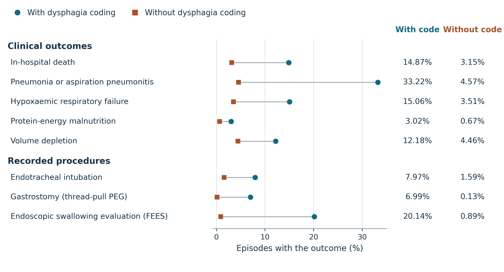
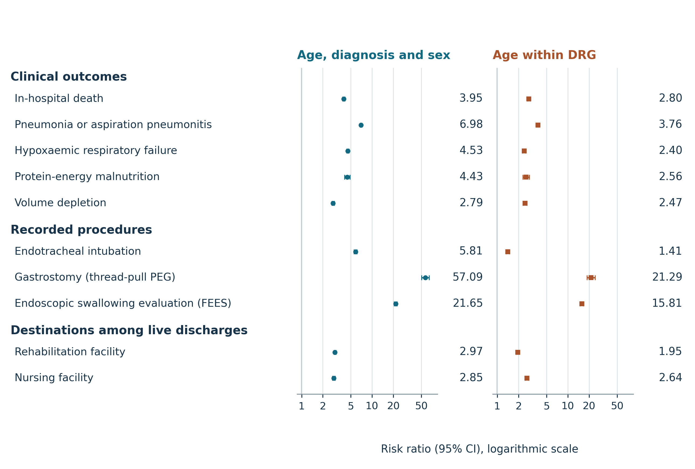

# Dysphagia and inpatient burden in German acute stroke care: a nationwide aggregate-data study

Bendix Labeit¹, Cinja Huber¹, Anel Karisik², Darius Günther Nabavi³, Götz Thomalla⁴, Martin Köhrmann⁵, Orhan Aktas¹, Michael Gliem¹, Rainer Dziewas⁶

¹ Department of Neurology, Medical Faculty and University Hospital Düsseldorf, Heinrich Heine University Düsseldorf, Düsseldorf, Germany

² Department of Neurology, Medical University of Innsbruck, Innsbruck, Austria

³ Department of Neurology with Stroke Unit, Vivantes Klinikum Neukölln, Berlin, Germany

⁴ Department of Neurology, University Medical Center Hamburg-Eppendorf, Hamburg, Germany

⁵ Department of Neurology, University Hospital Essen, University of Duisburg-Essen, Essen, Germany

⁶ Department of Neurology and Neurological Early Rehabilitation, Klinikum Osnabrück, Osnabrück, Germany

Corresponding author: Bendix Labeit; bendix.labeit@med.uni-duesseldorf.de

Short title: Dysphagia burden in acute stroke care

## Abstract

Background We examined how coded dysphagia relates to inpatient outcomes and discharge destinations after acute stroke treatment in Germany.

Methods We used nationwide aggregate discharge data from the German Institute for the Hospital Remuneration System (InEK). Among adults receiving neurological complex treatment for acute stroke in 2025, we compared episodes with and without a secondary dysphagia code. For binary outcomes, we report crude proportions and two standardized risk ratios (RRs). The first accounts for age, principal diagnosis and sex. The second compares episodes within the same age band and observable diagnosis-related group (DRG).

Results Dysphagia was coded in 33,641 of 279,255 episodes (12.0%). Pneumonia or aspiration-related pneumonitis was recorded in 33.2% of episodes with dysphagia coding versus 4.6% without (adjusted RRs 6.98 and 3.76). Corresponding proportions were 14.9% versus 3.2% for in-hospital death (3.95 and 2.80) and 3.0% versus 0.7% for protein-energy malnutrition (4.43 and 2.56). Among 266,506 live discharges, 21.3% versus 6.8% went to rehabilitation facilities (2.97 and 1.95) and 11.4% versus 3.6% to nursing facilities (2.85 and 2.64). Mean hospital stay was 8.85 days longer overall and 2.86 days longer within age–DRG strata (95% confidence interval 2.74–2.98).

Conclusions Coded dysphagia was associated with pulmonary complications, malnutrition, higher mortality, longer hospital stays and more frequent discharge to rehabilitation and nursing facilities. These findings indicate greater demand for hospital and post-acute care, with potential financial and societal implications. Despite covariate adjustment, we could not account for stroke severity at admission, limiting causal interpretation.

Keywords: Dysphagia; Stroke; Administrative data; Pneumonia; Length of stay; Swallowing assessment

## Background

Dysphagia can complicate acute stroke care through aspiration pneumonia, inadequate nutritional intake and difficulty administering medication, while also influencing feeding decisions and discharge planning [1]. European guidance places early swallowing screening and structured assessment within routine stroke management [2]. Assessment comprises initial swallowing screening followed, where indicated, by more detailed clinical and instrumental evaluation [1]. Flexible Endoscopic Evaluation of Swallowing (FEES) and Videofluoroscopic Swallowing Study (VFSS) are complementary diagnostic gold standards for evaluating penetration, aspiration and pharyngeal residue [3]. Frequency estimates depend on case selection, assessment and timing. Across 42 studies, the pooled prevalence of acute post-stroke dysphagia was 42% (95% CI 37–48%) overall and 75% in studies using FEES or VFSS [4]. Administrative dysphagia coding consequently represents a different case definition from clinically or instrumentally assessed swallowing impairment.

German clinical cohorts and registry data link dysphagia to pneumonia, mortality and disability [5, 6]. A German study using FEES also identified severe dysphagia with impaired secretion management as a marker of higher acute hospitalization expenditure from a health-insurance perspective [7]. Other economic studies support its resource relevance, although definitions and time horizons differ [8, 9]. These associations warrant nationwide quantification, although interpretation remains subject to confounding by age, neurological injury, disability and treatment limitations, which this aggregate-data study cannot fully address.

The German Institute for the Hospital Remuneration System (InEK) release includes the nationwide diagnosis-related group (DRG) sector submissions received by 16 January 2026. Hospitals were required to report all eligible 2025 discharges, including those awaiting final coding or billing [10, 11]. A recent analysis of 1,540,947 stroke-unit episodes from 2019 to 2024 described FEES coding and institutional variation [12]. We used the 2025 data to examine the clinical and care burden accompanying documented dysphagia.

We examined how dysphagia coding related to pulmonary and nutritional diagnoses, death, hospital stay, recorded care procedures and discharge destination in the 2025 InEK acute stroke-care cohort. To account for differences in case mix, we standardized comparisons of binary outcomes for age group, principal diagnosis and sex in one analysis and for age group and DRG in the other. The aggregate data lacked a direct measure of stroke severity at admission.

## Methods

### Design, source and population

This retrospective observational analysis used the InEK DatenBrowser release “Unterjährige Datenlieferung DRG Januar bis Dezember 2025,” delivered January 16, 2026, with the 2025 classifications [10, 13]. The release was retained to reproduce the source analyses and differs from subsequent annual submissions grouped using 2026 DRGs. The unit was a hospital episode; transfers and repeat admissions could not be linked. Reporting was informed by STROBE and RECORD [14, 15].

Eligible episodes had at least one German procedure classification (OPS) code 8-981.20-.23, 8-981.30-.33, 8-98b.20-.23 or 8-98b.30-.33, identifying neurological complex treatment for acute stroke care lasting at least 24 hours. The rules also permit transient ischemic attack and ophthalmic arterial ischemia [16]. We restricted every analysis to episodes in patients aged 18 years or older.

Exposure was the union of secondary diagnoses R13.0, R13.1 and R13.9. These describe dysphagia requiring supervision during eating, dysphagia in a specified tracheostomy context, and other or unspecified dysphagia [17]. The comparator lacked these secondary diagnoses; this does not establish normal swallowing. Onset, persistence, cause and clinical swallowing severity were unavailable.

### Outcomes and extraction

We measured hospital length of stay in days and recorded death during the admission. Pulmonary outcomes comprised aspiration-related pneumonitis or pneumonia (J69.0), pneumonia (J12–J18), either diagnosis, and acute hypoxaemic respiratory failure (J96.00). The U69.01 and U69.04 markers distinguish pneumonia after 48 hours from pneumonia present at admission or within 48 hours. They apply to fully inpatient adults and do not establish timing relative to dysphagia [18].

Nutritional and hydration outcomes comprised volume depletion (E86) and protein-energy malnutrition. We examined severe (E43), moderate (E44.0), mild (E44.1) and unspecified (E46) malnutrition separately. For the combined malnutrition endpoint, an episode with any of E40, E41, E42, E43, E44.0, E44.1 or E46 was counted once. We applied the same rule to overlapping pulmonary codes.

Recorded care procedures were simple endotracheal intubation (OPS 8-701), percutaneous endoscopic gastrostomy (PEG) by the thread-pull technique (5-431.22), and FEES (1-613). Intracranial mechanical thrombectomy (8-836.80) was recorded as a cohort characteristic. Counts used the export field “Fälle” (episodes with a code). An episode could include more than one procedure of the same type. Comparator counts were obtained by subtracting dysphagia-coded episodes from all episodes under the same filters. We reconciled filters and totals and treated omitted or suppressed cells as unknown (Online Resource 1).

We defined four mutually exclusive discharge destinations from the recorded discharge reason. These were rehabilitation facility (09), nursing facility (10), hospice (11) and external hospital transfer (06, 08 or 13). Each destination was assessed as a binary endpoint among episodes ending alive. We obtained the number discharged alive by subtracting observed inpatient deaths (07) from the matching episode totals. All remaining live discharges were grouped as other or unspecified. Routine completion of treatment leaves the subsequent place of residence unknown (Online Resource 1, Table S7a).

### Statistical analysis

We compared risks, risk ratios (RRs) and risk differences for 16 inpatient endpoints and four discharge destinations, and mean days for hospital stay. Both adult age bands (18–74 and ≥75 years) contributed. The planned diagnosis grouping distinguished cerebral infarction (I63), intracerebral haemorrhage (I61) and all remaining principal diagnoses within each age band.

Because the case counts were too small for disclosure, InEK suppressed two malnutrition queries for younger adults with I61 and dysphagia coding (E44.0 and E44.1). To retain the same diagnosis adjustment, we combined I61 and other non-I63 principal diagnoses at ages 18–74 by subtracting I63 from the total. The three older diagnosis groups were retained. We applied these five groups to the discharge extension. Two additional queries for hospice discharge at ages 18–74 with I61 were suppressed for the same reason. Six-group sensitivities used all three diagnoses at both ages when the necessary counts were observed.

For each endpoint, model 1 was the crude comparison. Destination models used live discharges throughout, with an additional crude proportion among all adult admissions. Model 2 standardized jointly for age band, principal diagnosis and sex. Model 3 standardized for age band, principal diagnosis and patient clinical complexity level (PCCL, categories 0–6). Within each filtered age–diagnosis population the source reports separate distributions for sex and PCCL. The number of cases and events at each combination of sex and PCCL is unknown, so including sex in model 3 would require assumptions about unobserved counts. PCCL can incorporate diagnoses recorded during admission [19]. In Model 4, we standardized comparisons for age group and DRG. We conducted two sensitivity analyses. The first additionally accounted for principal diagnosis. The second examined whether further adjustment for sex changed the estimates for in-hospital mortality and the four discharge destinations within B70D, a common stroke DRG defined in part by neurological complex treatment lasting up to 72 hours. We restricted the second analysis to one DRG because the InEK browser reports the sex distribution for the entire query. Obtaining sex-specific counts across multiple DRGs would therefore have required separate queries for each DRG, age group and outcome, both for all episodes and for those with coded dysphagia. For rare outcomes, some of these queries could also have fallen below the InEK reporting threshold of five cases.

For each point estimate, both exposure groups received the same weights, equal to the proportion of all included episodes in each stratum. Strata required a positive denominator in both groups. Within-DRG analyses additionally required identifiable named rows in all contributing source tables. A missing row or a pooled remainder could not identify events in an individual DRG. Each estimate was paired with a crude comparison on the same retained cases.

For hospital stay, we reconstructed the sum of days and squared days from counts, means and standard deviations. These moments were available by age and diagnosis, by age and DRG, and by age, diagnosis and DRG. Sex- and PCCL-specific counts lacked corresponding stay moments. We repeated the age–diagnosis analysis among adults discharged alive. For within-DRG estimates with a singleton in either group, we retained the point estimate and calculated a separate interval in strata with at least two episodes per group.

We obtained counts for episodes without coded dysphagia by subtracting the dysphagia-coded subset from all episodes meeting the same filters. For outcomes defined by overlapping diagnosis codes, we used a union query to count each episode once. We treated missing or suppressed counts as unknown unless they could be derived exactly from the available data.

We calculated nominal 95% confidence intervals from independent-episode variances, treating pooled stratum weights as fixed. RR intervals used the log scale and risk differences used the absolute scale. Mean differences used reconstructed sample variances. Sparse or zero-event strata can yield narrow intervals. Online Resource 1 identifies strata and coverage, with full model results and interval diagnostics in the accompanying analysis tables.

Exploratory functional sensitivity analyses compared mortality and pneumonia within 12 coded Functional Independence Measure or Mini-Mental State Examination categories (Online Resource 1, Table S6). We required observable adult denominators and event counts and report results only when both groups contained at least five events and five non-events. Functional coding can reflect selective assessment during admission [20].

Figures 1 and 2 show eight inpatient endpoints and two discharge destinations, first as absolute risks and then as standardized RRs. Rehabilitation and nursing facilities were selected for graphical display because both identify the setting for ongoing care after the acute admission. Hospital transfer and hospice discharge are reported in the tables. For each plotted endpoint we show the same two comparisons. Age, principal diagnosis and sex characterize clinical case mix, while age within DRG compares episodes assigned to the same billing group. Supplementary Fig. S1 shows the additional pulmonary and malnutrition codes.

Intervals assume independent episodes and omit hospital clustering, repeat admissions, coding uncertainty and confounding. Admission NIHSS was unavailable. No model jointly controls all measured domains or establishes independence from baseline neurological severity.

### AI assistance

OpenAI ChatGPT/Codex assisted analysis programming, numerical checks and manuscript editing. Numerical results were checked against original aggregate exports and separate reconstruction routines. Final scientific verification, interpretation and approval remain the authors' responsibility.

## Results

### Cohort and dysphagia prevalence

The cohort comprised 279,255 adult hospital episodes, including 33,641 (12.05%) with secondary dysphagia coding and 245,614 without it. Overall, 132,519 episodes (47.5%) involved women, 147,072 (52.7%) involved adults aged ≥75 years, and 109,830 (39.3%) involved adults aged ≥80 years. Adults aged ≥80 years accounted for 52.5% of episodes with dysphagia coding and 37.5% of those without (Table 1).

Cerebral infarction (I63) was the principal diagnosis in 176,014 episodes (63.0%) and intracerebral haemorrhage (I61) in 12,146 (4.3%). The remaining 91,095 (32.6%) included at least 75,050 episodes (26.9% of all episodes) with a named G45 principal diagnosis (transient cerebral ischaemia and related syndromes). Some less frequent diagnoses were pooled in the source. Cerebral infarction accounted for 79.1% of episodes with dysphagia coding and 60.8% without, and intracerebral haemorrhage for 10.0% and 3.6%, respectively. Of 19,549 thrombectomy-coded episodes, 6,447 (33.0%) had a secondary dysphagia code, compared with 27,194 of 259,706 (10.5%) episodes without thrombectomy (Table 1).

### Clinical burden

Pneumonia or aspiration-related pneumonitis was recorded in 33.2% of episodes with coded dysphagia and 4.6% of those without. The risk ratio (RR) was 6.98 after standardization for age group, principal diagnosis and sex and 3.76 when episodes were compared within the same age group and diagnosis-related group (DRG). In-hospital mortality was 14.9% versus 3.2%, with corresponding RRs of 3.95 and 2.80. Hypoxaemic respiratory failure, protein-energy malnutrition and volume depletion were also more frequent in episodes with coded dysphagia in both adjusted comparisons (Figs. 1 and 2).

Across all 16 inpatient outcomes, the age- and DRG-standardized RR was lower than the crude RR calculated from the same episodes. Tables 2 and 3 report crude and adjusted estimates, respectively, for 16 inpatient outcomes and four discharge destinations. Online Resource 1 provides model-specific denominators and sensitivity analyses (Tables S1–S3), the mortality analysis within DRG B70D (Table S4), and results for individual pulmonary and malnutrition codes and pneumonia-timing markers (Supplementary Fig. S1).

### Discharge status

Of 279,255 adult episodes, 266,506 (95.4%) ended in live discharge, including 28,638 with coded dysphagia and 237,868 without. Discharge to a rehabilitation facility was more frequent among survivors with coded dysphagia (21.34% versus 6.80%), as was discharge to a nursing facility (11.45% versus 3.63%). After standardization for age group, principal diagnosis and sex, the RRs were 2.97 for rehabilitation and 2.85 for nursing facilities. When episodes were compared within the same age group and DRG, the corresponding RRs were 1.95 and 2.64 (Figs. 1–2).

Transfers to another hospital were also more frequent among survivors with coded dysphagia (24.69% versus 7.32%). Hospice discharge was uncommon in both groups (0.35% versus 0.07%) but showed the largest relative difference of the four destinations in both adjusted comparisons. Online Resource 1 presents the full discharge results, including comparisons within DRG B70D and the finer diagnosis analysis for all destinations except hospice (Tables S7a–d). Table S2e presents the corresponding finer diagnosis analysis for inpatient outcomes.

### Hospital stay

Mean hospital stay was 16.26 days for episodes with coded dysphagia and 7.41 days for those without, a crude difference of 8.85 days (95% CI 8.67–9.04). After standardization for age group and principal diagnosis, the difference was 9.88 days (95% CI 9.62–10.14). Restricting the main age- and diagnosis-standardized analysis to live discharges yielded a difference of 10.23 days. Mean stays by sex or PCCL were unavailable within age and diagnosis groups, precluding adjustment for either variable.

The difference in mean stay was smaller when episodes were compared within the same age group and DRG. Among the 272,072 episodes in 203 groups defined by age and DRG, the crude difference was 8.76 days and the standardized difference was 2.86 days. One group contained only one episode without coded dysphagia. After excluding this group to calculate the confidence interval, the estimated difference remained 2.86 days (95% CI 2.74–2.98, Fig. 3). Further standardization for principal diagnosis within DRGs yielded a difference of 3.34 days (95% CI 3.22–3.47) in the 179 groups with estimable variance (Online Resource 1, Table S5).

### Recorded care procedures

FEES was recorded in 8,958 of 279,255 episodes (3.21%), including 20.14% of episodes with coded dysphagia and 0.89% of those without. Thread-pull PEG (6.99% versus 0.13%) and simple endotracheal intubation (7.97% versus 1.59%) were also more frequent in episodes with coded dysphagia.

For intubation, the RR was 5.81 after standardization for age group, principal diagnosis and sex and fell to 1.41 when episodes were compared within the same age group and DRG. In the same age–DRG comparison, the associations remained pronounced for both thread-pull PEG (RR 21.29) and FEES (RR 15.81) (Figs. 1–2).

## Discussion

In this nationwide cohort of adults receiving acute stroke care, coded dysphagia was associated with more frequent pulmonary complications and malnutrition. Even after standardization for age group and DRG, the risk of in-hospital death was 2.8 times as high and mean hospital stay was 2.9 days longer in episodes with coded dysphagia. Among survivors, those with coded dysphagia were more often discharged to rehabilitation or nursing facilities.

### Dysphagia coding and severity

The observed 12.05% frequency is not the prevalence of clinically assessed post-stroke dysphagia. The care-defined denominator contains many transient ischemic syndromes, and principal stroke diagnoses had higher coding frequencies. Recognition, documentation and coding rules also influence ascertainment. Clinical cohorts using structured assessment have reported higher frequencies [21, 22]. Under-recording of mild or transient dysphagia is likely. German coding guidance gives the need for gastric tube feeding or a need for dysphagia treatment beyond seven days after stroke onset as examples that warrant coding [23]. The associations observed here may therefore apply particularly to clinically apparent, more severe dysphagia. However, we could not test this hypothesis without clinical severity measurements.

The R13 dysphagia codes combine clinically heterogeneous conditions rather than validated swallowing-severity levels. FEES-based phenotyping distinguishes patterns with different neurological associations that this binary exposure cannot represent [24]. A US claims study classified dysphagia severity using features including feeding-tube placement, aspiration pneumonia and malnutrition [25]. Applying that approach here would define dysphagia severity partly through the outcomes under study.

### Adjustment for case mix

The complementary case-mix analyses address measured differences without resolving baseline neurological severity. Age-sex-diagnosis standardization accounts jointly for broad demographic and diagnostic composition. PCCL incorporates additional administrative complexity, but diagnoses accumulated during hospitalization can include downstream complications caused by dysphagia. Conditioning on these variables may remove mediated associations or create selection bias [26].

Functional categories (such as the additional sensitivity analyses with regards to FIM and MMSE) offer clinically recognizable information, but selective assessment, broad categories and uncertain ordering relative to dysphagia limit interpretation. Admission NIHSS, premorbid disability, lesion characteristics, treatment limitations and exposure timing would be needed for more direct adjustment.

### Nutrition and hydration

Associations with recorded malnutrition and volume depletion persisted across the two case-mix models. Within DRGs, coverage varied substantially, particularly for individual malnutrition codes.

Complementary evidence comes from the nationwide GEMIDAS geriatric registry, where dysphagia remained associated with mortality, aspiration pneumonia and discharge destination after multivariable adjustment [27]. A separate analysis of the same registry identified particularly high mortality with co-occurring dehydration and dysphagia [28]. These findings support attention to swallowing and hydration in vulnerable patients. The registry studied geriatric admissions, whereas our cohort was defined by acute stroke care.

Malnutrition and volume depletion can reflect vulnerability predating stroke. In the FOOD cohort, undernutrition at admission predicted poorer six-month survival after adjustment for stroke severity and prestroke function [29].

Australian administrative data also linked dysphagia coding with dehydration after adjustment for demographic and clinical characteristics [30]. Difficulty drinking enough is a plausible contributor. These findings support assessing hydration alongside nutrition and swallowing safety.

However, it is important to note that malnutrition was very likely undercoded in our cohort. Huppertz et al. estimated a pooled prevalence of malnutrition of 26% (95% CI 18–35%) in the acute phase after stroke [31]. In our cohort, protein-energy malnutrition was coded in only 0.95% of hospital episodes.

### Pulmonary complications and mortality

The strong association with aspiration-related pneumonitis/pneumonia (J69.0) accords with clinical evidence linking dysphagia and pulmonary complications [5, 6]. Nevertheless, J69.0 encompasses pneumonitis as well as pneumonia and does not establish bacterial infection or instrumental evidence of aspiration. A prospective acute-stroke intensive-care cohort also found that cough protection and dysphagia severity interacted in their association with pneumonia, emphasizing airway-protection information absent from these codes [32]. An episode could carry both a J69.0 code and a J12–J18 pneumonia code. Adding the separate counts would count 742 episodes twice. The combined pulmonary endpoint counts each affected episode once.

The J69.0 association persisted under age-sex-diagnosis standardization and in the separate PCCL sensitivity. The smaller RR in the latter does not quantify how much of the association is explained by baseline severity: PCCL can incorporate pulmonary diagnoses and other complications arising during hospitalization, and the models use different reference distributions. The residual association therefore supports J69.0 as an accompanying burden marker.

Both early and later pneumonia markers were more frequent with dysphagia coding, but admission-based timing does not establish whether swallowing impairment preceded pneumonia. Longer stays also allow more opportunity for detection. These markers do not reproduce the consensus definition of stroke-associated pneumonia based on stroke onset [33], and should not be interpreted as preventable hospital harm.

Mortality comparisons are likewise vulnerable to ascertainment and survival time: the qualifying treatment requires at least 24 hours, potentially excluding very early deaths. The higher in-hospital mortality we observed in patients with coded dysphagia is consistent with findings from two prospective studies of acute ischaemic stroke. In a German stroke registry [5] and a nationwide Chinese cohort of 827,314 patients [34], dysphagia remained associated with higher odds of in-hospital death after adjustment for stroke severity and other clinical factors. A meta-analysis by Banda et al. also found higher mortality after acute stroke among patients with dysphagia (pooled OR 4.07, 95% CI 2.17–7.63) [4]. A propensity-matched US study found that coded dysphagia was associated with longer hospital stays after both ischaemic stroke and intracerebral haemorrhage, as in our cohort, although it reported lower in-hospital mortality [35].

### Length of stay and hospital costs

The stay difference increased from 8.85 to 9.88 days after standardization for broad age and principal diagnosis. The age–DRG analysis addressed a different question. Its observed cases had a crude difference of 8.76 days and a difference of 2.86 days after comparing stays within the same billing group and age band. DRGs incorporate features of the completed admission, including procedures and complications. Adults with similar presenting diagnoses may receive different DRG assignments as their care diverges. These comparisons describe different episode populations and cannot identify preventable hospital days [7–9].

The higher frequency of complications and the longer stays observed even within the same DRG suggest that dysphagia may contribute to hospital costs. Systematic reviews have also linked oropharyngeal dysphagia to higher healthcare costs [36, 37]. Our data contained neither hospital costs nor actual payments. Comparing costs and reimbursement within stroke DRGs could test whether current payments cover the additional care associated with dysphagia and whether its severity should be reflected in reimbursement.

### Discharge destination

Among survivors with coded dysphagia, more than one in five episodes ended in rehabilitation and more than one in ten in a nursing facility. The two destinations reflect different care pathways. In the Austrian STROKE-CARD Registry, patients with dysphagia on admission for ischaemic stroke were more likely than those without dysphagia to require external support services (32.9% vs. 9.9%) and to live in a nursing home (20.2% vs. 2.8%) at three-month follow-up [38]. Preadmission residence, premorbid disability, discharge function and the local availability of beds were unavailable. A nursing-facility discharge could therefore represent a return to prior care. Rehabilitation coding identifies the immediate receiving setting and does not capture subsequent recovery. Because inpatient mortality differed between groups, destination comparisons describe the selected population surviving to discharge.

### FEES and clinical assessment

In German stroke-unit episodes, FEES coding increased from 2.4% in 2019 to 3.1% in 2024 overall and from 13.1% to 19.2% among episodes with coded dysphagia [12]. In our adult 2025 cohort, the corresponding proportions were 3.21% and 20.14%. These figures are close to the 2024 values, although differences in age and procedure eligibility limit direct year-to-year comparison.

The low frequency of FEES coding raises concern that instrumental swallowing assessment may be underused in acute stroke care, including among episodes with documented dysphagia. However, coding data alone cannot distinguish underuse from incomplete procedure recording. A recorded procedure does not report its indication, timing, findings or effect on management; absence of its code does not prove that FEES was not performed.

Clinical studies show that FEES can change feeding recommendations and identify swallowing problems not resolved by bedside assessment [39, 40]. Integrated FEES reporting also connects findings with severity, phenotype, likely mechanism and management, none of which is represented by an OPS flag [41]. Its value should consequently be judged against clinical indication, timeliness and whether management addresses the identified risk. The current counts justify closer examination of assessment pathways, but cannot identify how many additional examinations were needed.

A nationwide survey of 82 certified FEES instructors reported substantial variation in inpatient activity, with a mean of 29.3 FEES examinations per month and a range of 4-100 [42]. These self-reported volumes provide context for differences in inpatient assessment activity, although the selected instructor sample does not establish population-level coverage or quantify unmet need. Linking indications and assessment findings to procedure records would be needed to separate recording gaps from gaps in care.

### Dysphagia treatment and clinical outcomes

The pulmonary nutritional and mortality complications and frequent need for care after discharge raise the question of which outcomes dysphagia treatment can improve. Options include texture modification, oral hygiene and nutritional support, swallowing exercises, and selected neurostimulation techniques. Most intervention studies assess swallowing function or oral intake. Comparatively few have examined pneumonia, mortality or the subsequent need for institutional care [43]. The QASC stroke-unit trial found less death or dependency at 90 days with protocols for fever, glucose and swallowing, although the contribution of swallowing care alone was unclear [44].

In a randomized trial of 306 patients with acute stroke and dysphagia, structured behavioural swallowing therapy reduced chest infections (RR 0.56, 95% CI 0.40–0.80) and the combined risk of death or institutionalisation by six months (RR 0.73, 95% CI 0.55–0.97). Both were secondary outcomes [45]. In PHAST-TRAC, 69 tracheotomised patients with post-stroke dysphagia were randomised to pharyngeal electrical stimulation or sham treatment. At 24–72 hours after treatment, 49% of the stimulation group and 9% of the sham group met endoscopic criteria for decannulation [46]. A separate 60-patient trial of pharyngeal electrical stimulation for severe dysphagia after extubation reported pneumonia in 60% of the stimulation group and 83% of the sham group. The primary endpoint of reintubation within five days did not differ significantly (13% versus 33%, p = 0.067) [47]. The burden observed in our cohort warrants trials powered to assess pneumonia, survival and care needs after discharge.

### Limitations

Dysphagia was identified from diagnostic codes. Results of standardized swallowing assessments were unavailable, so mild or transient dysphagia was likely under-recorded. Stroke severity at admission, a potential confounder of the associations between dysphagia and clinical outcomes, could not be measured directly using the NIHSS or a comparable scale. Functional status was documented only selectively. The timing of dysphagia onset, other diagnoses and procedures was also unknown, which limits interpretation of their sequence within an admission.

The aggregate data placed further limits on adjustment. Age and principal diagnosis were available in broad groups, and sex and patient clinical complexity level (PCCL) could only be included in separate models. Both PCCL and DRG assignment can reflect events occurring during the admission. Comparisons within DRGs therefore have limited value for assessing differences in stroke severity at presentation. This distinction matters for mortality. Within B70D, the age-standardized mortality RR was 8.05 and changed little after adjustment for sex (8.04). Across 77 age–DRG strata, the RR was 2.80. The lower standardized mortality among episodes without coded dysphagia in B70D (1.40% versus 4.06% across strata) helps explain why the relative difference was larger in this billing group.

Suppressed and pooled DRG counts limited the proportion of episodes included in within-DRG analyses, particularly for less frequent malnutrition codes. For these outcomes, strata with no events in one comparison group may also have yielded overly narrow confidence intervals. The reported intervals treat the observed standardization weights as fixed. They do not capture uncertainty from coding or selection and were not adjusted for multiple comparisons.

The analysis used an interim data release. Repeat admissions could not be linked, and clustering within patients or hospitals could not be accounted for. Follow-up ended at discharge, so subsequent recovery and longer-term care needs remain unknown. Future studies linking administrative codes to admission NIHSS scores, standardized swallowing assessments and longitudinal outcomes could address these limitations. Recording why and when FEES was performed, and whether it changed management, would also help interpret the observed differences in its use.

## Conclusions

Dysphagia coding identified adult acute stroke-care episodes with greater pulmonary and nutritional morbidity, higher mortality, more frequent use of swallowing-related procedures and longer hospital stays. Among survivors, discharge to rehabilitation and nursing facilities was also more frequent. These associations persisted across complementary case-mix comparisons.

## Abbreviations

CI, confidence interval; DRG, diagnosis-related group; FEES, flexible endoscopic evaluation of swallowing; FIM, Functional Independence Measure; ICD-10-GM, International Statistical Classification of Diseases and Related Health Problems, tenth revision, German modification; InEK, Institute for the Hospital Remuneration System; MMSE, Mini-Mental State Examination; NIHSS, National Institutes of Health Stroke Scale; OPS, German procedure classification; PCCL, patient clinical complexity level; PEG, percutaneous endoscopic gastrostomy; RR, risk ratio

## Statements and Declarations

### Ethics approval and consent to participate

This analysis used anonymous aggregate hospital data without participant contact or access to patient identifiers. No ethical approval was necessary.

### Consent for publication

No identifiable individual information is reported.

### Funding

Bendix Labeit is supported by the Deutsche Forschungsgemeinschaft (DFG, German Research Foundation), project number 529859742, under the Walter Benjamin Programme.

### Competing interests

BL: has received research funding from the German Research Foundation (DFG), Clexio Bioscience Ltd, the Medical Faculty of the University of Münster, the Gesellschaft von Freunden und Förderern der Heinrich-Heine-Universität Düsseldorf e.V (GFFU), has received scientific prizes from the German Geriatric Society (DGG) in conjunction with the Rolf and Hubertine Schiffbauer Foundation, and the German Neurological Society (DGN), has received honoraria and/or travel grants for lectures, meetings and conferences from the German Society for Clinical Neurophysiology and Functional Imaging (DGKN), the European Stroke Organization (ESO), the Society for Clinical Nutrition and Metabolism (ESPEN), the German Society for Neurology (DGN), the European Society for Swallowing Disorders (ESSD), the United European Gastroenterology (UEG), the University of Strasbourg, the German Society for Muscular Dystrophy (DGM), the German Society for Nutritional Medicine (DGEM), the German Society for Internal Medicine (DGIM), the German Stroke Society (DSG), the University of Zurich, the Confederation of European Otorhinolaryngology - Head and Neck Surgery (CEORL-HNS), CONGRES ORPHEO, the Deutsche Interdisziplinäre Vereinigung für Intensiv- und Notfallmedizin (DIVI), the DGG, the BANSS foundation, Jottkaa Projekt.Konzept GmbH, Novartis, Nutricia, Phagenesis Ltd, Alexion, argenx, Hexal, and BIAL. Competing interest declarations for Cinja Huber, Anel Karisik, Darius Günther Nabavi, Götz Thomalla, Martin Köhrmann, Orhan Aktas, Michael Gliem and Rainer Dziewas are pending confirmation.

### Authors' contributions

Bendix Labeit and Rainer Dziewas designed the study. Bendix Labeit performed the analyses. Cinja Huber performed validity checking. Darius Günther Nabavi, Götz Thomalla, Martin Köhrmann, Orhan Aktas and Michael Gliem revised the manuscript for important intellectual content. Anel Karisik’s contribution is pending confirmation.

### Data availability

This study used aggregate hospital episode data from the InEK DatenBrowser (https://datenbrowser.inek.org/DRG202601), specifically the “Unterjährige Datenlieferung DRG Januar bis Dezember 2025” (data delivery of 16 January 2026). Registered users can reproduce the source queries through the InEK DatenBrowser under its terms of use. The query definitions, analysis code and aggregate results are available at https://github.com/benlabeit/inek-dysphagia-acute-2025. The original Excel exports are not redistributed. The authors had no access to patient-level data.

## Figures

Fig. 1  Observed proportions in adult episodes with and without secondary dysphagia coding. Clinical outcomes and recorded procedures use all 33,641 and 245,614 episodes in the respective groups. Rehabilitation and nursing-facility discharge use the 28,638 and 237,868 live discharges, respectively. Table 2 gives event counts for all 20 binary endpoints. FEES, flexible endoscopic evaluation of swallowing. PEG, percutaneous endoscopic gastrostomy.

Fig. 2  Standardized risk ratios for the eight inpatient endpoints and two destinations in Fig. 1. Points and bars show estimates and nominal 95% confidence intervals on a logarithmic scale. The left panel standardizes for age band, principal diagnosis and sex. The right panel compares episodes within the same age band and observable diagnosis-related group (DRG), with endpoint-specific coverage. Destination models use live discharges. Supplementary Fig. S1 covers additional pulmonary and nutritional codes. Tables S2–S4 and S7 provide the other estimates.

Fig. 3  Difference in mean hospital stay for dysphagia-coded minus comparator episodes, in days, with 95% confidence intervals. The crude and age–principal diagnosis comparisons use all 279,255 adult episodes. The within-DRG estimate uses the 202 age–DRG strata with at least two episodes per group (272,066 episodes). The estimate across all 203 observable strata also rounded to 2.86 days (Table S5).

## Electronic supplementary material

Online Resource 1 provides model results and coverage, the finer principal-diagnosis sensitivity, the B70D mortality analysis, hospital stay and functional categories. Supplementary Fig. S1 shows eight further inpatient endpoints. Tables S7a–d give discharge status, all four destinations and sensitivity analyses.

## Tables

### Table 1  Characteristics of adult episodes receiving neurological complex treatment for acute stroke

| Characteristic | All adults | Dysphagia code | No dysphagia code |
| --- | --- | --- | --- |
| Adult episodes | 279,255 (100.0%) | 33,641 (100.0%) | 245,614 (100.0%) |
| Age, years |  |  |  |
| 18–29 | 1,037 (0.4%) | 44 (0.1%) | 993 (0.4%) |
| 30–39 | 3,635 (1.3%) | 173 (0.5%) | 3,462 (1.4%) |
| 40–49 | 10,094 (3.6%) | 540 (1.6%) | 9,554 (3.9%) |
| 50–54 | 9,701 (3.5%) | 615 (1.8%) | 9,086 (3.7%) |
| 55–59 | 17,691 (6.3%) | 1,262 (3.8%) | 16,429 (6.7%) |
| 60–64 | 25,394 (9.1%) | 2,120 (6.3%) | 23,274 (9.5%) |
| 65–74 | 64,631 (23.1%) | 6,787 (20.2%) | 57,844 (23.6%) |
| 75–79 | 37,242 (13.3%) | 4,453 (13.2%) | 32,789 (13.3%) |
| ≥80 | 109,830 (39.3%) | 17,647 (52.5%) | 92,183 (37.5%) |
| Recorded sex |  |  |  |
| Female | 132,519 (47.5%) | 16,090 (47.8%) | 116,429 (47.4%) |
| Male | 146,729 (52.5%) | 17,551 (52.2%) | 129,178 (52.6%) |
| Other or unknown | 7 (<0.1%) | 0 (0.0%) | 7 (<0.1%) |
| Principal diagnosis |  |  |  |
| Cerebral infarction (I63) | 176,014 (63.0%) | 26,612 (79.1%) | 149,402 (60.8%) |
| Intracerebral haemorrhage (I61) | 12,146 (4.3%) | 3,364 (10.0%) | 8,782 (3.6%) |
| All other principal diagnoses | 91,095 (32.6%) | 3,665 (10.9%) | 87,430 (35.6%) |
| Patient clinical complexity level |  |  |  |
| 0 | 154,413 (55.3%) | 7,857 (23.4%) | 146,556 (59.7%) |
| 1–2 | 85,139 (30.5%) | 13,589 (40.4%) | 71,550 (29.1%) |
| 3–6 | 39,703 (14.2%) | 12,195 (36.3%) | 27,508 (11.2%) |
| Recorded procedure |  |  |  |
| Intracranial mechanical thrombectomy | 19,549 (7.0%) | 6,447 (19.2%) | 13,102 (5.3%) |

Values are episode counts (percent of the column total). Within each section, the age, sex, principal-diagnosis and PCCL categories each sum to the respective group total. Thrombectomy is a procedure recorded during the episode. PCCL, patient clinical complexity level.

### Table 2  Crude adult risks and risk ratios

| Endpoint | Dysphagia, n (%) | Comparator, n (%) | RR (95% CI) |
| --- | --- | --- | --- |
| In-hospital death | 5,003 (14.87) | 7,746 (3.15) | 4.72 (4.56–4.88) |
| Aspiration-related pneumonitis (J69.0) | 7,801 (23.19) | 4,443 (1.81) | 12.82 (12.38–13.28) |
| Pneumonia (J12–J18) | 3,875 (11.52) | 7,026 (2.86) | 4.03 (3.88–4.18) |
| Pneumonia or aspiration-related pneumonitis | 11,175 (33.22) | 11,228 (4.57) | 7.27 (7.10–7.44) |
| Hypoxemic respiratory failure | 5,066 (15.06) | 8,616 (3.51) | 4.29 (4.15–4.44) |
| Pneumonia after 48 hours | 5,575 (16.57) | 4,664 (1.90) | 8.73 (8.41–9.06) |
| Pneumonia by 48 hours | 5,438 (16.16) | 6,195 (2.52) | 6.41 (6.19–6.63) |
| Protein-energy malnutrition (any) | 1,016 (3.02) | 1,645 (0.67) | 4.51 (4.17–4.87) |
| Severe malnutrition (E43) | 216 (0.64) | 318 (0.13) | 4.96 (4.17–5.89) |
| Moderate malnutrition (E44.0) | 191 (0.57) | 298 (0.12) | 4.68 (3.90–5.61) |
| Mild malnutrition (E44.1) | 145 (0.43) | 302 (0.12) | 3.51 (2.88–4.27) |
| Unspecified malnutrition (E46) | 463 (1.38) | 734 (0.30) | 4.61 (4.10–5.17) |
| Volume depletion | 4,096 (12.18) | 10,944 (4.46) | 2.73 (2.64–2.83) |
| Simple endotracheal intubation | 2,681 (7.97) | 3,899 (1.59) | 5.02 (4.79–5.27) |
| PEG, thread-pull technique | 2,353 (6.99) | 311 (0.13) | 55.24 (49.11–62.14) |
| FEES | 6,776 (20.14) | 2,182 (0.89) | 22.67 (21.63–23.76) |
| Discharge destination among survivors |  |  |  |
| Rehabilitation facility | 6,112 (21.34) | 16,169 (6.80) | 3.14 (3.06–3.22) |
| Nursing facility | 3,278 (11.45) | 8,626 (3.63) | 3.16 (3.04–3.28) |
| Hospice | 101 (0.35) | 156 (0.07) | 5.38 (4.19–6.91) |
| External hospital transfer | 7,071 (24.69) | 17,416 (7.32) | 3.37 (3.29–3.46) |

Inpatient endpoints use all 33,641 dysphagia-coded and 245,614 comparator episodes. The final four rows use 28,638 and 237,868 live discharges. The other or unspecified live-discharge category is reported in Table S7a.

### Table 3  Adult risk ratios by standardization model

| Endpoint | Age + HD | Age + HD + sex | Age + HD + PCCL | Age + DRG |
| --- | --- | --- | --- | --- |
| In-hospital death | 3.96 | 3.95 | 2.29 | 2.80 |
| Aspiration-related pneumonitis (J69.0) | 11.66 | 11.59 | 4.74 | 5.97 |
| Pneumonia (J12–J18) | 4.37 | 4.33 | 1.95 | 2.23 |
| Pneumonia or aspiration-related pneumonitis | 7.02 | 6.98 | 3.04 | 3.76 |
| Hypoxemic respiratory failure | 4.55 | 4.53 | 2.27 | 2.40 |
| Pneumonia after 48 hours | 8.78 | 8.72 | 3.41 | 4.07 |
| Pneumonia by 48 hours | 6.07 | 6.04 | 2.86 | 3.70 |
| Protein-energy malnutrition (any) | 4.41 | 4.43 | 2.63 | 2.56 |
| Severe malnutrition (E43) | 4.87 | 4.91 | 2.87 | 2.91 |
| Moderate malnutrition (E44.0) | 4.31 | 4.34 | 2.58 | 3.03 |
| Mild malnutrition (E44.1) | 3.38 | 3.39 | 2.72 | 1.55 |
| Unspecified malnutrition (E46) | 4.64 | 4.65 | 2.48 | 2.62 |
| Volume depletion | 2.79 | 2.79 | 2.13 | 2.47 |
| Simple endotracheal intubation | 5.82 | 5.81 | 2.40 | 1.41 |
| PEG, thread-pull technique | 57.22 | 57.09 | 28.45 | 21.29 |
| FEES | 21.73 | 21.65 | 18.31 | 15.81 |
| Discharge destination among survivors |  |  |  |  |
| Rehabilitation facility | 2.98 | 2.97 | 2.66 | 1.95 |
| Nursing facility | 2.85 | 2.85 | 2.46 | 2.64 |
| Hospice | 5.94 | 6.01 | 2.49 | 4.66 |
| External hospital transfer | 3.16 | 3.17 | 2.46 | 2.25 |

HD denotes principal diagnosis. The first three columns use the common five age–diagnosis groups. The last column uses observable age–DRG strata without sex adjustment. Destination models use survivors. Online Resource 1 gives intervals, model denominators and matched crude comparisons.

## References

1.  Labeit B, Michou E, Hamdy S, et al (2023) The assessment of dysphagia after stroke: state of the art and future directions. Lancet Neurol 22:858–870. https://doi.org/10.1016/S1474-4422(23)00153-9

2.  Dziewas R, Michou E, Trapl-Grundschober M, et al (2021) European Stroke Organisation and European Society for Swallowing Disorders guideline for the diagnosis and treatment of post-stroke dysphagia. Eur Stroke J 6:LXXXIX–CXV. https://doi.org/10.1177/23969873211039721

3.  Labeit B, Ahring S, Boehmer M, et al (2022) Comparison of Simultaneous Swallowing Endoscopy and Videofluoroscopy in Neurogenic Dysphagia. J Am Med Dir Assoc 23:1360–1366. https://doi.org/10.1016/j.jamda.2021.09.026

4.  Banda KJ, Chu H, Kang XL, et al (2022) Prevalence of dysphagia and risk of pneumonia and mortality in acute stroke patients: a meta-analysis. BMC Geriatr 22:420. https://doi.org/10.1186/s12877-022-02960-5

5.  Al-Khaled M, Matthis C, Binder A, et al (2016) Dysphagia in Patients with Acute Ischemic Stroke: Early Dysphagia Screening May Reduce Stroke-Related Pneumonia and Improve Stroke Outcomes. Cerebrovasc Dis Basel Switz 42:81–89. https://doi.org/10.1159/000445299

6.  Suntrup-Krueger S, Minnerup J, Muhle P, et al (2018) The Effect of Improved Dysphagia Care on Outcome in Patients with Acute Stroke: Trends from 8-Year Data of a Large Stroke Register. Cerebrovasc Dis Basel Switz 45:101–108. https://doi.org/10.1159/000487811

7.  Labeit B, Kremer A, Muhle P, et al (2023) Costs of post-stroke dysphagia during acute hospitalization from a health-insurance perspective. Eur Stroke J 8:361–369. https://doi.org/10.1177/23969873221147740

8.  Bonilha HS, Simpson AN, Ellis C, et al (2014) The one-year attributable cost of post-stroke dysphagia. Dysphagia 29:545–552. https://doi.org/10.1007/s00455-014-9543-8

9.  Marin S, Serra-Prat M, Ortega O, et al (2021) Healthcare costs of post-stroke oropharyngeal dysphagia and its complications: malnutrition and respiratory infections. Eur J Neurol 28:3670–3681. https://doi.org/10.1111/ene.14998

10.  Institut für das Entgeltsystem im Krankenhaus (2026) InEK DatenBrowser user manual, version September 1, 2026; dataset section 2.51. https://datenbrowser.inek.org/assets/manual/InekDatenBrowser.pdf. Accessed 17 Nov 2026

11.  Institut für das Entgeltsystem im Krankenhaus (2025) Verfahrensbeschreibung zur unterjährigen Lieferung von Daten gemäß § 21 Absatz 3b KHEntgG zum 15. Juni 2025, 15. Oktober 2025 und 15. Januar 2026. Datenjahr 2025. https://www.g-drg.de/content/download/16847/file/Verfahrensbeschreibung_Par_21_Absatz_3b_KHEntgG_2025_20250506.pdf. Accessed 19 Nov 2026

12.  Ungerer MN, Bartig D, Agredo AM, et al (2026) Fiberoptic endoscopic evaluation of swallowing in German stroke units: a retrospective diagnosis-related group analysis (2019-2024). Neurol Res Pract 8:46. https://doi.org/10.1186/s42466-026-00506-3

13.  Institut für das Entgeltsystem im Krankenhaus (2025) Unterjährige Datenlieferung DRG Januar bis Dezember 2025, data delivery January 16, 2026, classifications 2025. https://datenbrowser.inek.org/DRG202601. Accessed 17 Nov 2026

14.  von Elm E, Altman DG, Egger M, et al (2007) The Strengthening the Reporting of Observational Studies in Epidemiology (STROBE) statement: guidelines for reporting observational studies. PLoS Med 4:e296. https://doi.org/10.1371/journal.pmed.0040296

15.  Benchimol EI, Smeeth L, Guttmann A, et al (2015) The REporting of studies Conducted using Observational Routinely-collected health Data (RECORD) statement. PLoS Med 12:e1001885. https://doi.org/10.1371/journal.pmed.1001885

16.  Bundesinstitut für Arzneimittel und Medizinprodukte (2025) OPS 2025, neurological complex treatment codes 8-981 and 8-98b. https://klassifikationen.bfarm.de/ops/kode-suche/htmlops2025/block-8-97...8-98.htm. Accessed 17 Nov 2026

17.  Bundesinstitut für Arzneimittel und Medizinprodukte (2025) ICD-10-GM 2025, R13 dysphagia. https://klassifikationen.bfarm.de/icd-10-gm/kode-suche/htmlgm2025/block-r10-r19.htm. Accessed 17 Nov 2026

18.  Bundesinstitut für Arzneimittel und Medizinprodukte (2025) ICD-10-GM 2025, U69 pneumonia-timing codes. https://klassifikationen.bfarm.de/icd-10-gm/kode-suche/htmlgm2025/block-u69-u69.htm. Accessed 17 Nov 2026

19.  Institut für das Entgeltsystem im Krankenhaus (2024) Abschlussbericht zur Weiterentwicklung des aG-DRG-Systems fuer das Jahr 2025. December 19, 2024. Section 3.3.1.4, CCL matrix and PCCL. https://www.g-drg.de/content/download/14761/file/Abschlussbericht_aG-DRG_2025_2024-12-19.pdf. Accessed 17 Nov 2026

20.  Bundesinstitut für Arzneimittel und Medizinprodukte (2025) ICD-10-GM 2025, U50-U52 functional impairment codes and assessment timing. https://klassifikationen.bfarm.de/icd-10-gm/kode-suche/htmlgm2025/block-u50-u52.htm. Accessed 17 Nov 2026

21.  Arnold M, Liesirova K, Broeg-Morvay A, et al (2016) Dysphagia in Acute Stroke: Incidence, Burden and Impact on Clinical Outcome. PloS One 11:e0148424. https://doi.org/10.1371/journal.pone.0148424

22.  Selg J, Mirkoska V, Holmlund T, et al (2026) Incidence of dysphagia in acute stroke patients-a prospective multicentre cohort study. Front Neurol 17:1886254. https://doi.org/10.3389/fneur.2026.1886254

23.  Deutsche Krankenhausgesellschaft, GKV-Spitzenverband, Verband der privaten Krankenversicherung, Institut für das Entgeltsystem im Krankenhaus (2024) Deutsche Kodierrichtlinien. Allgemeine und Spezielle Kodierrichtlinien für die Verschlüsselung von Krankheiten und Prozeduren. Version 2025. https://www.g-drg.de/ag-drg-system-2025/kodierrichtlinien/deutsche-kodierrichtlinien-2025. Accessed 19 Nov 2026

24.  Warnecke T, Labeit B, Schroeder J, et al (2021) Neurogenic Dysphagia: Systematic Review and Proposal of a Classification System. Neurology 96:e876–e889. https://doi.org/10.1212/WNL.0000000000011350

25.  Horn J, Simpson KN, Simpson AN, et al (2026) An Exploratory Classification Framework for Poststroke Dysphagia Severity Using Administrative Data: Administrative Data Dysphagia Severity Scale. Am J Speech Lang Pathol 35:98–108. https://doi.org/10.1044/2025_AJSLP-24-00313

26.  Schisterman EF, Cole SR, Platt RW (2009) Overadjustment bias and unnecessary adjustment in epidemiologic studies. Epidemiology 20:488–495. https://doi.org/10.1097/EDE.0b013e3181a819a1

27.  Lueg G, Willschrei P, Pourhassan M, et al (2026) Dysphagia as a geriatric syndrome: nationwide outcomes from the GEMIDAS registry. Arch Gerontol Geriatr 150:106341. https://doi.org/10.1016/j.archger.2026.106341

28.  Lueg G, Funk L, Labeit B, et al (2026) In-hospital mortality in co-occurring dehydration and dysphagia: results from the nationwide GEMIDAS Pro registry. Eur Geriatr Med. https://doi.org/10.1007/s41999-026-01627-3

29.  FOOD Trial Collaboration (2003) Poor nutritional status on admission predicts poor outcomes after stroke: observational data from the FOOD trial. Stroke 34:1450–1456. https://doi.org/10.1161/01.STR.0000074037.49197.8C

30.  Bond VE, Doeltgen S, Kleinig T, Murray J (2023) Dysphagia-related acute stroke complications: A retrospective observational cohort study. J Stroke Cerebrovasc Dis 32:107123. https://doi.org/10.1016/j.jstrokecerebrovasdis.2023.107123

31.  Huppertz V, Guida S, Holdoway A, et al (2021) Impaired Nutritional Condition After Stroke From the Hyperacute to the Chronic Phase: A Systematic Review and Meta-Analysis. Front Neurol 12:780080. https://doi.org/10.3389/fneur.2021.780080

32.  Jung A, Labeit B, Oelenberg S, et al (2026) Cough reflex testing for dysphagia severity and pneumonia risk after acute stroke: a prospective observational study. Stroke Vasc Neurol. https://doi.org/10.1136/svn-2026-005197

33.  Smith CJ, Kishore AK, Vail A, et al (2015) Diagnosis of Stroke-Associated Pneumonia: Recommendations From the Pneumonia in Stroke Consensus Group. Stroke 46:2335–2340. https://doi.org/10.1161/STROKEAHA.115.009617

34.  Huang Z-X, Gu H-Q, Yang X, et al (2021) Risk factors for in-hospital mortality among acute ischemic stroke patients in China: a nationwide prospective study. Neurol Res 43:387–395. https://doi.org/10.1080/01616412.2020.1866356

35.  Vasan V, Hardigan TA, Ali M, et al (2023) Dysphagia after ischemic and hemorrhagic stroke: A propensity-matched 20-year analysis of the national inpatient sample. J Stroke Cerebrovasc Dis 32:107295. https://doi.org/10.1016/j.jstrokecerebrovasdis.2023.107295

36.  Marin S, Serra-Prat M, Ortega O, Clavé P (2020) Healthcare-related cost of oropharyngeal dysphagia and its complications pneumonia and malnutrition after stroke: a systematic review. BMJ Open 10:e031629. https://doi.org/10.1136/bmjopen-2019-031629

37.  Attrill S, White S, Murray J, et al (2018) Impact of oropharyngeal dysphagia on healthcare cost and length of stay in hospital: a systematic review. BMC Health Serv Res 18:594. https://doi.org/10.1186/s12913-018-3376-3

38.  Karisik A, Dejakum B, Moelgg K, et al (2024) Association between dysphagia and symptoms of depression and anxiety after ischemic stroke. Eur J Neurol 31:e16224. https://doi.org/10.1111/ene.16224

39.  Dziewas R, Auf dem Brinke M, Birkmann U, et al (2019) Safety and clinical impact of FEES - results of the FEES-registry. Neurol Res Pract 1:16. https://doi.org/10.1186/s42466-019-0021-5

40.  Braun T, Juenemann M, Viard M, et al (2019) Adjustment of oral diet based on flexible endoscopic evaluation of swallowing (FEES) in acute stroke patients: a cross-sectional hospital-based registry study. BMC Neurol 19:282. https://doi.org/10.1186/s12883-019-1499-8

41.  Dziewas R, Warnecke T, Labeit B, et al (2024) Systematic approach to contextualize findings of flexible endoscopic evaluation of swallowing in neurogenic dysphagia- towards an integrated FEES report. Neurol Res Pract 6:26. https://doi.org/10.1186/s42466-024-00321-8

42.  Marae JG, Masanneck L, Pawlitzki M, et al (2026) Mapping neurogenic dysphagia diagnostics in Germany: accessibility, implementation practices, and barriers to swallowing endoscopy. Neurol Res Pract 8:17. https://doi.org/10.1186/s42466-026-00473-9

43.  Labeit B, Michou E, Trapl-Grundschober M, et al (2024) Dysphagia after stroke: research advances in treatment interventions. Lancet Neurol 23:418–428. https://doi.org/10.1016/S1474-4422(24)00053-X

44.  Middleton S, McElduff P, Ward J, et al (2011) Implementation of evidence-based treatment protocols to manage fever, hyperglycaemia, and swallowing dysfunction in acute stroke (QASC): a cluster randomised controlled trial. Lancet Lond Engl 378:1699–1706. https://doi.org/10.1016/S0140-6736(11)61485-2

45.  Carnaby G, Hankey GJ, Pizzi J (2006) Behavioural intervention for dysphagia in acute stroke: a randomised controlled trial. Lancet Neurol 5:31–37. https://doi.org/10.1016/S1474-4422(05)70252-0

46.  Dziewas R, Stellato R, van der Tweel I, et al (2018) Pharyngeal electrical stimulation for early decannulation in tracheotomised patients with neurogenic dysphagia after stroke (PHAST-TRAC): a prospective, single-blinded, randomised trial. Lancet Neurol 17:849–859. https://doi.org/10.1016/S1474-4422(18)30255-2

47.  Suntrup-Krueger S, Labeit B, Marian T, et al (2023) Pharyngeal electrical stimulation for postextubation dysphagia in acute stroke: a randomized controlled pilot trial. Crit Care Lond Engl 27:383. https://doi.org/10.1186/s13054-023-04665-6
