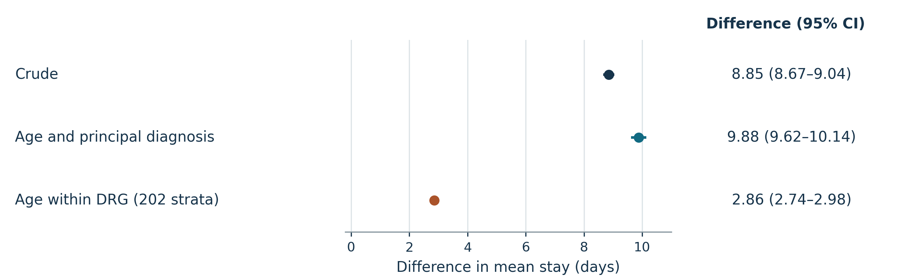

# Dysphagia and inpatient burden in German acute stroke care: a nationwide aggregate-data study

Bendix Labeit¹, Darius Günther Nabavi², Götz Thomalla³, Martin Köhrmann⁴, Rainer Dziewas⁵

¹ Department of Neurology, Medical Faculty and University Hospital Düsseldorf, Heinrich Heine University Düsseldorf, Düsseldorf, Germany

² Department of Neurology with Stroke Unit, Vivantes Klinikum Neukölln, Berlin, Germany

³ Department of Neurology, University Medical Center Hamburg-Eppendorf, Hamburg, Germany

⁴ Department of Neurology, University Hospital Essen, University of Duisburg-Essen, Essen, Germany

⁵ Department of Neurology and Neurological Early Rehabilitation, Klinikum Osnabrück, Osnabrück, Germany

Corresponding author: Bendix Labeit; bendix.labeit@med.uni-duesseldorf.de

Short title: Dysphagia burden in acute stroke care

## Abstract

Background  We examined how documented dysphagia relates to inpatient outcomes and the care setting to which adults are discharged after acute stroke treatment in Germany.

Methods  We compared 2025 hospital episodes receiving neurological complex treatment for acute stroke, with and without a secondary dysphagia code. We estimated risks, risk ratios (RRs) and mean hospital stay. The main adjusted comparisons standardized for age, principal diagnosis and sex, or for age within observable diagnosis-related groups (DRGs). Discharge destinations were assessed among survivors.

Results  Dysphagia was coded in 33,641 of 279,255 adult episodes (12.0%). Pneumonia or aspiration-related pneumonitis was recorded in 33.2% versus 4.6% of episodes with and without dysphagia coding, respectively, and in-hospital mortality was 14.9% versus 3.2%. After standardization for age, principal diagnosis and sex, the RRs were 6.98 (6.80–7.16) and 3.95 (3.81–4.11), respectively (95% CIs). Flexible endoscopic evaluation of swallowing was recorded in 20.1% versus 0.9%. Among 266,506 live discharges, 21.3% versus 6.8% went to rehabilitation and 11.4% versus 3.6% to a nursing facility. The corresponding age-, diagnosis- and sex-standardized RRs were 2.97 (2.88–3.06) and 2.85 (2.73–2.98). Within age–DRG strata the RRs were 1.95 and 2.64. Mean stay was 8.85 days longer overall and 2.86 days longer (95% CI 2.74–2.98) within age–DRG strata.

Conclusions  Dysphagia coding marked higher pulmonary morbidity and mortality, longer stays and more frequent discharge to rehabilitation or nursing facilities among survivors. Differences in stroke severity and selective dysphagia coding may contribute to these associations.

Keywords: Dysphagia; Stroke; Administrative data; Pneumonia; Length of stay; Swallowing assessment

## Background

Dysphagia can complicate stroke care through aspiration pneumonia, inadequate nutritional intake and difficulty administering medication, while also influencing feeding decisions and discharge planning [1]. European guidance places early swallowing screening and structured assessment within routine stroke management [2]. Assessment comprises initial swallowing screening followed, where indicated, by more detailed clinical and instrumental evaluation [1]. Flexible endoscopic evaluation of swallowing (FEES) and videofluoroscopic swallowing study (VFSS) are complementary diagnostic gold standards for evaluating penetration, aspiration and pharyngeal residue [3]. Frequency estimates depend on case selection, assessment and timing: a meta-analysis summarized in the assessment review estimated acute post-stroke dysphagia prevalence at approximately 42% overall and approximately 75% in studies using instrumental diagnostics [1]. Administrative coding consequently represents a different case definition from clinically assessed swallowing impairment.

German clinical cohorts and registry data link dysphagia to pneumonia, mortality and disability [4, 5]. A German study using flexible endoscopic evaluation of swallowing (FEES) also identified severe dysphagia with impaired secretion management as a marker of higher acute hospitalization expenditure [6]. Other economic studies support its resource relevance, although definitions and time horizons differ [7, 8]. These associations warrant nationwide quantification, although interpretation remains subject to confounding by age, neurological injury, disability and treatment limitations, which this aggregate-data study cannot fully address.

The German Institute for the Hospital Remuneration System (InEK) database permits evaluation of hospital episodes across a broad range of providers. A recent analysis of 1,540,947 stroke-unit episodes from 2019 to 2024 described FEES coding and institutional variation [9]. The incremental question is therefore the inpatient burden accompanying documented dysphagia, rather than the novelty of national FEES frequencies.

We examined how dysphagia coding related to pulmonary and nutritional diagnoses, death, hospital stay, recorded care procedures and discharge destination in the 2025 InEK acute stroke-care cohort. Complementary analyses addressed differences in diagnosis, demographics, administrative complexity and recorded function.

## Methods

### Design, source and population

This retrospective observational analysis used the InEK DatenBrowser release “Unterjährige Datenlieferung DRG Januar bis Dezember 2025,” delivered January 16, 2026, with the 2025 classifications [10, 11]. The release was retained to reproduce the source analyses and differs from subsequent annual submissions grouped using 2026 diagnosis-related groups (DRGs). The unit was a hospital episode; transfers and repeat admissions could not be linked. Reporting was informed by STROBE and RECORD [12, 13].

Eligible episodes had at least one German procedure classification (OPS) code 8-981.20-.23, 8-981.30-.33, 8-98b.20-.23 or 8-98b.30-.33, identifying neurological complex treatment for acute stroke care lasting at least 24 hours. The rules also permit transient ischemic attack and ophthalmic arterial ischemia, making this a care-defined cohort rather than one restricted to a principal stroke diagnosis [14]. We restricted every analysis to episodes in patients aged 18 years or older.

Exposure was the union of secondary diagnoses R13.0, R13.1 and R13.9. These describe dysphagia requiring supervision during eating, dysphagia in a specified tracheostomy context, and other or unspecified dysphagia [15]. The comparator lacked these secondary diagnoses; this does not establish normal swallowing or exclude dysphagia recorded only as a principal diagnosis. Onset, persistence, cause and clinical swallowing severity were unavailable.

### Outcomes and extraction

Outcomes were length of stay, in-hospital death, aspiration-related pneumonitis/pneumonia coding (J69.0), the unique J12-J18 pneumonia union and the combined pulmonary endpoint. Direct union queries counted affected episodes once despite overlapping codes. Additional diagnoses included volume depletion, respiratory failure, malnutrition and pneumonia-timing markers U69.01 and U69.04. The latter distinguish pneumonia after 48 hours from pneumonia present at admission or within 48 hours, apply to fully inpatient adults and do not establish timing relative to dysphagia [16].

FEES was identified by OPS 1-613 and intracranial mechanical thrombectomy by OPS 8-836.80. These describe episodes with procedure coding, not numbers of examinations or their clinical indications. Counts used the export field “Fälle” (episodes with a code), not “Nennungen” (mentions). Comparator values were obtained by subtracting dysphagia counts from the identically defined total cohort. Filters, integer counts and totals were reconciled. Omitted or suppressed cells were not assigned zero. Detailed reconstruction and quality checks are provided in Online Resource 1.

Additional post hoc analyses considered unspecified severe protein-energy malnutrition (E43), unspecified protein-energy malnutrition (E46), volume depletion (E86), simple endotracheal intubation (OPS 8-701) and PEG using the thread-pull technique (OPS 5-431.22). We also counted each episode with any of E40, E41, E42, E43, E44.0, E44.1 or E46 once, using an InEK query for the combined definition. The procedure codes do not measure overall ventilation requirement, reintubation, or every PEG technique.

We defined four mutually exclusive discharge destinations from the recorded discharge reason. These were rehabilitation facility (09), nursing facility (10), hospice (11) and external hospital transfer (06, 08 or 13). Each destination was assessed as a binary endpoint among episodes ending alive. We obtained the number discharged alive by subtracting observed inpatient deaths (07) from the matching episode totals. All remaining live discharges were grouped as other or unspecified. Routine completion of treatment leaves the subsequent place of residence unknown (Online Resource 1, Table S7a).

### Statistical analysis

We compared risks, risk ratios (RRs) and risk differences for 16 inpatient endpoints and four discharge destinations, and mean days for hospital stay. Both adult age bands (18–74 and ≥75 years) contributed. The planned diagnosis grouping distinguished cerebral infarction (I63), intracerebral haemorrhage (I61) and all remaining principal diagnoses within each age band.

InEK suppressed two malnutrition queries for younger adults with I61 and dysphagia coding (E44.0 and E44.1). To retain the same diagnosis adjustment, we combined I61 and other non-I63 principal diagnoses at ages 18–74 by subtracting I63 from the total. The three older diagnosis groups were retained. We applied these five groups to the discharge extension. Two additional queries for hospice discharge at ages 18–74 with I61 were suppressed. Six-group sensitivities used all three diagnoses at both ages when the necessary counts were observed.

For each endpoint, model 1 was the crude comparison. Destination models used live discharges throughout, with an additional crude proportion among all adult admissions. Model 2 standardized jointly for age band, principal diagnosis and sex. Model 3 standardized for age band, principal diagnosis and patient clinical complexity level (PCCL, categories 0–6). Within each filtered age–diagnosis population the source reports separate distributions for sex and PCCL. The number of cases and events at each combination of sex and PCCL is unknown, so including sex in model 3 would require assumptions about unobserved counts. PCCL can incorporate diagnoses recorded during admission [17].

Model 4 specified standardization for age and sex within DRGs. Sex-specific denominators and event counts identified this comparison in B70D for death and each discharge destination. B70D is a stroke DRG defined in part by neurological complex treatment lasting up to 72 hours. For comparisons across several DRGs, the observable joint counts supported standardization by age and DRG, and separately by age, principal diagnosis and DRG. Sex was unavailable jointly with age and DRG across multiple DRGs.

For each point estimate, both exposure groups received the same weights, equal to the proportion of all included episodes in each stratum. Strata required a positive denominator in both groups. Within-DRG analyses additionally required identifiable named rows in all contributing source tables. A missing row or a pooled remainder could not identify events in an individual DRG. Each estimate was paired with a crude comparison on the same retained cases.

For hospital stay, we reconstructed the sum of days and squared days from counts, means and standard deviations. These moments were available by age and diagnosis, by age and DRG, and by age, diagnosis and DRG. Sex- and PCCL-specific counts lacked corresponding stay moments. We repeated the age–diagnosis analysis among adults discharged alive. For within-DRG estimates with a singleton in either group, we retained the point estimate and calculated a separate interval in strata with at least two episodes per group.

We derived the comparison group by subtracting the dysphagia-coded subset from all episodes with identical filters. We counted overlapping diagnosis codes once using a union query. The pneumonia query for ages 18–74 without a diagnosis filter could be reconstructed exactly because its unrestricted event exports showed zero events in every paediatric age band. We did not assign zero to missing rows.

We calculated nominal 95% confidence intervals from independent-episode variances, treating pooled stratum weights as fixed. RR intervals used the log scale and risk differences used the absolute scale. Mean differences used reconstructed sample variances. Sparse or zero-event strata can yield narrow intervals. Online Resource 1 identifies strata and coverage, with full model results and interval diagnostics in the accompanying analysis tables.

Exploratory functional analyses compared mortality and pneumonia within 21 coded Barthel, Functional Independence Measure or Mini-Mental State Examination categories. We required observable adult denominators and event counts and report results only when both groups contained at least five events and five non-events. Functional coding can reflect selective assessment during admission [18].

Figures 1 and 2 show eight inpatient endpoints and two discharge destinations, first as absolute risks and then as standardized RRs. Rehabilitation and nursing facilities were selected for graphical display because both identify the setting for ongoing care after the acute admission. Hospital transfer and hospice discharge are reported in the tables. The selection of settings for display preceded estimation of their effects. For each plotted endpoint we show the same two comparisons. Age, principal diagnosis and sex characterize clinical case mix, while age within DRG compares episodes assigned to the same billing group. Supplementary Fig. S1 shows the additional pulmonary and malnutrition codes.

The study was not preregistered; endpoints and sensitivities were selected during retrospective replication and expansion of the source presentations. All additional analyses were exploratory, with nominal 95% CIs and no multiplicity correction. Intervals assume independent episodes and omit hospital clustering, repeat admissions, coding uncertainty and confounding. Admission NIHSS was unavailable. No model jointly controls all measured domains or establishes independence from baseline neurological severity.

### AI assistance

OpenAI ChatGPT/Codex assisted analysis programming, numerical checks and manuscript editing. Numerical results were checked against original aggregate exports and separate reconstruction routines. Final scientific verification, interpretation and approval remain the authors' responsibility.

## Results

### Cohort and clinical burden

The cohort comprised 279,255 adult hospital episodes, including 33,641 (12.05%) with secondary dysphagia coding and 245,614 without it. Overall, 132,519 episodes (47.5%) involved women, 147,072 (52.7%) involved adults aged ≥75 years, and 109,830 (39.3%) involved adults aged ≥80 years. Adults aged ≥80 years accounted for 52.5% of episodes with dysphagia coding and 37.5% of those without (Table 1).

Cerebral infarction (I63) was the principal diagnosis in 176,014 episodes (63.0%) and intracerebral haemorrhage (I61) in 12,146 (4.3%). The remaining 91,095 (32.6%) included at least 75,050 episodes (26.9% of all episodes) with a named G45 principal diagnosis (transient cerebral ischaemia and related syndromes). Some less frequent diagnoses were pooled in the source. Cerebral infarction accounted for 79.1% of episodes with dysphagia coding and 60.8% without, and intracerebral haemorrhage for 10.0% and 3.6%, respectively.

Pneumonia or aspiration-related pneumonitis occurred in 33.22% of episodes with dysphagia coding and 4.57% of those without (Fig. 1). The component frequencies were 23.19% versus 1.81% for J69.0 and 11.52% versus 2.86% for J12–J18 pneumonia (Table 2).

In-hospital death occurred in 14.87% versus 3.15%, protein-energy malnutrition in 3.02% versus 0.67%, and volume depletion in 12.18% versus 4.46%. The source reports diagnoses accumulated over the admission.

### Discharge status and destination

Of 279,255 adult episodes, 266,506 (95.4%) ended alive, including 28,638 with and 237,868 without dysphagia coding. Among these live discharges, 21.34% versus 6.80% went to rehabilitation and 11.45% versus 3.63% to a nursing facility (Fig. 1). The RRs after standardization for age, principal diagnosis and sex were 2.97 (2.88–3.06) for rehabilitation and 2.85 (2.73–2.98) for nursing facilities. Within observable age–DRG strata the RRs were 1.95 (1.88–2.01) and 2.64 (2.50–2.78), respectively (Fig. 2).

External hospital transfers accounted for 24.69% versus 7.32% of live discharges with and without dysphagia coding, respectively. Hospice discharge was uncommon (0.35% versus 0.07%). Their age-, diagnosis- and sex-standardized RRs were 3.17 (3.08–3.25) and 6.01 (4.55–7.95), respectively (Tables 2–3). All four settings supported the common PCCL model and the age- and sex-standardized B70D analysis. The finer diagnosis breakdown for hospice was unavailable (Online Resource 1, Tables S7a–d).

### Common and additional case-mix analyses

All 16 inpatient endpoints and all four discharge destinations supported crude comparisons, age standardization and the five-group age–diagnosis specification with sex or PCCL entered separately. The six-group specification was estimable for 14 inpatient endpoints and three destinations (Table 3 and Online Resource 1, Tables S2e and S7d).

For inpatient endpoints the common sex model retained 279,248 of 279,255 episodes in ten strata, and the common PCCL model retained 279,254 in 34 strata. For the four destination endpoints, the same specifications retained 266,502 of 266,506 live discharges and 266,506 live discharges, respectively.

For the combined pulmonary endpoint, standardized RRs were 6.98 (6.80–7.16) for age, principal diagnosis and sex, and 3.04 (2.95–3.14) for age, principal diagnosis and PCCL. Corresponding RRs for the malnutrition union were 4.43 (4.07–4.84) and 2.63 (2.35–2.94) (Table 3).

All 16 inpatient endpoints and all four destinations also supported a comparison within observable age–DRG strata. For mortality this included 31,070 dysphagia-coded and 199,523 comparator episodes across 77 strata. The crude mortality RR on these same cases was 4.29. The age–DRG RR was 2.80 (2.70–2.92). Additional standardization for principal diagnosis within observable age–DRG strata yielded 2.75 (2.65–2.86) on its own supported cases. For the pulmonary composite and protein-energy malnutrition, age–DRG RRs were 3.76 (3.64–3.88) and 2.56 (2.30–2.85), respectively.

In the single-DRG mortality analysis (B70D), model 4 included 4,915 dysphagia-coded and 64,344 comparator episodes. The age- and sex-standardized risks were 11.26% and 1.40%. The corresponding RR was 8.04 (7.27–8.89) versus a crude RR of 10.08 on the same cases. The same single-DRG model was estimable for all four destinations among survivors. Other inpatient endpoints lacked the joint counts needed for sex adjustment in B70D (Online Resource 1, Tables S4 and S7c).

Among episodes with a recorded Barthel Index of 0–15, the mortality RR was 1.08 (95% CI 1.03–1.15). Among those with an extended Barthel Index of 0–15 it was 1.02 (0.90–1.15). These are comparisons among selected adults with documented scores (Online Resource 1, Table S6).

### Hospital stay and recorded care procedures

Mean hospital stay was 16.26 days with dysphagia coding and 7.41 days without it. The crude difference was 8.85 days (95% CI 8.67–9.04). After standardization for the five age–diagnosis groups, it was 9.88 days (95% CI 9.62–10.14) and among adults discharged alive it was 10.23 days (95% CI 9.95–10.52). The finer six-group estimate for all adults was 9.74 days (95% CI 9.45–10.03).

Among the 272,072 episodes in 203 observable age–DRG strata, the crude mean stay difference was 8.76 days. Standardization on those same cases yielded 2.86 days. One stratum had a single comparator episode. In the remaining 202 strata (272,066 episodes), the difference was 2.86 days (95% CI 2.74–2.98) (Fig. 3). Adding principal diagnosis within DRGs yielded 3.34 days (3.22–3.47) in the 179 strata with estimable variance (Online Resource 1, Table S5).

Simple endotracheal intubation was recorded in 7.97% versus 1.59% and thread-pull PEG in 6.99% versus 0.13% (Table 2).

FEES was recorded in 20.14% of episodes with dysphagia coding and 0.89% of those without. For this procedure, the standardized RR was 21.65 (20.62–22.72) with age, principal diagnosis and sex and 15.81 (14.93–16.75) within observable age–DRG strata (Fig. 2).

## Discussion

Adults with dysphagia coding had higher recorded risks of pulmonary and nutritional diagnoses and death, and longer hospital stays. Among those discharged alive, both rehabilitation and nursing-facility discharge were more frequent after accounting for age, principal diagnosis and sex. These associations persisted within observable age and billing groups. Mortality also varied by functional category and billing group.

### Coding and severity

The observed 12.05% frequency is not the prevalence of clinically assessed post-stroke dysphagia. The care-defined denominator contains many transient ischemic syndromes, and principal stroke diagnoses had higher coding frequencies. Recognition, documentation and coding rules also influence ascertainment. Clinical cohorts using structured assessment have reported higher frequencies [20, 21]. This is compatible with incomplete capture of milder or transient impairment, but differing populations and measurement methods prevent estimating an undercoding rate.

The R13 dysphagia codes combine clinically heterogeneous conditions rather than validated swallowing-severity levels. FEES-based phenotyping distinguishes patterns with different neurological associations that this binary exposure cannot represent [22]. A recently proposed US administrative classification remains exploratory and cannot be assumed valid for German coding [23]. Clinical measures and swallowing recovery trajectories provide information unavailable here [24].

The complementary case-mix analyses address measured differences without resolving baseline neurological severity. Age-sex-diagnosis standardization accounts jointly for broad demographic and diagnostic composition. PCCL incorporates additional administrative complexity, but diagnoses accumulated during hospitalization can include downstream complications. Conditioning on these variables may remove mediated associations or create selection bias [25]. Separate models also use different reference distributions and common-support populations; their RRs are not a causal decomposition or a percentage of excess risk explained by confounding.

Functional categories offer clinically recognizable information, but selective assessment, broad categories and uncertain ordering relative to dysphagia limit interpretation. Barthel scoring itself includes feeding-related function. Near-null or smaller mortality contrasts in the most impaired categories show that the aggregate RR is not a uniform association across functional states. Persistent pneumonia contrasts in those groups are compatible with swallowing-related burden, but do not prove a causal interaction or an effect independent of severity. Admission NIHSS, premorbid disability, lesion characteristics, treatment limitations and exposure timing would be needed for more direct adjustment. Even NIHSS requires clinical context: in a FEES-selected stroke cohort, its ability to identify dysphagia differed between supra- and infratentorial lesions and had moderate sensitivity and specificity [26].

Complementary evidence comes from the nationwide GEMIDAS geriatric registry, where dysphagia remained associated with mortality, aspiration pneumonia and discharge destination after adjustment including admission Barthel Index, age, sex, stroke and dementia [27]. A separate analysis of the same registry identified particularly high mortality with co-occurring dehydration and dysphagia [28]. These findings support attention to swallowing and hydration in vulnerable patients, but concern geriatric admissions and adjusted odds ratios, not validation of the present stroke-care RRs. Volume-depletion coding (E86) in our study also cannot establish dysphagia-related dehydration or its onset.

Associations with recorded malnutrition and volume depletion persisted across the two case-mix models. Within DRGs, coverage varied substantially, particularly for individual malnutrition codes. These diagnoses can reflect vulnerability predating stroke. In the FOOD cohort, undernutrition at admission predicted poorer six-month survival after adjustment for stroke severity and prestroke function [29]. A small acute-stroke cohort found dysphagia-associated hydration impairment and similar nutritional status during the first week [30].

Australian administrative data also linked dysphagia coding with dehydration after adjustment using available demographic and clinical variables, although admission NIHSS and onset timing were unavailable [31]. This provides complementary evidence rather than validation of German volume-depletion coding. In our data, malnutrition and volume depletion identify documented diagnoses rather than systematically measured nutritional or hydration status. The clinical implication is to consider nutritional and fluid-intake assessment alongside swallowing safety; neither the magnitude of preventable deficits nor treatment benefit can be inferred from these associations. The association with coded volume depletion also persisted in the age-sex-diagnosis and separate age-diagnosis-PCCL models. This supports its relevance as an accompanying burden marker across these comparisons, while uncertain timing and the broad E86 definition prevent attributing it specifically to inadequate fluid intake caused by dysphagia.

Using the same five age–diagnosis groups allowed the estimates for respiratory failure, pneumonia-timing markers and the less frequent nutrition and procedure codes to be compared across endpoints. The six-group results show how separating I61 among younger adults affects the estimates where that comparison could be made. For intubation, gastrostomy and FEES, severity, clinical indication and diagnostic assessment all influence the probability that a procedure is recorded.

### Pulmonary outcomes and hospital stay

The strong association with aspiration-related pneumonitis/pneumonia (J69.0) accords with clinical evidence linking dysphagia and pulmonary complications [4, 5]. Nevertheless, J69.0 encompasses pneumonitis as well as pneumonia and does not establish bacterial infection or instrumental evidence of aspiration. A prospective acute-stroke intensive-care cohort also found that cough protection and dysphagia severity interacted in their association with pneumonia, emphasizing airway-protection information absent from these codes [32]. The combined pulmonary endpoint remained prominent after counting overlapping diagnoses once. Explicit union queries are therefore essential for interpreting aggregate code tables.

The J69.0 association persisted under age-sex-diagnosis standardization and in the separate PCCL sensitivity. The smaller RR in the latter does not quantify how much of the association is explained by baseline severity: PCCL can incorporate pulmonary diagnoses and other complications arising during hospitalization, and the models use different reference distributions. The residual association therefore supports J69.0 as an accompanying burden marker, without establishing a causal effect of dysphagia or an incident aspiration event.

Both early and later pneumonia markers were more frequent with dysphagia coding, but admission-based timing does not establish whether swallowing impairment preceded pneumonia. Longer stays also allow more opportunity for detection. These markers do not reproduce the consensus definition of stroke-associated pneumonia based on stroke onset [33], and should not be interpreted as preventable hospital harm. Mortality comparisons are likewise vulnerable to ascertainment and survival time: the qualifying treatment requires at least 24 hours, potentially excluding very early deaths. Interpretation also requires caution because administrative studies can produce contrasting findings; a US analysis reported longer stays but lower adjusted inpatient mortality with coded dysphagia [34].

The stay difference increased from 8.85 to 9.88 days after standardization for broad age and principal diagnosis. The age–DRG analysis addressed a different question. Its observed cases had a crude difference of 8.76 days and a difference of 2.86 days after comparing stays within the same billing group and age band. DRGs incorporate features of the completed admission, including procedures and complications. Adults with similar presenting diagnoses may receive different DRG assignments as their care diverges. These comparisons describe different episode populations and cannot identify preventable hospital days [6–8].

### Discharge destination

Among survivors with coded dysphagia, more than one in five episodes ended in rehabilitation and more than one in ten in a nursing facility. The two destinations reflect different care pathways. Preadmission residence, premorbid disability, discharge function and the local availability of beds were unavailable. A nursing-facility discharge could therefore represent a return to prior care. Rehabilitation coding identifies the immediate receiving setting and does not capture subsequent recovery. Because inpatient mortality differed between groups, destination comparisons describe the selected population surviving to discharge.

### FEES and clinical assessment

FEES coding occurred in 20.14% versus 0.89% of adult episodes with and without dysphagia coding. The previous InEK study provides historical context [9]. Comparing years would require harmonized cohort definitions and procedure coding.

The low frequency of FEES coding raises concern that instrumental swallowing assessment may be underused in acute stroke care, including among episodes with documented dysphagia. However, coding data alone cannot distinguish underuse from incomplete procedure recording or the use of other assessment methods. A recorded procedure does not report its indication, timing, findings or effect on management; absence of its code does not prove that FEES was not performed. The exports also do not measure bedside screening, clinical swallowing assessment, videofluoroscopy or all other instrumental assessment. Some patients recover promptly or have goals of care that limit testing. Conversely, patients without dysphagia coding (R13) may undergo FEES with normal findings or without a subsequently recorded dysphagia diagnosis. The 2,182 such episodes therefore cannot be used to estimate diagnostic error.

Clinical studies show that FEES can change feeding recommendations and identify swallowing problems not resolved by bedside assessment [35, 36]. Integrated FEES reporting also connects findings with severity, phenotype, likely mechanism and management, none of which is represented by an OPS flag [37]. Its value should consequently be judged against clinical indication, timeliness and whether management addresses the identified risk. The current counts justify closer examination of assessment pathways, but cannot identify how many additional examinations were needed or whether services were insufficient.

A nationwide survey of 82 certified FEES instructors reported substantial variation in inpatient activity, with a mean of 29.3 FEES examinations per month and a range of 4-100 [38]. These self-reported volumes provide context for differences in inpatient assessment activity, although the selected instructor sample does not establish population-level coverage or quantify unmet need. Linking indications and assessment findings to procedure records would be needed to separate recording gaps from gaps in care.

The thrombectomy subgroup had a high dysphagia-coding frequency. Early systematic FEES in a clinical thrombectomy cohort identified substantially more dysphagia, illustrating how ascertainment affects the measured frequency of dysphagia [39]. This does not imply a harmful treatment effect: stroke severity and the inclusion of transient ischemic syndromes in the non-thrombectomy group confound the comparison.

Recent treatment synthesis distinguishes protective measures, including diet and oral care, from interventions aiming to restore swallowing function [40]. Evidence for improving dysphagia care comes from clinical process and intervention studies. Screening protocols, implementation studies and a national audit linked structured or earlier assessment with fewer respiratory complications [41-43]. Registry evidence also supports attention to management in more severe strokes [44]. QASC evaluated a multicomponent fever, glucose and swallowing bundle, so its benefit cannot be assigned solely to swallowing care [45]. Feeding and stimulation trials address different selected populations [46, 47]; their effects cannot be inferred from the procedure frequencies here.

A 60-patient randomized pilot of pharyngeal electrical stimulation after extubation and its subsequent clinical and economic analyses illustrate the distinction between prognostic burden and modifiable outcomes [48-50]. The primary reintubation comparison was not statistically significant; secondary swallowing and length-of-stay findings were encouraging, while the mean hospitalization-cost difference was also not statistically significant. These publications concern one pilot cohort, and do not establish that the bed-day difference observed in this nationwide analysis is recoverable through stimulation. Evidence remains population-specific: the larger STEPS trial found no improvement in swallowing safety compared with sham stimulation [51].

### Limitations

The interim release, coding-dependent ascertainment, broad age and diagnosis groups, unavailable admission NIHSS and onset times, selective functional coding and unlinked repeat admissions limit interpretation. Hospital-level clustering was unavailable. Separate sex and PCCL models leave residual case-mix differences. PCCL can reflect conditions arising during admission. Post hoc coarsening of the younger diagnosis groups preserved a common comparison for all endpoints while reducing diagnosis detail. Suppression and pooled DRG rows restricted coverage, especially for less frequent nutritional codes. Nominal intervals condition on observed weights and exclude coding, selection and multiplicity uncertainty. For moderate and mild malnutrition, strata with an observed risk of zero or one contributed 20.4% and 15.7% of the model 3 reference weight, respectively. The order of dysphagia, diagnoses and procedures within an admission was unknown.

Follow-up after discharge was unavailable. Longitudinal work reports later pneumonia and mortality, but definitions based on nasogastric-tube use describe a different dysphagia phenotype [52].

The companion neurological/neurosurgical early-rehabilitation analysis uses the same source and may include overlapping episodes. It is not an independent replication, and the cohorts cannot be linked as stages of individual recovery. Future validation should combine administrative codes with admission severity, standardized swallowing assessment and longitudinal outcomes, and measure the indication, timing and consequences of FEES to distinguish service need from recorded use.

Within observable age–DRG strata, all 16 inpatient risk ratios were smaller than the crude RRs on the same retained episodes. For mild malnutrition only 38.5% of dysphagia-coded episodes and 22.9% of comparators contributed. Billing groups incorporate features of the completed admission, potentially including early death. The higher mortality RR within B70D reflects a single selected group with a low comparator mortality risk. Within B70D the RR changed little between age adjustment alone (8.05) and adjustment for age and sex (8.04). The difference from the multi-DRG RR of 2.80 therefore cannot be attributed to adding sex.

## Conclusions

Dysphagia coding identified adult acute stroke-care episodes with greater pulmonary and nutritional morbidity, higher mortality, more frequent use of swallowing-related procedures and longer hospital stays. Among survivors, discharge to rehabilitation and nursing facilities was also more frequent. These associations persisted across complementary case-mix comparisons. Clinical assessment and longitudinal follow-up are needed to establish how swallowing impairment contributes to care needs after stroke.

## Abbreviations

CI, confidence interval; DRG, diagnosis-related group; FEES, flexible endoscopic evaluation of swallowing; FIM, Functional Independence Measure; ICD-10-GM, International Statistical Classification of Diseases and Related Health Problems, tenth revision, German modification; InEK, Institute for the Hospital Remuneration System; MMSE, Mini-Mental State Examination; NIHSS, National Institutes of Health Stroke Scale; OPS, German procedure classification; PCCL, patient clinical complexity level; PEG, percutaneous endoscopic gastrostomy; RR, risk ratio

## Statements and Declarations

### Ethics approval and consent to participate

This analysis used anonymous aggregate hospital data without participant contact or access to patient identifiers. No ethical approval was necessary.

### Consent for publication

No identifiable individual information is reported.

### Funding

Bendix Labeit is supported by the Deutsche Forschungsgemeinschaft (DFG, German Research Foundation), project number 529859742, under the Walter Benjamin Programme.

### Competing interests

BL: has received research funding from the German Research Foundation (DFG), Clexio Bioscience Ltd, the Medical Faculty of the University of Münster, the Gesellschaft von Freunden und Förderern der Heinrich-Heine-Universität Düsseldorf e.V (GFFU), has received scientific prizes from the German Geriatric Society (DGG) in conjunction with the Rolf and Hubertine Schiffbauer Foundation, and the German Neurological Society (DGN), has received honoraria and/or travel grants for lectures, meetings and conferences from the German Society for Clinical Neurophysiology and Functional Imaging (DGKN), the European Stroke Organization (ESO), the Society for Clinical Nutrition and Metabolism (ESPEN), the German Society for Neurology (DGN), the European Society for Swallowing Disorders (ESSD), the United European Gastroenterology (UEG), the University of Strasbourg, the German Society for Muscular Dystrophy (DGM), the German Society for Nutritional Medicine (DGEM), the German Society for Internal Medicine (DGIM), the German Stroke Society (DSG), the University of Zurich, the Confederation of European Otorhinolaryngology - Head and Neck Surgery (CEORL-HNS), CONGRES ORPHEO, the Deutsche Interdisziplinäre Vereinigung für Intensiv- und Notfallmedizin (DIVI), the DGG, the BANSS foundation, Jottkaa Projekt.Konzept GmbH, Novartis, Nutricia, Phagenesis Ltd, Alexion, argenx, Hexal, and BIAL.

### Authors' contributions

Bendix Labeit and Rainer Dziewas designed the study and performed the analyses. All other authors revised the manuscript for important intellectual content.

### Data availability

This study used aggregate hospital episode data from the InEK DatenBrowser (https://datenbrowser.inek.org/DRG202601), specifically the “Unterjährige Datenlieferung DRG Januar bis Dezember 2025” (data delivery of 16 January 2026). Registered users can reproduce the source queries through the InEK DatenBrowser under its terms of use. The query definitions, analysis code and aggregate results are available at https://github.com/benlabeit/inek-dysphagia-acute-2025. The original Excel exports are not redistributed. The authors had no access to patient-level data.

## Figures

Fig. 1  Observed proportions in adult episodes with and without secondary dysphagia coding. Clinical outcomes and recorded procedures use all 33,641 and 245,614 episodes in the respective groups. Rehabilitation and nursing-facility discharge use the 28,638 and 237,868 live discharges, respectively. Table 2 gives event counts for all 20 binary endpoints. FEES, flexible endoscopic evaluation of swallowing. PEG, percutaneous endoscopic gastrostomy.

Fig. 2  Standardized risk ratios for the eight inpatient endpoints and two destinations in Fig. 1. Points and bars show estimates and nominal 95% confidence intervals on a logarithmic scale. The left panel standardizes for age band, principal diagnosis and sex. The right panel compares episodes within the same age band and observable diagnosis-related group (DRG), with endpoint-specific coverage. Destination models use live discharges. Supplementary Fig. S1 covers additional pulmonary and nutritional codes. Tables S2–S4 and S7 provide the other estimates.

Fig. 3  Difference in mean hospital stay for dysphagia-coded minus comparator episodes, in days, with 95% confidence intervals. The crude and age–principal diagnosis comparisons use all 279,255 adult episodes. The within-DRG estimate uses the 202 age–DRG strata with at least two episodes per group (272,066 episodes). The estimate across all 203 observable strata also rounded to 2.86 days (Table S5).

## Electronic supplementary material

Online Resource 1 provides model results and coverage, the finer principal-diagnosis sensitivity, the B70D mortality analysis, hospital stay and functional categories. Supplementary Fig. S1 shows eight further inpatient endpoints. Tables S7a–d give discharge status, all four destinations and sensitivity analyses. The literature-search appendix follows.

## Tables

### Table 1  Characteristics of adult episodes receiving neurological complex treatment for acute stroke

| Characteristic | All adults | Dysphagia code | No dysphagia code |
| --- | --- | --- | --- |
| Adult episodes | 279,255 (100.0%) | 33,641 (100.0%) | 245,614 (100.0%) |
| Age, years |  |  |  |
| 18–29 | 1,037 (0.4%) | 44 (0.1%) | 993 (0.4%) |
| 30–39 | 3,635 (1.3%) | 173 (0.5%) | 3,462 (1.4%) |
| 40–49 | 10,094 (3.6%) | 540 (1.6%) | 9,554 (3.9%) |
| 50–54 | 9,701 (3.5%) | 615 (1.8%) | 9,086 (3.7%) |
| 55–59 | 17,691 (6.3%) | 1,262 (3.8%) | 16,429 (6.7%) |
| 60–64 | 25,394 (9.1%) | 2,120 (6.3%) | 23,274 (9.5%) |
| 65–74 | 64,631 (23.1%) | 6,787 (20.2%) | 57,844 (23.6%) |
| 75–79 | 37,242 (13.3%) | 4,453 (13.2%) | 32,789 (13.3%) |
| ≥80 | 109,830 (39.3%) | 17,647 (52.5%) | 92,183 (37.5%) |
| Recorded sex |  |  |  |
| Female | 132,519 (47.5%) | 16,090 (47.8%) | 116,429 (47.4%) |
| Male | 146,729 (52.5%) | 17,551 (52.2%) | 129,178 (52.6%) |
| Other or unknown | 7 (<0.1%) | 0 (0.0%) | 7 (<0.1%) |
| Principal diagnosis |  |  |  |
| Cerebral infarction (I63) | 176,014 (63.0%) | 26,612 (79.1%) | 149,402 (60.8%) |
| Intracerebral haemorrhage (I61) | 12,146 (4.3%) | 3,364 (10.0%) | 8,782 (3.6%) |
| All other principal diagnoses | 91,095 (32.6%) | 3,665 (10.9%) | 87,430 (35.6%) |
| Patient clinical complexity level |  |  |  |
| 0 | 154,413 (55.3%) | 7,857 (23.4%) | 146,556 (59.7%) |
| 1–2 | 85,139 (30.5%) | 13,589 (40.4%) | 71,550 (29.1%) |
| 3–6 | 39,703 (14.2%) | 12,195 (36.3%) | 27,508 (11.2%) |
| Recorded procedure |  |  |  |
| Intracranial mechanical thrombectomy | 19,549 (7.0%) | 6,447 (19.2%) | 13,102 (5.3%) |

Values are episode counts (percent of the column total). Within each section, the age, sex, principal-diagnosis and PCCL categories each sum to the respective group total. Thrombectomy is a procedure recorded during the episode. PCCL, patient clinical complexity level.

### Table 2  Crude adult risks and risk ratios

| Endpoint | Dysphagia, n (%) | Comparator, n (%) | RR (95% CI) |
| --- | --- | --- | --- |
| In-hospital death | 5,003 (14.87) | 7,746 (3.15) | 4.72 (4.56–4.88) |
| Aspiration-related pneumonitis (J69.0) | 7,801 (23.19) | 4,443 (1.81) | 12.82 (12.38–13.28) |
| Pneumonia (J12–J18) | 3,875 (11.52) | 7,026 (2.86) | 4.03 (3.88–4.18) |
| Pneumonia or aspiration-related pneumonitis | 11,175 (33.22) | 11,228 (4.57) | 7.27 (7.10–7.44) |
| Hypoxemic respiratory failure | 5,066 (15.06) | 8,616 (3.51) | 4.29 (4.15–4.44) |
| Pneumonia after 48 hours | 5,575 (16.57) | 4,664 (1.90) | 8.73 (8.41–9.06) |
| Pneumonia by 48 hours | 5,438 (16.16) | 6,195 (2.52) | 6.41 (6.19–6.63) |
| Protein-energy malnutrition (any) | 1,016 (3.02) | 1,645 (0.67) | 4.51 (4.17–4.87) |
| Severe malnutrition (E43) | 216 (0.64) | 318 (0.13) | 4.96 (4.17–5.89) |
| Moderate malnutrition (E44.0) | 191 (0.57) | 298 (0.12) | 4.68 (3.90–5.61) |
| Mild malnutrition (E44.1) | 145 (0.43) | 302 (0.12) | 3.51 (2.88–4.27) |
| Unspecified malnutrition (E46) | 463 (1.38) | 734 (0.30) | 4.61 (4.10–5.17) |
| Volume depletion | 4,096 (12.18) | 10,944 (4.46) | 2.73 (2.64–2.83) |
| Simple endotracheal intubation | 2,681 (7.97) | 3,899 (1.59) | 5.02 (4.79–5.27) |
| PEG, thread-pull technique | 2,353 (6.99) | 311 (0.13) | 55.24 (49.11–62.14) |
| FEES | 6,776 (20.14) | 2,182 (0.89) | 22.67 (21.63–23.76) |
| Discharge destination among survivors |  |  |  |
| Rehabilitation facility | 6,112 (21.34) | 16,169 (6.80) | 3.14 (3.06–3.22) |
| Nursing facility | 3,278 (11.45) | 8,626 (3.63) | 3.16 (3.04–3.28) |
| Hospice | 101 (0.35) | 156 (0.07) | 5.38 (4.19–6.91) |
| External hospital transfer | 7,071 (24.69) | 17,416 (7.32) | 3.37 (3.29–3.46) |

Inpatient endpoints use all 33,641 dysphagia-coded and 245,614 comparator episodes. The final four rows use 28,638 and 237,868 live discharges. The other or unspecified live-discharge category is reported in Table S7a.

### Table 3  Adult risk ratios by standardization model

| Endpoint | Age + HD | Age + HD + sex | Age + HD + PCCL | Age + DRG |
| --- | --- | --- | --- | --- |
| In-hospital death | 3.96 | 3.95 | 2.29 | 2.80 |
| Aspiration-related pneumonitis (J69.0) | 11.66 | 11.59 | 4.74 | 5.97 |
| Pneumonia (J12–J18) | 4.37 | 4.33 | 1.95 | 2.23 |
| Pneumonia or aspiration-related pneumonitis | 7.02 | 6.98 | 3.04 | 3.76 |
| Hypoxemic respiratory failure | 4.55 | 4.53 | 2.27 | 2.40 |
| Pneumonia after 48 hours | 8.78 | 8.72 | 3.41 | 4.07 |
| Pneumonia by 48 hours | 6.07 | 6.04 | 2.86 | 3.70 |
| Protein-energy malnutrition (any) | 4.41 | 4.43 | 2.63 | 2.56 |
| Severe malnutrition (E43) | 4.87 | 4.91 | 2.87 | 2.91 |
| Moderate malnutrition (E44.0) | 4.31 | 4.34 | 2.58 | 3.03 |
| Mild malnutrition (E44.1) | 3.38 | 3.39 | 2.72 | 1.55 |
| Unspecified malnutrition (E46) | 4.64 | 4.65 | 2.48 | 2.62 |
| Volume depletion | 2.79 | 2.79 | 2.13 | 2.47 |
| Simple endotracheal intubation | 5.82 | 5.81 | 2.40 | 1.41 |
| PEG, thread-pull technique | 57.22 | 57.09 | 28.45 | 21.29 |
| FEES | 21.73 | 21.65 | 18.31 | 15.81 |
| Discharge destination among survivors |  |  |  |  |
| Rehabilitation facility | 2.98 | 2.97 | 2.66 | 1.95 |
| Nursing facility | 2.85 | 2.85 | 2.46 | 2.64 |
| Hospice | 5.94 | 6.01 | 2.49 | 4.66 |
| External hospital transfer | 3.16 | 3.17 | 2.46 | 2.25 |

HD denotes principal diagnosis. The first three columns use the common five age–diagnosis groups. The last column uses observable age–DRG strata without sex adjustment. Destination models use survivors. An age- and sex-standardized analysis within B70D was possible for mortality (RR 8.04, 95% CI 7.27–8.89) and all four destinations. Online Resource 1 gives intervals, model denominators and matched crude comparisons.

## References

1.  Labeit B, Michou E, Hamdy S, et al (2023) The assessment of dysphagia after stroke: state of the art and future directions. Lancet Neurol 22:858–870. https://doi.org/10.1016/S1474-4422(23)00153-9

2.  Dziewas R, Michou E, Trapl-Grundschober M, et al (2021) European Stroke Organisation and European Society for Swallowing Disorders guideline for the diagnosis and treatment of post-stroke dysphagia. Eur Stroke J 6:LXXXIX–CXV. https://doi.org/10.1177/23969873211039721

3.  Labeit B, Ahring S, Boehmer M, et al (2022) Comparison of Simultaneous Swallowing Endoscopy and Videofluoroscopy in Neurogenic Dysphagia. J Am Med Dir Assoc 23:1360–1366. https://doi.org/10.1016/j.jamda.2021.09.026

4.  Al-Khaled M, Matthis C, Binder A, et al (2016) Dysphagia in Patients with Acute Ischemic Stroke: Early Dysphagia Screening May Reduce Stroke-Related Pneumonia and Improve Stroke Outcomes. Cerebrovasc Dis Basel Switz 42:81–89. https://doi.org/10.1159/000445299

5.  Suntrup-Krueger S, Minnerup J, Muhle P, et al (2018) The Effect of Improved Dysphagia Care on Outcome in Patients with Acute Stroke: Trends from 8-Year Data of a Large Stroke Register. Cerebrovasc Dis Basel Switz 45:101–108. https://doi.org/10.1159/000487811

6.  Labeit B, Kremer A, Muhle P, et al (2023) Costs of post-stroke dysphagia during acute hospitalization from a health-insurance perspective. Eur Stroke J 8:361–369. https://doi.org/10.1177/23969873221147740

7.  Bonilha HS, Simpson AN, Ellis C, et al (2014) The one-year attributable cost of post-stroke dysphagia. Dysphagia 29:545–552. https://doi.org/10.1007/s00455-014-9543-8

8.  Marin S, Serra-Prat M, Ortega O, et al (2021) Healthcare costs of post-stroke oropharyngeal dysphagia and its complications: malnutrition and respiratory infections. Eur J Neurol 28:3670–3681. https://doi.org/10.1111/ene.14998

9.  Ungerer MN, Bartig D, Agredo AM, et al (2026) Fiberoptic endoscopic evaluation of swallowing in German stroke units: a retrospective diagnosis-related group analysis (2019-2024). Neurol Res Pract 8:46. https://doi.org/10.1186/s42466-026-00506-3

10.  Institut für das Entgeltsystem im Krankenhaus (2025) Unterjährige Datenlieferung DRG Januar bis Dezember 2025, data delivery January 16, 2026, classifications 2025. https://datenbrowser.inek.org/DRG202601. Accessed 17 Nov 2026

11.  Institut für das Entgeltsystem im Krankenhaus (2026) InEK DatenBrowser user manual, version September 1, 2026; dataset section 2.51. https://datenbrowser.inek.org/assets/manual/InekDatenBrowser.pdf. Accessed 17 Nov 2026

12.  von Elm E, Altman DG, Egger M, et al (2007) The Strengthening the Reporting of Observational Studies in Epidemiology (STROBE) statement: guidelines for reporting observational studies. PLoS Med 4:e296. https://doi.org/10.1371/journal.pmed.0040296

13.  Benchimol EI, Smeeth L, Guttmann A, et al (2015) The REporting of studies Conducted using Observational Routinely-collected health Data (RECORD) statement. PLoS Med 12:e1001885. https://doi.org/10.1371/journal.pmed.1001885

14.  Bundesinstitut für Arzneimittel und Medizinprodukte (2025) OPS 2025, neurological complex treatment codes 8-981 and 8-98b. https://klassifikationen.bfarm.de/ops/kode-suche/htmlops2025/block-8-97...8-98.htm. Accessed 17 Nov 2026

15.  Bundesinstitut für Arzneimittel und Medizinprodukte (2025) ICD-10-GM 2025, R13 dysphagia. https://klassifikationen.bfarm.de/icd-10-gm/kode-suche/htmlgm2025/block-r10-r19.htm. Accessed 17 Nov 2026

16.  Bundesinstitut für Arzneimittel und Medizinprodukte (2025) ICD-10-GM 2025, U69 pneumonia-timing codes. https://klassifikationen.bfarm.de/icd-10-gm/kode-suche/htmlgm2025/block-u69-u69.htm. Accessed 17 Nov 2026

17.  Institut für das Entgeltsystem im Krankenhaus (2024) Abschlussbericht zur Weiterentwicklung des aG-DRG-Systems fuer das Jahr 2025. December 19, 2024. Section 3.3.1.4, CCL matrix and PCCL. https://www.g-drg.de/content/download/14761/file/Abschlussbericht_aG-DRG_2025_2024-12-19.pdf. Accessed 17 Nov 2026

18.  Bundesinstitut für Arzneimittel und Medizinprodukte (2025) ICD-10-GM 2025, U50-U52 functional impairment codes and assessment timing. https://klassifikationen.bfarm.de/icd-10-gm/kode-suche/htmlgm2025/block-u50-u52.htm. Accessed 17 Nov 2026

19.  Bundesinstitut für Arzneimittel und Medizinprodukte (2025) ICD-10-GM 2025, Barthel Index criteria according to the Hamburg Manual. https://klassifikationen.bfarm.de/icd-10-gm/kode-suche/htmlgm2025/zusatz-06-anh-barthelindex.htm. Accessed 17 Nov 2026

20.  Arnold M, Liesirova K, Broeg-Morvay A, et al (2016) Dysphagia in Acute Stroke: Incidence, Burden and Impact on Clinical Outcome. PloS One 11:e0148424. https://doi.org/10.1371/journal.pone.0148424

21.  Selg J, Mirkoska V, Holmlund T, et al (2026) Incidence of dysphagia in acute stroke patients-a prospective multicentre cohort study. Front Neurol 17:1886254. https://doi.org/10.3389/fneur.2026.1886254

22.  Warnecke T, Labeit B, Schroeder J, et al (2021) Neurogenic Dysphagia: Systematic Review and Proposal of a Classification System. Neurology 96:e876–e889. https://doi.org/10.1212/WNL.0000000000011350

23.  Horn J, Simpson KN, Simpson AN, et al (2026) An Exploratory Classification Framework for Poststroke Dysphagia Severity Using Administrative Data: Administrative Data Dysphagia Severity Scale. Am J Speech Lang Pathol 35:98–108. https://doi.org/10.1044/2025_AJSLP-24-00313

24.  Galovic M, Stauber AJ, Leisi N, et al (2019) Development and Validation of a Prognostic Model of Swallowing Recovery and Enteral Tube Feeding After Ischemic Stroke. JAMA Neurol 76:561–570. https://doi.org/10.1001/jamaneurol.2018.4858

25. Schisterman EF, Cole SR, Platt RW (2009) Overadjustment bias and unnecessary adjustment in epidemiologic studies. Epidemiology 20:488-495. https://doi.org/10.1097/EDE.0b013e3181a819a1

26.  Labeit B, Mueller H, Muhle P, et al (2018) Predicting Dysphagia with National Institute of Health Stroke Scale: Distinction between Infra- and Supratentorial Region is Essential. Cerebrovasc Dis Basel Switz 46:152–160. https://doi.org/10.1159/000493371

27.  Lueg G, Willschrei P, Pourhassan M, et al (2026) Dysphagia as a geriatric syndrome: nationwide outcomes from the GEMIDAS registry. Arch Gerontol Geriatr 150:106341. https://doi.org/10.1016/j.archger.2026.106341

28.  Lueg G, Funk L, Labeit B, et al (2026) In-hospital mortality in co-occurring dehydration and dysphagia: results from the nationwide GEMIDAS Pro registry. Eur Geriatr Med. https://doi.org/10.1007/s41999-026-01627-3

29. FOOD Trial Collaboration (2003) Poor nutritional status on admission predicts poor outcomes after stroke: observational data from the FOOD trial. Stroke 34:1450-1456. https://doi.org/10.1161/01.STR.0000074037.49197.8C

30. Crary MA, Humphrey JL, Carnaby-Mann G, et al (2013) Dysphagia, nutrition, and hydration in ischemic stroke patients at admission and discharge from acute care. Dysphagia 28:69-76. https://doi.org/10.1007/s00455-012-9414-0

31. Bond VE, Doeltgen S, Kleinig T, Murray J (2023) Dysphagia-related acute stroke complications: A retrospective observational cohort study. J Stroke Cerebrovasc Dis 32:107123. https://doi.org/10.1016/j.jstrokecerebrovasdis.2023.107123

32.  Jung A, Labeit B, Oelenberg S, et al (2026) Cough reflex testing for dysphagia severity and pneumonia risk after acute stroke: a prospective observational study. Stroke Vasc Neurol. https://doi.org/10.1136/svn-2026-005197

33.  Smith CJ, Kishore AK, Vail A, et al (2015) Diagnosis of Stroke-Associated Pneumonia: Recommendations From the Pneumonia in Stroke Consensus Group. Stroke 46:2335–2340. https://doi.org/10.1161/STROKEAHA.115.009617

34.  Vasan V, Hardigan TA, Ali M, et al (2023) Dysphagia after ischemic and hemorrhagic stroke: A propensity-matched 20-year analysis of the national inpatient sample. J Stroke Cerebrovasc Dis Off J Natl Stroke Assoc 32:107295. https://doi.org/10.1016/j.jstrokecerebrovasdis.2023.107295

35.  Dziewas R, Auf dem Brinke M, Birkmann U, et al (2019) Safety and clinical impact of FEES - results of the FEES-registry. Neurol Res Pract 1:16. https://doi.org/10.1186/s42466-019-0021-5

36.  Braun T, Juenemann M, Viard M, et al (2019) Adjustment of oral diet based on flexible endoscopic evaluation of swallowing (FEES) in acute stroke patients: a cross-sectional hospital-based registry study. BMC Neurol 19:282. https://doi.org/10.1186/s12883-019-1499-8

37.  Dziewas R, Warnecke T, Labeit B, et al (2024) Systematic approach to contextualize findings of flexible endoscopic evaluation of swallowing in neurogenic dysphagia- towards an integrated FEES report. Neurol Res Pract 6:26. https://doi.org/10.1186/s42466-024-00321-8

38.  Marae JG, Masanneck L, Pawlitzki M, et al (2026) Mapping neurogenic dysphagia diagnostics in Germany: accessibility, implementation practices, and barriers to swallowing endoscopy. Neurol Res Pract 8:17. https://doi.org/10.1186/s42466-026-00473-9

39.  Pinho J, Meyer T, Mall B, et al (2024) Early flexible endoscopic evaluation of swallowing after mechanical thrombectomy in stroke patients. Ann Clin Transl Neurol 11:757–767. https://doi.org/10.1002/acn3.51998

40.  Labeit B, Michou E, Trapl-Grundschober M, et al (2024) Dysphagia after stroke: research advances in treatment interventions. Lancet Neurol 23:418–428. https://doi.org/10.1016/S1474-4422(24)00053-X

41.  Hinchey JA, Shephard T, Furie K, et al (2005) Formal dysphagia screening protocols prevent pneumonia. Stroke 36:1972–1976. https://doi.org/10.1161/01.STR.0000177529.86868.8d

42.  Titsworth WL, Abram J, Fullerton A, et al (2013) Prospective quality initiative to maximize dysphagia screening reduces hospital-acquired pneumonia prevalence in patients with stroke. Stroke 44:3154–3160. https://doi.org/10.1161/STROKEAHA.111.000204

43.  Bray BD, Smith CJ, Cloud GC, et al (2017) The association between delays in screening for and assessing dysphagia after acute stroke, and the risk of stroke-associated pneumonia. J Neurol Neurosurg Psychiatry 88:25–30. https://doi.org/10.1136/jnnp-2016-313356

44.  Hotz JF, Kaindl L, Schneider L, et al (2025) Dysphagia Management is Associated with Reduced Mortality in Patients with Moderate to Severe Acute Ischemic Stroke. Neurol Ther 14:1539–1552. https://doi.org/10.1007/s40120-025-00783-1

45.  Middleton S, McElduff P, Ward J, et al (2011) Implementation of evidence-based treatment protocols to manage fever, hyperglycaemia, and swallowing dysfunction in acute stroke (QASC): a cluster randomised controlled trial. Lancet Lond Engl 378:1699–1706. https://doi.org/10.1016/S0140-6736(11)61485-2

46.  Dennis MS, Lewis SC, Warlow C, FOOD Trial Collaboration (2005) Effect of timing and method of enteral tube feeding for dysphagic stroke patients (FOOD): a multicentre randomised controlled trial. Lancet Lond Engl 365:764–772. https://doi.org/10.1016/S0140-6736(05)17983-5

47.  Dziewas R, Stellato R, van der Tweel I, et al (2018) Pharyngeal electrical stimulation for early decannulation in tracheotomised patients with neurogenic dysphagia after stroke (PHAST-TRAC): a prospective, single-blinded, randomised trial. Lancet Neurol 17:849–859. https://doi.org/10.1016/S1474-4422(18)30255-2

48.  Suntrup-Krueger S, Labeit B, Marian T, et al (2023) Pharyngeal electrical stimulation for postextubation dysphagia in acute stroke: a randomized controlled pilot trial. Crit Care Lond Engl 27:383. https://doi.org/10.1186/s13054-023-04665-6

49.  Suntrup-Krueger S, Labeit B, von Itter J, et al (2025) Treating postextubation dysphagia after stroke with pharyngeal electrical stimulation -insights from a randomized controlled pilot trial. Neurother J Am Soc Exp Neurother 22:e00613. https://doi.org/10.1016/j.neurot.2025.e00613

50.  Labeit B, Jung A, von Itter J, et al (2026) Pharyngeal electrical stimulation for postextubation dysphagia after stroke: a randomized trial on hospitalization costs from a health insurance perspective. Sci Rep 16:8556. https://doi.org/10.1038/s41598-026-43591-9

51.  Bath PM, Scutt P, Love J, et al (2016) Pharyngeal Electrical Stimulation for Treatment of Dysphagia in Subacute Stroke: A Randomized Controlled Trial. Stroke 47:1562–1570. https://doi.org/10.1161/STROKEAHA.115.012455

52.  Ho C-H, Lin W-C, Hsu Y-F, et al (2018) One-Year Risk of Pneumonia and Mortality in Patients with Poststroke Dysphagia: A Nationwide Population-Based Study. J Stroke Cerebrovasc Dis Off J Natl Stroke Assoc 27:1311–1317. https://doi.org/10.1016/j.jstrokecerebrovasdis.2017.12.017
