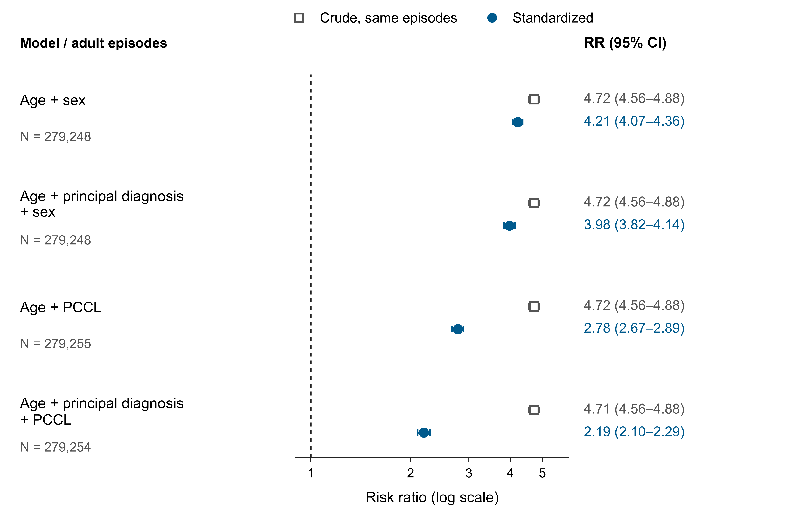
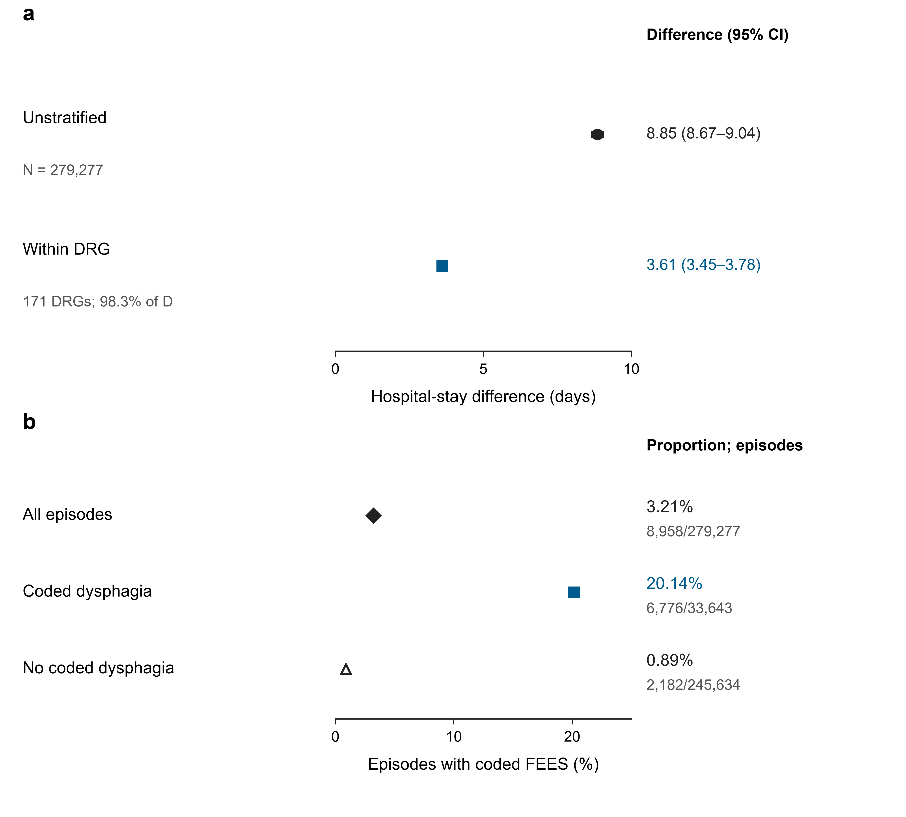

# Dysphagia and inpatient burden in German acute stroke care: a nationwide aggregate-data study

**Bendix Labeit¹, Darius Günther Nabavi², Götz Thomalla³, Martin Köhrmann⁴, Rainer Dziewas⁵**

¹ Department of Neurology, Medical Faculty and University Hospital Düsseldorf, Heinrich Heine University Düsseldorf, Düsseldorf, Germany

² Department of Neurology with Stroke Unit, Vivantes Klinikum Neukölln, Berlin, Germany

³ Department of Neurology, University Medical Center Hamburg-Eppendorf, Hamburg, Germany

⁴ Department of Neurology, University Hospital Essen, University of Duisburg-Essen, Essen, Germany

⁵ Department of Neurology and Neurological Early Rehabilitation, Klinikum Osnabrück, Osnabrück, Germany

**Proposed corresponding author:** Bendix Labeit; bendix.labeit@med.uni-duesseldorf.de

**Short title:** Dysphagia burden in acute stroke care

The author order follows the proposed manuscript team. Current affiliations and contact details require author confirmation for this study; corresponding authorship, contributions and final approval are not implied by this draft.

# Abstract

**Background:** Dysphagia accompanies adverse stroke outcomes, but its nationwide inpatient burden is difficult to separate from neurological severity and case mix.

**Methods:** We analyzed German national hospital data for 2025 episodes receiving neurological complex treatment of acute stroke. Recorded dysphagia was defined by secondary diagnoses. Outcomes included pulmonary diagnoses, death, length of stay and flexible endoscopic evaluation of swallowing. Exploratory mortality analyses standardized jointly for age, sex and principal diagnosis or, separately, age, principal diagnosis and patient clinical complexity level. Additional analyses examined functional categories and hospital stays within diagnosis-related groups.

**Results:** Among 279,277 episodes, 33,643 (12.05%) had dysphagia coding. Combined pneumonia or aspiration-related pneumonitis occurred in 33.22% versus 4.57%; mortality was 14.87% versus 3.15%. Joint age-sex-diagnosis standardization yielded a mortality risk ratio of 3.98 (95% confidence interval 3.82–4.14); separate age-diagnosis-complexity standardization yielded 2.19 (approximate interval 2.10–2.29). Mortality contrasts were smaller within severe functional categories: risk ratios 1.08 (1.03–1.15) at Barthel Index 0–15 and 1.02 (0.90–1.15) at extended Barthel Index 0–15. Mean stay was 16.26 versus 7.41 days; the within-diagnosis-related-group difference was 3.61 days (3.45–3.78). Endoscopic swallowing evaluation was coded in 20.14% of dysphagia episodes.

**Conclusions:** Recorded dysphagia identifies substantial pulmonary morbidity, mortality and resource use. Associations persisted in complementary case-mix analyses but varied by functional category. Selective coding, uncertain timing and residual neurological-severity confounding preclude causal attribution; low procedure coding alone cannot establish underuse of assessment.

**Keywords:** Dysphagia; Stroke; Administrative data; Pneumonia; Length of stay; Swallowing assessment

# Background

Dysphagia can complicate stroke care through aspiration, inadequate intake and difficulty administering medication, while also influencing feeding decisions and discharge planning. European guidance places early swallowing screening and structured assessment within routine stroke management [Dziewas2021Guideline]. A contemporary review distinguishes initial screening from more detailed clinical and instrumental assessment according to the individual question [Labeit2023Assessment]. Frequency estimates depend on case selection, assessment and timing: prospective cohorts identified dysphagia in 20.7% of patients using the Gugging Swallowing Screen and in 38.8% using standardized assessment within 96 hours [Arnold2016; Selg2026]. Administrative coding consequently represents a different phenotype from clinically assessed swallowing impairment.

German clinical cohorts and registry data link dysphagia to pneumonia, mortality and disability [AlKhaled2016; SuntrupKrueger2018]. A German study using flexible endoscopic evaluation of swallowing (FEES) also identified severe dysphagia with impaired secretion management as a marker of higher acute hospitalization expenditure [Labeit2023Costs]. Other economic studies support its resource relevance, although definitions and time horizons differ [Bonilha2014; Marin2021]. These associations warrant nationwide quantification, but do not establish that outcome differences are caused by dysphagia: age, neurological injury, disability and treatment limitations can affect both swallowing and prognosis.

The German Institute for the Hospital Remuneration System (InEK) database permits evaluation of hospital episodes across a broad range of providers. A recent analysis of 1,540,947 stroke-unit episodes from 2019 to 2024 described FEES coding and institutional variation [Ungerer2026]. The incremental question is therefore the inpatient burden accompanying documented dysphagia, rather than the novelty of national FEES frequencies. Interpretation also requires caution because administrative studies can produce contrasting findings; a US analysis reported longer stays but lower adjusted inpatient mortality with coded dysphagia [Vasan2023].

We examined associations of dysphagia coding with pulmonary diagnoses, death, FEES use and length of stay in the 2025 InEK acute stroke-care cohort. Complementary diagnosis, demographic, administrative-complexity and functional analyses addressed measured aspects of case mix without equating these proxies with admission neurological severity.

# Methods

## Design, source and population

This retrospective observational analysis used the InEK DatenBrowser release “Unterjährige Datenlieferung DRG Januar bis Dezember 2025,” delivered January 16, 2026, with the 2025 classifications [InEKData2025; InEKManual2026]. The release was retained to reproduce the source analyses and differs from subsequent annual submissions grouped using 2026 diagnosis-related groups (DRGs). The unit was a hospital episode; transfers and repeat admissions could not be linked. Reporting was informed by STROBE and RECORD [vonElm2007STROBE; Benchimol2015RECORD].

Eligible episodes had at least one German procedure classification (OPS) code 8-981.20–.23, 8-981.30–.33, 8-98b.20–.23 or 8-98b.30–.33, identifying neurological complex treatment for acute stroke care lasting at least 24 hours. The rules also permit transient ischemic attack and ophthalmic arterial ischemia, making this a care-defined cohort rather than one restricted to a principal stroke diagnosis [BfArMOPS2025]. The main cohort included all ages; simultaneous standardizations were restricted to adults.

Exposure was the union of secondary diagnoses R13.0, R13.1 and R13.9. These describe dysphagia requiring supervision during eating, dysphagia in a specified tracheostomy context, and other or unspecified dysphagia [BfArMR132025]. The comparator lacked these secondary diagnoses; this does not establish normal swallowing or exclude dysphagia recorded only as a principal diagnosis. Onset, persistence, cause and clinical swallowing severity were unavailable.

## Outcomes and extraction

Outcomes were length of stay, in-hospital death, aspiration-related pneumonitis/pneumonia coding (J69.0), the unique J12–J18 pneumonia union and the combined pulmonary endpoint. Direct union queries counted affected episodes once despite overlapping codes. Additional diagnoses included volume depletion, respiratory failure, malnutrition and pneumonia-timing markers U69.01 and U69.04. The latter distinguish pneumonia after 48 hours from pneumonia present at admission or within 48 hours, apply to fully inpatient adults and do not establish timing relative to dysphagia [BfArMU692025].

FEES was identified by OPS 1-613 and intracranial mechanical thrombectomy by OPS 8-836.80. These describe episodes with procedure coding, not numbers of examinations or their clinical indications. Counts used the export field “Fälle” (episodes with a code), not “Nennungen” (mentions). Comparator values were obtained by subtracting dysphagia counts from the identically defined total cohort. Filters, integer counts and totals were reconciled. Omitted or suppressed cells were not assigned zero. Detailed reconstruction and quality checks are provided in Online Resource 1.

## Statistical analysis

We calculated proportions, risk ratios (RRs), risk differences and mean stay differences with 95% confidence intervals (CIs). Risk-ratio intervals used the log-Wald method; mean differences used separate reconstructed group variances. For each estimable DRG, the mean stay difference was weighted by its dysphagia count, standardizing to that subgroup's observed DRG distribution. Sensitivities required at least 20 episodes per group or examined episodes ending in discharge alive. The latter required explicitly available death rows for exact DRG reconstruction. “Associated bed-days” multiplied within-DRG differences by exposed-group counts; this is a descriptive quantity, not preventable bed-days or savings.

Mortality was standardized separately by three age bands (under 65, 65–79 and 80 years or older) and by the seven patient clinical complexity level (PCCL) categories, using fixed pooled-cohort weights. PCCL-standardized J12–J18 pneumonia was also examined. PCCL summarizes coded complications and comorbidities relevant to resource use; it is not an admission neurological score and can include consequences of dysphagia [InEKPCCL2025].

Further mortality models used directly observed joint strata, rather than combinations inferred from marginal tables. Queries restricted to ages 18–74 and 75 years or older supplied age-by-sex and age-by-PCCL counts. Direct queries of complete principal-diagnosis I63 and I61 groups, including all endcodes, and subtraction of these from all diagnoses established a mutually exclusive three-group diagnosis partition. Separate models standardized for age and sex; age and PCCL; age, sex and principal diagnosis; or age, principal diagnosis and PCCL. Sex and PCCL were never included together. Each model retained strata with positive denominators in both exposure groups, used fixed pooled common-support weights and recalculated the crude RR in that same population. Independent workbook reconstruction reproduced the estimates.

Standardized-risk differences and log RRs used the delta method with independent binomial stratum variances. Sparse strata (fewer than five events or non-events in either group) and boundary risks (zero or one) were flagged. Boundary risks produce zero plug-in variance and can make intervals too optimistic. Post hoc exclusion of boundary or all sparse strata assessed numerical influence, with renormalized weights and matched crude comparisons. Such outcome-dependent exclusions alter the target population and are not improved adjustment or validation of interval calibration.

All-age diagnosis sensitivities used complete I61 and an explicitly restricted I63 cohort excluding I63.6, whose death rows were unavailable. These differ from the directly queried complete I63 group in joint adult models. Functional analyses compared death and J12–J18 pneumonia within each of 21 categories of the Barthel Index, motor Functional Independence Measure (FIM), extended Barthel Index, cognitive FIM and Mini-Mental State Examination (MMSE). U50/U51 rules specify assessment within the first five hospital days or at the beginning of geriatric/early-rehabilitation care, using the highest score if it changes [BfArMFunction2025]. These are not necessarily pre-dysphagia measurements; Barthel scoring includes eating or percutaneous endoscopic gastrostomy self-care [BfArMBarthel2025]. Instruments were kept separate, no episode-level exclusivity was assumed across categories, and missing required rows remained non-estimable. All categories, including unavailable contrasts, appear in Online Resource 1.

The study was not preregistered; endpoints and sensitivities were selected during retrospective replication and expansion of the source presentations. Intervals describe model-based precision conditional on observed data, not uncertainty from coding or confounding. They assume independent episodes and do not account for hospital clustering or repeat admissions. No admission National Institutes of Health Stroke Scale (NIHSS) measurements were available. None of the models jointly controls all measured domains or establishes independence from baseline neurological severity.

## Literature context and AI assistance

A targeted narrative search retrieved primary PubMed records, publisher articles and accessible full texts on dysphagia, prognosis, costs and assessment. Search methods and subsequent author-specific screening are documented in Online Resource 1; this was not a systematic review or meta-analysis.

OpenAI ChatGPT/Codex assisted workflow development, analysis programming, numerical checks, literature retrieval and manuscript drafting. Numerical results were checked against original aggregate exports and separate reconstruction routines. Final scientific verification, interpretation and approval remain the authors' responsibility; this statement does not imply that all authors have completed that review.

# Results

## Cohort, pulmonary diagnoses and mortality

Among 279,277 episodes, 33,643 had an R13 secondary diagnosis (12.05%, 95% CI 11.93–12.17), with 245,634 comparators (Table 1). Dysphagia coding occurred in 26,613/176,029 principal cerebral-infarction episodes (15.12%) and 3,364/12,148 intracerebral-hemorrhage episodes (27.69%). Displayed G45 principal-diagnosis rows comprised 75,056 episodes, demonstrating the contribution of transient ischemic and related syndromes. Thrombectomy was coded in 19,553 episodes, with dysphagia in 6,448 (32.98%), compared with 27,195/259,724 (10.47%) without thrombectomy.

J69.0 occurred in 7,801 dysphagia episodes and 4,444 comparators, and the J12–J18 union in 3,875 and 7,026, respectively (Table 2). The two groups overlapped in 501 and 241 episodes. Their combined union therefore affected 11,175 (33.22%) versus 11,229 (4.57%); RR 7.27 (95% CI 7.10–7.44). Summing individual J12–J18 rows would have produced 4,240 versus 7,340, overstating the unique counts. The mutually exclusive pulmonary partition is reported in Online Resource 1, Table S4.

Inpatient deaths numbered 5,003 versus 7,746 (14.87% versus 3.15%; RR 4.72, 95% CI 4.56–4.88). Volume depletion, respiratory failure and both pneumonia-timing markers were also more frequent with dysphagia coding (Table 2).

## Case-mix and functional analyses

The adult population comprised 279,255 episodes. Age-sex-diagnosis standardization retained 279,248 (99.997%) in 12 supported strata and yielded mortality risks of 13.39% versus 3.37% (RR 3.98, 95% CI 3.82–4.14; risk difference 10.02 percentage points, 95% CI 9.57–10.47). Separate age-diagnosis-PCCL standardization retained 279,254 episodes (99.9996%) in 41 strata, with risks of 8.46% versus 3.86% (RR 2.19, approximate 95% CI 2.10–2.29; difference 4.60 percentage points, approximate 95% CI 4.27–4.93). The corresponding matched-population crude RRs were 4.72 and 4.71. Two-factor standardized RRs were 4.21 (95% CI 4.07–4.36) for age and sex, and 2.78 (95% CI 2.67–2.89) for age and PCCL (Fig. 1; Online Resource 1, Table S7).

Only the age-diagnosis-PCCL model had sparse or boundary-event retained strata: eight sparse strata represented 13.84% of reference weight, including three boundary-risk strata representing 10.28%. Excluding boundary strata yielded RR 2.20 (95% CI 2.10–2.29; 250,545 episodes); excluding all sparse strata yielded RR 2.17 (95% CI 2.08–2.26; 240,610 episodes). These diagnostics showed limited numerical influence on the RR while changing the population (Online Resource 1, Table S3).

Separate single-factor standardizations yielded mortality RRs of 4.08 (95% CI 3.95–4.23) for age and 3.20 (95% CI 3.07–3.33) for PCCL. The PCCL-standardized J12–J18 pneumonia RR was 2.07 (95% CI 1.97–2.16). All-age diagnosis-restricted mortality RRs were 3.91 (95% CI 3.76–4.07) for I63 excluding I63.6 and 1.47 (95% CI 1.34–1.61) for complete I61 (Online Resource 1, Tables S6–S7).

Functional-category contrasts were heterogeneous. At Barthel Index 0–15, mortality was 1,894/9,215 versus 2,244/11,843 (20.55% versus 18.95%; RR 1.08, 95% CI 1.03–1.15), while the pneumonia RR was 1.32 (95% CI 1.23–1.42). At extended Barthel Index 0–15, mortality was 334/1,093 versus 400/1,332 (30.56% versus 30.03%; RR 1.02, 95% CI 0.90–1.15), and the pneumonia RR was 1.47 (95% CI 1.20–1.79). Mortality RRs across less impaired Barthel categories ranged from 2.42 at 20–35 points to 31.88 at 100 points, with differing baseline risks and subgroup sizes. Exact contrasts were available for 31/42 category-outcome combinations. Even the sum of all six Barthel category counts represented only 41.11% of the cohort, an upper bound on unique coverage rather than a verified union (Online Resource 1, Tables S1–S2).

## Hospital stay and recorded FEES use

Mean stay was 16.26 versus 7.41 days, a difference of 8.85 days (95% CI 8.67–9.04). The within-DRG difference was 3.61 days (95% CI 3.45–3.78), covering 171 DRGs and 33,063 dysphagia episodes (98.28%) and corresponding to 119,423 associated bed-days. Requiring at least 20 episodes per group retained 95.43% of dysphagia episodes and yielded 3.60 days (95% CI 3.44–3.76). Among episodes ending in discharge alive, the unadjusted difference was 9.40 days (95% CI 9.19–9.60); the restricted within-DRG difference was 3.59 days (95% CI 3.41–3.78), covering 95.05% of dysphagia survivors (Fig. 2; Online Resource 1, Tables S5–S6).

FEES was recorded in 8,958/279,277 episodes overall (3.21%), including 6,776/33,643 with dysphagia coding (20.14%) and 2,182/245,634 without it (0.89%). These are episodes with an OPS 1-613 code, not the number of performed examinations or the proportion of patients with a clinical indication (Fig. 2).

# Discussion

Recorded dysphagia identified a substantial concentration of pulmonary morbidity, inpatient deaths and occupied bed-days in German acute stroke care. Mortality remained associated after joint demographic/diagnosis standardization and separate standardization incorporating administrative complexity. Yet contrasts were much smaller within severe functional categories, including near-equal mortality at extended Barthel Index 0–15. These findings support dysphagia coding as a clinically important burden marker while directly illustrating why the full-cohort association cannot be interpreted as an independent effect of swallowing dysfunction.

## Coding and severity

The observed 12.05% frequency is not the prevalence of clinically assessed post-stroke dysphagia. The care-defined denominator contains many transient ischemic syndromes, and principal stroke diagnoses had higher coding frequencies. Recognition, documentation and coding rules also influence ascertainment. Clinical cohorts using structured assessment have reported higher frequencies [Arnold2016; Selg2026]. This is compatible with incomplete capture of milder or transient impairment, but differing populations and measurement methods prevent estimating an undercoding rate.

The R13 codes combine clinically heterogeneous conditions rather than validated swallowing-severity levels. FEES-based phenotyping distinguishes patterns with different neurological associations that this binary exposure cannot represent [Warnecke2021Classification]. A recently proposed US administrative classification remains exploratory and cannot be assumed valid for German coding [Horn2026]. Clinical measures and swallowing recovery trajectories provide information unavailable here [Galovic2019].

The complementary case-mix analyses address measured differences without resolving baseline neurological severity. Age-sex-diagnosis standardization accounts jointly for broad demographic and diagnostic composition. PCCL incorporates additional administrative complexity, but diagnoses accumulated during hospitalization can include downstream complications. Conditioning on these variables may remove mediated associations or create selection bias. Separate models also use different reference distributions and common-support populations; their RRs are not a causal decomposition or a percentage of excess risk explained by confounding.

Functional categories offer clinically recognizable information, but selective assessment, broad categories and uncertain ordering relative to dysphagia limit interpretation. Barthel scoring itself includes feeding-related function. Near-null or smaller mortality contrasts in the most impaired categories show that the aggregate RR is not a uniform association across functional states. Persistent pneumonia contrasts in those groups are compatible with swallowing-related burden, but do not prove a causal interaction or an effect independent of severity. Admission NIHSS, premorbid disability, lesion characteristics, treatment limitations and exposure timing would be needed for more direct adjustment. Even NIHSS requires clinical context: in a FEES-selected stroke cohort, its ability to identify dysphagia differed between supra- and infratentorial lesions and had only moderate sensitivity and specificity [Labeit2018NIHSS].

Complementary evidence comes from the nationwide GEMIDAS geriatric registry, where dysphagia remained associated with mortality, aspiration pneumonia and discharge destination after adjustment including admission Barthel Index, age, sex, stroke and dementia [Lueg2026GEMIDAS]. A separate analysis of the same registry identified particularly high mortality with co-occurring dehydration and dysphagia [Lueg2026Dehydration]. These findings support attention to swallowing and hydration in vulnerable patients, but concern geriatric admissions and adjusted odds ratios, not validation of the present stroke-care RRs. E86 coding in our study also cannot establish dysphagia-related dehydration or its onset.

## Pulmonary outcomes and hospital stay

The strong J69.0 association accords with clinical evidence linking dysphagia and pulmonary complications [AlKhaled2016; SuntrupKrueger2018]. Nevertheless, J69.0 encompasses pneumonitis as well as pneumonia and does not establish bacterial infection or instrumental evidence of aspiration. A prospective acute-stroke intensive-care cohort also found that cough protection and dysphagia severity interacted in their association with pneumonia, emphasizing airway-protection information absent from these codes [Jung2026CoughStroke]. The combined pulmonary endpoint remained prominent after counting overlapping diagnoses once. Explicit union queries are therefore essential for interpreting aggregate code tables.

Both early and later pneumonia markers were more frequent with dysphagia coding, but admission-based timing does not establish whether swallowing impairment preceded pneumonia. Longer stays also allow more opportunity for detection. These markers do not reproduce the consensus definition of stroke-associated pneumonia based on stroke onset [Smith2015PISCES], and should not be interpreted as preventable hospital harm. Mortality comparisons are likewise vulnerable to ascertainment and survival time: the qualifying treatment requires at least 24 hours, potentially excluding very early deaths. The contrasting US administrative mortality finding reinforces this concern [Vasan2023].

Hospital stay provides a practical service-burden measure. The within-DRG difference of 3.61 days was stable after excluding small strata and in the restricted survivor analysis. However, DRGs can depend on complications and treatment, and conditioning on survival introduces further selection. These contrasts do not quantify causal prolongation or bed-days recoverable through intervention. They complement economic evidence linking dysphagia to expenditure [Labeit2023Costs; Bonilha2014; Marin2021], while bed occupancy, reimbursement and costs remain distinct quantities. Applying a daily tariff would not establish savings or cost effectiveness.

## FEES and clinical assessment

Only 3.21% of all care episodes and 20.14% of episodes with dysphagia coding contained OPS 1-613. The prior InEK analysis supplies national historical context [Ungerer2026], but temporal comparisons require harmonized releases, cohort definitions and procedure coding. The present single-year analysis cannot test certification effects or changes in practice.

Low FEES coding must be distinguished from incomplete dysphagia ascertainment and from inappropriate underuse. A recorded procedure does not report its indication, timing, findings or effect on management; absence of its code does not prove that FEES was not performed. The exports also do not measure bedside screening, clinical swallowing assessment, videofluoroscopy or all other instrumental assessment. Simultaneous FEES–videofluoroscopy comparison demonstrates complementary information about airway invasion and residue [Labeit2022FEESVFSS]. Some patients recover promptly or have goals of care that limit testing. Conversely, patients without R13 coding may undergo FEES with normal findings or without a subsequently recorded dysphagia diagnosis. The 2,182 such episodes therefore cannot be used to estimate diagnostic error.

Clinical studies show that FEES can change feeding recommendations and identify swallowing problems not resolved by bedside assessment [Dziewas2019Registry; Braun2019]. Integrated FEES reporting also connects findings with severity, phenotype, likely mechanism and management, none of which is represented by an OPS flag [Dziewas2024IntegratedFEES]. Its value should consequently be judged against clinical indication, timeliness and whether management addresses the identified risk. The current counts justify closer examination of assessment pathways, but cannot identify how many additional examinations were needed or whether services were insufficient.

A nationwide survey of 82 certified FEES instructors and mapping of publicly advertised services identified barriers and regional disparities in outpatient access [Marae2026FEESAccess]. This provides a distinct service-delivery perspective: outpatient availability and reimbursement do not validate inpatient procedure-coding completeness or establish unmet inpatient demand. Linking indications and assessment findings to procedure records would be needed to separate recording gaps from gaps in care.

The thrombectomy subgroup had a high dysphagia-coding frequency. Early systematic FEES in a clinical thrombectomy cohort identified substantially more dysphagia, illustrating how ascertainment changes the measured phenotype [Pinho2024]. This does not imply a harmful treatment effect: stroke severity and the inclusion of transient ischemic syndromes in the non-thrombectomy group confound the comparison.

Recent treatment synthesis distinguishes protective measures, including diet and oral care, from interventions aiming to restore swallowing function [Labeit2024Treatment]. Evidence for improving dysphagia care comes from clinical process and intervention studies. Screening protocols, implementation studies and a national audit linked structured or earlier assessment with fewer respiratory complications [Hinchey2005; Titsworth2013; Bray2017]. Registry evidence also supports attention to management in more severe strokes [Hotz2025]. QASC evaluated a multicomponent fever, glucose and swallowing bundle, so its benefit cannot be assigned solely to swallowing care [Middleton2011QASC]. Feeding and stimulation trials address different selected populations [Dennis2005FOOD; Dziewas2018PHAST]; their effects cannot be inferred from the procedure frequencies here.

A 60-patient randomized pilot of pharyngeal electrical stimulation after extubation and its subsequent clinical and economic analyses illustrate the distinction between prognostic burden and modifiable outcomes [Suntrup2023PES; Suntrup2025PES; Labeit2026PESCosts]. The primary reintubation comparison was not statistically significant; secondary swallowing and length-of-stay findings were encouraging, while the mean hospitalization-cost difference was also not statistically significant. These publications concern one pilot cohort, and do not establish that the bed-day difference observed in this nationwide analysis is recoverable through stimulation.

## Strengths and limitations

Strengths include national coverage of a defined care pathway, source-export reconstruction, direct pulmonary unions, observed joint strata and complementary resource and functional analyses. Limitations include a specific interim release, coding-dependent ascertainment, unavailable onset times and admission NIHSS, broad age and diagnosis groups, selective functional coding, suppressed cells, inability to link admissions and absent hospital-level clustering. Sex and PCCL were not jointly controlled. The age-diagnosis-PCCL intervals may be too optimistic because boundary-risk strata represented 10.28% of reference weight; stable post hoc RR diagnostics do not establish interval calibration. Narrow model-based intervals do not encompass these uncertainties.

Outcomes after discharge were unavailable. Longitudinal work reports later pneumonia and mortality, but definitions based on nasogastric-tube use describe a different dysphagia phenotype [Ho2018].

The companion neurological/neurosurgical early-rehabilitation analysis uses the same source and may include overlapping episodes. It is not an independent replication, and the cohorts cannot be linked as stages of individual recovery. Future validation should combine administrative codes with admission severity, standardized swallowing assessment and longitudinal outcomes, and measure the indication, timing and consequences of FEES to distinguish service need from recorded use.

# Conclusions

Dysphagia coding marked substantial pulmonary morbidity, mortality and prolonged hospitalization in German acute stroke care. Associations persisted in complementary case-mix analyses but varied across functional categories. The findings support attention to swallowing assessment and management without establishing an effect independent of neurological severity, a preventable burden or insufficient FEES provision.

# Abbreviations

CI, confidence interval; DRG, diagnosis-related group; FEES, flexible endoscopic evaluation of swallowing; FIM, Functional Independence Measure; ICD-10-GM, International Statistical Classification of Diseases and Related Health Problems, tenth revision, German modification; InEK, Institute for the Hospital Remuneration System; MMSE, Mini-Mental State Examination; NIHSS, National Institutes of Health Stroke Scale; OPS, German procedure classification; PCCL, patient clinical complexity level; PEG, percutaneous endoscopic gastrostomy; RR, risk ratio

# Statements and Declarations

## Ethics approval and consent to participate

This analysis used anonymous aggregate hospital data without participant contact or access to patient identifiers. The applicable institutional ethics determination and any consent waiver have not yet been documented for this manuscript and require author confirmation before submission.

## Consent for publication

No identifiable individual information is reported. The authors must confirm the journal declaration before submission.

## Funding

Funding information has not yet been supplied and must be completed by the authors before submission.

## Competing interests

Competing-interest declarations have not yet been supplied and must be completed individually by the authors before submission.

## Authors' contributions

Contributor roles and final manuscript approval require confirmation by all listed authors before submission; no contribution or approval is inferred from author order.

## Data availability

The source is the InEK DatenBrowser release “Unterjährige Datenlieferung DRG Januar bis Dezember 2025,” delivery January 16, 2026, available through [the InEK DatenBrowser](https://datenbrowser.inek.org/DRG202601) under its access conditions. Query definitions, analysis scripts and reproducibility outputs are maintained at [https://github.com/benlabeit/inek-dysphagia-acute-2025](https://github.com/benlabeit/inek-dysphagia-acute-2025). This repository is currently private and restricted to authorized collaborators; it is not an openly accessible data archive. Public release of code, query definitions and disclosure-checked aggregate outputs is planned at publication. Original InEK exports are not redistributed because permission for redistribution has not been established. Access to the source data remains subject to InEK conditions. Detailed internal audit files containing small source cells are not part of the public supplement. No patient-level data were available.

## Acknowledgements

Acknowledgements, if applicable, require confirmation by the authors before submission.

# Figures

**Fig. 1** Mortality associations under separate simultaneous standardizations in the OPS-defined acute stroke-care cohort

Adults aged 18 years or older. Filled circles show directly standardized risk ratios comparing episodes with a secondary R13.0, R13.1 or R13.9 code with episodes without these codes. Open squares show the crude risk ratio recalculated on exactly the same common-support population as its paired standardized estimate; the displayed N is the total number of retained episodes. Whiskers are approximate 95% confidence intervals. Each model uses fixed pooled weights within its retained strata. Age comprises 18–74 and 75+ years; principal diagnosis comprises I63, I61 and all other principal diagnoses. Models containing sex and models containing PCCL are separate; no simultaneous sex-by-PCCL adjustment is implied. PCCL models are descriptive sensitivities and do not establish adjustment for baseline neurological severity. Different models can retain different episodes and reference distributions; differences between their estimates are not causal effects or causal mediation estimates. In the age–diagnosis–PCCL model, boundary-risk strata contribute zero plug-in variance and may make intervals too optimistic; see Online Resource 1, Table S3

**Fig. 2** Hospital stay and coded FEES in the OPS-defined acute stroke-care cohort

(a) Mean difference in whole-hospital length of stay, coded dysphagia minus no coded dysphagia, in all-age episodes. Unstratified and within-DRG estimates are shown on the same days scale, with approximate 95% confidence intervals where estimable. Within-DRG estimates use the observed dysphagia-group DRG distribution as weights; the percentage of dysphagia episodes covered is shown. The within-DRG estimate includes 171 comparable DRGs and 98.3% of coded-dysphagia episodes. These are descriptive case-mix comparisons, not causal attributable hospital days. (b) Percentage of all-age episodes with at least one recorded FEES procedure (OPS 1-613), shown for the full cohort and its two dysphagia-code subgroups. Numerators count episodes, not repeated procedure mentions; whiskers are 95% Wilson intervals, which can be narrower than the plotting symbols. The full-cohort point includes both subgroups and is not an independent comparator. Recorded FEES frequency does not measure clinical need, unmet need, coding completeness or all instrumental swallowing examinations, including videofluoroscopy. D, coded dysphagia; DRG, diagnosis-related group; FEES, flexible endoscopic evaluation of swallowing; PCCL, patient clinical complexity level

# Electronic supplementary material

**Online Resource 1** Detailed extraction and statistical methods; complete functional-category mortality and pneumonia results including non-estimable comparisons (Tables S1–S2); post hoc precision diagnostics (Table S3); pulmonary coding partition (Table S4); full hospital-stay and age/survivor analyses (Tables S5–S6); complete case-mix and subgroup estimates (Table S7); literature-search methods and reproducibility information

# Tables

## Table 1 Selected characteristics of the acute stroke care cohort

| Characteristic | R13 secondary diagnosis n = 33,643 | No R13 secondary diagnosis n = 245,634 |
| --- | ---: | ---: |
| Age under 65 years | 4,756 (14.14%) | 62,818 (25.57%) |
| Age 65–79 years | 11,240 (33.41%) | 90,633 (36.90%) |
| Age 80 years or older | 17,647 (52.45%) | 92,183 (37.53%) |
| Male | 17,552 (52.17%) | 129,189 (52.59%) |
| Female | 16,091 (47.83%) | 116,438 (47.40%) |
| Principal diagnosis I63 cerebral infarction | 26,613 (79.10%) | 149,416 (60.83%) |
| Principal diagnosis I61 intracerebral hemorrhage | 3,364 (10.00%) | 8,784 (3.58%) |
| Intracranial thrombectomy OPS 8-836.80 | 6,448 (19.17%) | 13,105 (5.34%) |
| FEES OPS 1-613 | 6,776 (20.14%) | 2,182 (0.89%) |

Values are episode counts and within-column percentages. The age bands are exhaustive; seven comparator episodes are outside the displayed male/female categories. The displayed principal-diagnosis categories are selected and do not exhaust the cohort. Treatment rows can overlap diagnosis rows. Group membership denotes R13 secondary-diagnosis coding, not clinically confirmed presence or absence of swallowing impairment.

## Table 2 Coded outcomes

| Endpoint | R13 secondary diagnosis n = 33,643 | No R13 secondary diagnosis n = 245,634 | Unadjusted RR with 95% CI |
| --- | ---: | ---: | ---: |
| Aspiration-related pneumonitis/pneumonia J69.0 | 7,801 (23.19%) | 4,444 (1.81%) | 12.82 (12.38–13.27) |
| Pneumonia J12–J18 unique union | 3,875 (11.52%) | 7,026 (2.86%) | 4.03 (3.88–4.18) |
| Pneumonia or aspiration-related pneumonitis J12–J18 or J69.0 | 11,175 (33.22%) | 11,229 (4.57%) | 7.27 (7.10–7.44) |
| In-hospital death | 5,003 (14.87%) | 7,746 (3.15%) | 4.72 (4.56–4.88) |
| Pneumonia occurring after 48 hours U69.01 | 5,575 (16.57%) | 4,664 (1.90%) | 8.73 (8.41–9.06) |
| Pneumonia present by 48 hours U69.04 | 5,438 (16.16%) | 6,195 (2.52%) | 6.41 (6.19–6.63) |
| Volume depletion E86 | 4,096 (12.17%) | 10,946 (4.46%) | 2.73 (2.64–2.83) |
| Hypoxemic acute respiratory failure J96.00 | 5,067 (15.06%) | 8,617 (3.51%) | 4.29 (4.15–4.44) |
| Unspecified severe protein-energy malnutrition E43 | 216 (0.64%) | 318 (0.13%) | 4.96 (4.17–5.89) |

All diagnostic endpoints refer to secondary diagnoses. RR, risk ratio; CI, confidence interval. Intervals use an independent-episode model and do not represent uncertainty from coding, confounding, hospital clustering or repeated admissions. J69.0 is not restricted to bacterial pneumonia. U69 codes are defined for fully inpatient adults; the displayed proportions use the full care cohort, which contains 22 episodes aged under 18 years. U69.01 and U69.04 were not assumed to be mutually exclusive. E43 does not cover every form of malnutrition.

The absolute risk difference for J69.0 was 21.38 percentage points (95% CI 20.92–21.83). For the combined J12–J18 or J69.0 endpoint it was 28.64 percentage points.

# References

1. **[AlKhaled2016]** Al-Khaled M, Matthis C, Binder A, et al. Dysphagia in Patients with Acute Ischemic Stroke: Early Dysphagia Screening May Reduce Stroke-Related Pneumonia and Improve Stroke Outcomes. Cerebrovasc Dis. 42(1-2):81-89. 2016. [DOI 10.1159/000445299](https://doi.org/10.1159/000445299); [PMID 27074007](https://pubmed.ncbi.nlm.nih.gov/27074007/).

2. **[Arnold2016]** Arnold M, Liesirova K, Broeg-Morvay A, et al. Dysphagia in Acute Stroke: Incidence, Burden and Impact on Clinical Outcome. PLoS One. 11(2):e0148424. 2016. [DOI 10.1371/journal.pone.0148424](https://doi.org/10.1371/journal.pone.0148424); [PMID 26863627](https://pubmed.ncbi.nlm.nih.gov/26863627/).

3. **[Bray2017]** Bray BD, Smith CJ, Cloud GC, et al. The association between delays in screening for and assessing dysphagia after acute stroke, and the risk of stroke-associated pneumonia. J Neurol Neurosurg Psychiatry. 88(1):25-30. 2017. [DOI 10.1136/jnnp-2016-313356](https://doi.org/10.1136/jnnp-2016-313356); [PMID 27298147](https://pubmed.ncbi.nlm.nih.gov/27298147/).

4. **[Hinchey2005]** Hinchey JA, Shephard T, Furie K, et al. Formal dysphagia screening protocols prevent pneumonia. Stroke. 36(9):1972-1976. 2005. [DOI 10.1161/01.STR.0000177529.86868.8d](https://doi.org/10.1161/01.STR.0000177529.86868.8d); [PMID 16109909](https://pubmed.ncbi.nlm.nih.gov/16109909/).

5. **[Titsworth2013]** Titsworth WL, Abram J, Fullerton A, et al. Prospective quality initiative to maximize dysphagia screening reduces hospital-acquired pneumonia prevalence in patients with stroke. Stroke. 44(11):3154-3160. 2013. [DOI 10.1161/STROKEAHA.111.000204](https://doi.org/10.1161/STROKEAHA.111.000204); [PMID 23963330](https://pubmed.ncbi.nlm.nih.gov/23963330/).

6. **[SuntrupKrueger2018]** Suntrup-Krueger S, Minnerup J, Muhle P, et al. The Effect of Improved Dysphagia Care on Outcome in Patients with Acute Stroke: Trends from 8-Year Data of a Large Stroke Register. Cerebrovasc Dis. 45(3-4):101-108. 2018. [DOI 10.1159/000487811](https://doi.org/10.1159/000487811); [PMID 29533960](https://pubmed.ncbi.nlm.nih.gov/29533960/).

7. **[Dziewas2021Guideline]** Dziewas R, Michou E, Trapl-Grundschober M, et al. European Stroke Organisation and European Society for Swallowing Disorders guideline for the diagnosis and treatment of post-stroke dysphagia. Eur Stroke J. 6(3):LXXXIX-CXV. 2021. [DOI 10.1177/23969873211039721](https://doi.org/10.1177/23969873211039721); [PMID 34746431](https://pubmed.ncbi.nlm.nih.gov/34746431/).

8. **[Dziewas2019Registry]** Dziewas R, Auf dem Brinke M, Birkmann U, et al. Safety and clinical impact of FEES - results of the FEES-registry. Neurol Res Pract. 1:16. 2019. [DOI 10.1186/s42466-019-0021-5](https://doi.org/10.1186/s42466-019-0021-5); [PMID 33324882](https://pubmed.ncbi.nlm.nih.gov/33324882/).

9. **[Ungerer2026]** Ungerer MN, Bartig D, Moreno Agredo A, Braun T, Gumbinger C Fiberoptic endoscopic evaluation of swallowing in German stroke units: a retrospective diagnosis-related group analysis (2019-2024). Neurol Res Pract. 8:46. 2026. [DOI 10.1186/s42466-026-00506-3](https://doi.org/10.1186/s42466-026-00506-3); [PMID 42277987](https://pubmed.ncbi.nlm.nih.gov/42277987/).

10. **[Vasan2023]** Vasan V, Hardigan TA, Ali M, et al. Dysphagia after ischemic and hemorrhagic stroke: A propensity-matched 20-year analysis of the national inpatient sample. J Stroke Cerebrovasc Dis. 32(9):107295. 2023. [DOI 10.1016/j.jstrokecerebrovasdis.2023.107295](https://doi.org/10.1016/j.jstrokecerebrovasdis.2023.107295); [PMID 37544059](https://pubmed.ncbi.nlm.nih.gov/37544059/).

11. **[Ho2018]** Ho CH, Lin WC, Hsu YF, Lee IH, Hung YC One-Year Risk of Pneumonia and Mortality in Patients with Poststroke Dysphagia: A Nationwide Population-Based Study. J Stroke Cerebrovasc Dis. 27(5):1311-1317. 2018. [DOI 10.1016/j.jstrokecerebrovasdis.2017.12.017](https://doi.org/10.1016/j.jstrokecerebrovasdis.2017.12.017); [PMID 29395642](https://pubmed.ncbi.nlm.nih.gov/29395642/).

12. **[Labeit2023Costs]** Labeit B, Kremer A, Muhle P, Claus I, Warnecke T, Dziewas R, Suntrup-Krueger S Costs of post-stroke dysphagia during acute hospitalization from a health-insurance perspective. Eur Stroke J. 8(1):361-369. 2023. [DOI 10.1177/23969873221147740](https://doi.org/10.1177/23969873221147740); [PMID 37021194](https://pubmed.ncbi.nlm.nih.gov/37021194/).

13. **[Bonilha2014]** Bonilha HS, Simpson AN, Ellis C, Mauldin P, Martin-Harris B, Simpson K The one-year attributable cost of post-stroke dysphagia. Dysphagia. 29(5):545-552. 2014. [DOI 10.1007/s00455-014-9543-8](https://doi.org/10.1007/s00455-014-9543-8); [PMID 24948438](https://pubmed.ncbi.nlm.nih.gov/24948438/).

14. **[Marin2021]** Marin S, Serra-Prat M, Ortega O, et al. Healthcare costs of post-stroke oropharyngeal dysphagia and its complications: malnutrition and respiratory infections. Eur J Neurol. 28(11):3670-3681. 2021. [DOI 10.1111/ene.14998](https://doi.org/10.1111/ene.14998); [PMID 34176195](https://pubmed.ncbi.nlm.nih.gov/34176195/).

15. **[Braun2019]** Braun T, Juenemann M, Viard M, et al. Adjustment of oral diet based on flexible endoscopic evaluation of swallowing (FEES) in acute stroke patients: a cross-sectional hospital-based registry study. BMC Neurol. 19(1):282. 2019. [DOI 10.1186/s12883-019-1499-8](https://doi.org/10.1186/s12883-019-1499-8); [PMID 31718562](https://pubmed.ncbi.nlm.nih.gov/31718562/).

16. **[Pinho2024]** Pinho J, Meyer T, Mall B, et al. Early flexible endoscopic evaluation of swallowing after mechanical thrombectomy in stroke patients. Ann Clin Transl Neurol. 11(3):757-767. 2024. [DOI 10.1002/acn3.51998](https://doi.org/10.1002/acn3.51998); [PMID 38217067](https://pubmed.ncbi.nlm.nih.gov/38217067/).

17. **[Galovic2019]** Galovic M, Stauber AJ, Leisi N, et al. Development and Validation of a Prognostic Model of Swallowing Recovery and Enteral Tube Feeding After Ischemic Stroke. JAMA Neurol. 76(5):561-570. 2019. [DOI 10.1001/jamaneurol.2018.4858](https://doi.org/10.1001/jamaneurol.2018.4858); [PMID 30742198](https://pubmed.ncbi.nlm.nih.gov/30742198/).

18. **[Dennis2005FOOD]** Dennis MS, Lewis SC, Warlow C; FOOD Trial Collaboration Effect of timing and method of enteral tube feeding for dysphagic stroke patients (FOOD): a multicentre randomised controlled trial. Lancet. 365(9461):764-772. 2005. [DOI 10.1016/S0140-6736(05)17983-5](https://doi.org/10.1016/S0140-6736(05)17983-5); [PMID 15733717](https://pubmed.ncbi.nlm.nih.gov/15733717/).

19. **[Middleton2011QASC]** Middleton S, McElduff P, Ward J, et al.; QASC Trialists Group Implementation of evidence-based treatment protocols to manage fever, hyperglycaemia, and swallowing dysfunction in acute stroke (QASC): a cluster randomised controlled trial. Lancet. 378(9804):1699-1706. 2011. [DOI 10.1016/S0140-6736(11)61485-2](https://doi.org/10.1016/S0140-6736(11)61485-2); [PMID 21996470](https://pubmed.ncbi.nlm.nih.gov/21996470/).

20. **[Dziewas2018PHAST]** Dziewas R, Stellato R, van der Tweel I, et al.; PHAST-TRAC investigators Pharyngeal electrical stimulation for early decannulation in tracheotomised patients with neurogenic dysphagia after stroke (PHAST-TRAC): a prospective, single-blinded, randomised trial. Lancet Neurol. 17(10):849-859. 2018. [DOI 10.1016/S1474-4422(18)30255-2](https://doi.org/10.1016/S1474-4422(18)30255-2); [PMID 30170898](https://pubmed.ncbi.nlm.nih.gov/30170898/).

21. **[Horn2026]** Horn J, Simpson KN, Simpson AN, Bonilha LF, Bonilha HS An Exploratory Classification Framework for Poststroke Dysphagia Severity Using Administrative Data: Administrative Data Dysphagia Severity Scale. Am J Speech Lang Pathol. 35(1):98-108. 2026. [DOI 10.1044/2025_AJSLP-24-00313](https://doi.org/10.1044/2025_AJSLP-24-00313); [PMID 41124314](https://pubmed.ncbi.nlm.nih.gov/41124314/).

22. **[Smith2015PISCES]** Smith CJ, Kishore AK, Vail A, et al. Diagnosis of Stroke-Associated Pneumonia: Recommendations From the Pneumonia in Stroke Consensus Group. Stroke. 46(8):2335-2340. 2015. [DOI 10.1161/STROKEAHA.115.009617](https://doi.org/10.1161/STROKEAHA.115.009617); [PMID 26111886](https://pubmed.ncbi.nlm.nih.gov/26111886/).

23. **[Benchimol2015RECORD]** Benchimol EI, Smeeth L, Guttmann A, et al.; RECORD Working Committee The REporting of studies Conducted using Observational Routinely-collected health Data (RECORD) statement. PLoS Med. 12(10):e1001885. 2015. [DOI 10.1371/journal.pmed.1001885](https://doi.org/10.1371/journal.pmed.1001885); [PMID 26440803](https://pubmed.ncbi.nlm.nih.gov/26440803/).

24. **[vonElm2007STROBE]** von Elm E, Altman DG, Egger M, Pocock SJ, Gotzsche PC, Vandenbroucke JP; STROBE Initiative The Strengthening the Reporting of Observational Studies in Epidemiology (STROBE) statement: guidelines for reporting observational studies. PLoS Med. 4(10):e296. 2007. [DOI 10.1371/journal.pmed.0040296](https://doi.org/10.1371/journal.pmed.0040296); [PMID 17941714](https://pubmed.ncbi.nlm.nih.gov/17941714/).

25. **[Selg2026]** Selg J, Mirkoska V, Holmlund T, et al. Incidence of dysphagia in acute stroke patients—a prospective multicentre cohort study. Front Neurol. 17:1886254. 2026. [DOI 10.3389/fneur.2026.1886254](https://doi.org/10.3389/fneur.2026.1886254); [PMID 42964110](https://pubmed.ncbi.nlm.nih.gov/42964110/).

26. **[Hotz2025]** Hotz JF, Kaindl L, Schneider L, et al.; Austria Stroke Unit Registry Collaborators Dysphagia Management is Associated with Reduced Mortality in Patients with Moderate to Severe Acute Ischemic Stroke. Neurol Ther. 14(4):1539-1552. 2025. [DOI 10.1007/s40120-025-00783-1](https://doi.org/10.1007/s40120-025-00783-1); [PMID 40489041](https://pubmed.ncbi.nlm.nih.gov/40489041/).

27. **[Labeit2023Assessment]** Labeit B, Michou E, Hamdy S, et al. (2023) The assessment of dysphagia after stroke: state of the art and future directions. Lancet Neurol 22:858–870. https://doi.org/10.1016/S1474-4422(23)00153-9. [PMID 37596008](https://pubmed.ncbi.nlm.nih.gov/37596008/).

28. **[Labeit2024Treatment]** Labeit B, Michou E, Trapl-Grundschober M, et al. (2024) Dysphagia after stroke: research advances in treatment interventions. Lancet Neurol 23:418–428. https://doi.org/10.1016/S1474-4422(24)00053-X. [PMID 38508837](https://pubmed.ncbi.nlm.nih.gov/38508837/).

29. **[Lueg2026GEMIDAS]** Lueg G, Willschrei P, Pourhassan M, et al. (2026) Dysphagia as a geriatric syndrome: nationwide outcomes from the GEMIDAS registry. Arch Gerontol Geriatr 150:106341. https://doi.org/10.1016/j.archger.2026.106341. [PMID 42361766](https://pubmed.ncbi.nlm.nih.gov/42361766/).

30. **[Lueg2026Dehydration]** Lueg G, Funk L, Labeit B, et al. (2026) In-hospital mortality in co-occurring dehydration and dysphagia: results from the nationwide GEMIDAS Pro registry. Eur Geriatr Med. https://doi.org/10.1007/s41999-026-01627-3. [PMID 42862540](https://pubmed.ncbi.nlm.nih.gov/42862540/).

31. **[Marae2026FEESAccess]** Marae JG, Masanneck L, Pawlitzki M, et al. (2026) Mapping neurogenic dysphagia diagnostics in Germany: accessibility, implementation practices, and barriers to swallowing endoscopy. Neurol Res Pract 8:17. https://doi.org/10.1186/s42466-026-00473-9. [PMID 41851886](https://pubmed.ncbi.nlm.nih.gov/41851886/).

32. **[Suntrup2023PES]** Suntrup-Krueger S, Labeit B, Marian T, et al. (2023) Pharyngeal electrical stimulation for postextubation dysphagia in acute stroke: a randomized controlled pilot trial. Crit Care 27:383. https://doi.org/10.1186/s13054-023-04665-6. [PMID 37789340](https://pubmed.ncbi.nlm.nih.gov/37789340/).

33. **[Suntrup2025PES]** Suntrup-Krueger S, Labeit B, von Itter J, et al. (2025) Treating postextubation dysphagia after stroke with pharyngeal electrical stimulation -insights from a randomized controlled pilot trial. Neurotherapeutics 22:e00613. https://doi.org/10.1016/j.neurot.2025.e00613. [PMID 40383663](https://pubmed.ncbi.nlm.nih.gov/40383663/).

34. **[Labeit2026PESCosts]** Labeit B, Jung A, von Itter J, et al. (2026) Pharyngeal electrical stimulation for postextubation dysphagia after stroke: a randomized trial on hospitalization costs from a health insurance perspective. Sci Rep 16:8556. https://doi.org/10.1038/s41598-026-43591-9. [PMID 41803360](https://pubmed.ncbi.nlm.nih.gov/41803360/).

35. **[Labeit2018NIHSS]** Labeit B, Mueller H, Muhle P, et al. (2018) Predicting Dysphagia with National Institute of Health Stroke Scale: Distinction between Infra- and Supratentorial Region is Essential. Cerebrovasc Dis 46:152–160. https://doi.org/10.1159/000493371. [PMID 30253410](https://pubmed.ncbi.nlm.nih.gov/30253410/).

36. **[Labeit2022FEESVFSS]** Labeit B, Ahring S, Boehmer M, et al. (2022) Comparison of Simultaneous Swallowing Endoscopy and Videofluoroscopy in Neurogenic Dysphagia. J Am Med Dir Assoc 23:1360–1366. https://doi.org/10.1016/j.jamda.2021.09.026. [PMID 34678269](https://pubmed.ncbi.nlm.nih.gov/34678269/).

37. **[Dziewas2024IntegratedFEES]** Dziewas R, Warnecke T, Labeit B, et al. (2024) Systematic approach to contextualize findings of flexible endoscopic evaluation of swallowing in neurogenic dysphagia- towards an integrated FEES report. Neurol Res Pract 6:26. https://doi.org/10.1186/s42466-024-00321-8. [PMID 38720388](https://pubmed.ncbi.nlm.nih.gov/38720388/).

38. **[Warnecke2021Classification]** Warnecke T, Labeit B, Schroeder J, et al. (2021) Neurogenic Dysphagia: Systematic Review and Proposal of a Classification System. Neurology 96:e876–e889. https://doi.org/10.1212/WNL.0000000000011350. [PMID 33318164](https://pubmed.ncbi.nlm.nih.gov/33318164/).

39. **[Jung2026CoughStroke]** Jung A, Labeit B, Oelenberg S, et al. (2026) Cough reflex testing for dysphagia severity and pneumonia risk after acute stroke: a prospective observational study. Stroke Vasc Neurol. https://doi.org/10.1136/svn-2026-005197. [PMID 42276582](https://pubmed.ncbi.nlm.nih.gov/42276582/).

## Data and classification sources

- **[InEKData2025]** InEK GmbH. Unterjährige Datenlieferung DRG Januar bis Dezember 2025, data delivery January 16, 2026, classifications 2025. [Data browser](https://datenbrowser.inek.org/DRG202601).
- **[InEKManual2026]** InEK GmbH. InEK DatenBrowser user manual, version September 1, 2026; dataset section 2.51. [Manual](https://datenbrowser.inek.org/assets/manual/InekDatenBrowser.pdf).
- **[BfArMOPS2025]** BfArM. OPS 2025, neurological complex treatment codes 8-981 and 8-98b. [Official classification](https://klassifikationen.bfarm.de/ops/kode-suche/htmlops2025/block-8-97...8-98.htm).
- **[BfArMR132025]** BfArM. ICD-10-GM 2025, R13 dysphagia. [Official classification](https://klassifikationen.bfarm.de/icd-10-gm/kode-suche/htmlgm2025/block-r10-r19.htm).
- **[BfArMU692025]** BfArM. ICD-10-GM 2025, U69 pneumonia-timing codes. [Official classification](https://klassifikationen.bfarm.de/icd-10-gm/kode-suche/htmlgm2025/block-u69-u69.htm).

- **[InEKPCCL2025]** InEK GmbH. Abschlussbericht zur Weiterentwicklung des aG-DRG-Systems fuer das Jahr 2025. December 19, 2024. Section 3.3.1.4, CCL matrix and PCCL. [Official report](https://www.g-drg.de/content/download/14761/file/Abschlussbericht_aG-DRG_2025_2024-12-19.pdf).
- **[BfArMFunction2025]** BfArM. ICD-10-GM 2025, U50-U52 functional impairment codes and assessment timing. [Official classification](https://klassifikationen.bfarm.de/icd-10-gm/kode-suche/htmlgm2025/block-u50-u52.htm).
- **[BfArMBarthel2025]** BfArM. ICD-10-GM 2025, Barthel Index criteria according to the Hamburg Manual. [Official scoring criteria](https://klassifikationen.bfarm.de/icd-10-gm/kode-suche/htmlgm2025/zusatz-06-anh-barthelindex.htm).

The initial literature and coding sources were accessed November 16, 2026; additional coding sources and the author-specific PubMed update were verified November 17, 2026.

