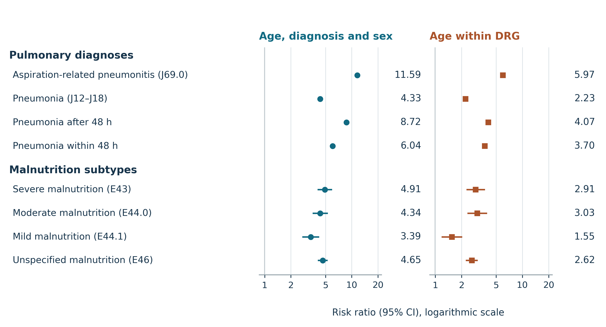

# Online Resource 1: Supplementary methods and analyses

Article: Dysphagia and inpatient burden in German acute stroke care: a nationwide aggregate-data study

Journal: Neurological Research and Practice

Authors: Bendix Labeit, Darius Günther Nabavi, Götz Thomalla, Martin Köhrmann, Rainer Dziewas

Proposed corresponding author: Bendix Labeit, Department of Neurology, Medical Faculty and University Hospital Düsseldorf, Heinrich Heine University Düsseldorf, Düsseldorf, Germany; bendix.labeit@med.uni-duesseldorf.de

Current affiliations and proposed correspondence require author confirmation for this study. This supplement does not imply that all listed authors have approved the manuscript.

All analyses below use inpatient episodes at age 18 years or older. The groups comprise adults with a secondary dysphagia code (D) and all remaining adults (C). The model denominators describe episodes. One person can contribute more than one admission. The 16 inpatient endpoints use all eligible admissions. The four additional destination endpoints use episodes ending alive.

### Supplementary Table S1  Analysis populations and model availability

| Model or sensitivity | Binary endpoints | Mean hospital stay |
| --- | --- | --- |
| 1. Crude adult comparison | 20 / 20 | Full adult cohort |
| 2. Age, principal diagnosis and sex | 20 / 20, five common groups | Sex-specific stay moments unavailable |
| 3. Age, principal diagnosis and PCCL | 20 / 20, five common groups | PCCL-specific stay moments unavailable |
| 4. Age and sex within DRGs | Across multiple DRGs unavailable. In B70D, death and four destinations. | Sex-specific within-DRG stay moments unavailable |
| Age alone or age and diagnosis | 20 / 20 | Age only and five common groups |
| Six planned age–diagnosis groups; with sex or PCCL separately | 17 / 20 (14 inpatient endpoints and three destinations) | Six groups, including survivor sensitivity |
| Age and DRG | 20 / 20 | 203 observable strata |
| Age, principal diagnosis and DRG | 20 / 20 | 183 observable strata |

The adult cohort contained 33,641 dysphagia-coded episodes and 245,614 comparators. A comparison group was constructed by subtracting the dysphagia-coded subset from all episodes under identical filters. The two age bands were 18–74 and ≥75 years. Sex and PCCL were reported as separate marginal distributions within each source query. Joint sex-by-PCCL counts were unavailable.

The 128-query extension produced 126 verified native workbooks. Queries 46 (E44.0) and 58 (E44.1) were suppressed for low case counts in adults aged 18–74 with principal diagnosis I61 and dysphagia coding. To use identical support definitions, the five-group specifications use I63 versus all non-I63 diagnoses at ages 18–74 and I63, I61 and all other diagnoses at ≥75. The broader younger group is observed by subtracting I63 from all principal diagnoses. Suppressed counts are unknown. The planned six-group specification is shown in Table S2e where estimable. The destination extension comprised 64 further queries, with 62 verified workbooks and two documented suppressions. Tables S7a–d give the corresponding data and model results.

### Supplementary Table S2a  Age alone

Included in each endpoint estimate: 33,641 dysphagia-coded episodes (D) and 245,614 comparators (C) across 2 supported strata. The RR uses the pooled distribution of the cases contributing to this model.

| Endpoint | Risk %, D / C | RR (95% CI) | RD, pp (95% CI) | Matched crude RR |
| --- | --- | --- | --- | --- |
| In-hospital death | 13.50 / 3.21 | 4.21 (4.07–4.35) | 10.29 (9.93–10.65) | 4.72 |
| Aspiration-related pneumonitis (J69.0) | 23.01 / 1.83 | 12.59 (12.15–13.05) | 21.18 (20.71–21.65) | 12.82 |
| Pneumonia (J12–J18) | 11.67 / 2.89 | 4.04 (3.89–4.20) | 8.79 (8.42–9.15) | 4.03 |
| Pneumonia or aspiration-related pneumonitis | 33.07 / 4.62 | 7.16 (6.99–7.33) | 28.45 (27.93–28.98) | 7.27 |
| Hypoxemic respiratory failure | 15.39 / 3.53 | 4.36 (4.21–4.50) | 11.86 (11.45–12.27) | 4.29 |
| Pneumonia after 48 hours | 16.59 / 1.92 | 8.65 (8.32–8.98) | 14.67 (14.26–15.09) | 8.73 |
| Pneumonia by 48 hours | 16.05 / 2.55 | 6.30 (6.08–6.52) | 13.50 (13.09–13.91) | 6.41 |
| Protein-energy malnutrition (any) | 2.87 / 0.68 | 4.22 (3.90–4.56) | 2.19 (2.01–2.37) | 4.51 |
| Severe malnutrition (E43) | 0.61 / 0.13 | 4.67 (3.92–5.57) | 0.48 (0.40–0.57) | 4.96 |
| Moderate malnutrition (E44.0) | 0.54 / 0.12 | 4.37 (3.63–5.26) | 0.41 (0.33–0.49) | 4.68 |
| Mild malnutrition (E44.1) | 0.41 / 0.13 | 3.31 (2.71–4.06) | 0.29 (0.22–0.36) | 3.51 |
| Unspecified malnutrition (E46) | 1.30 / 0.30 | 4.29 (3.81–4.83) | 1.00 (0.88–1.12) | 4.61 |
| Volume depletion | 11.56 / 4.53 | 2.55 (2.46–2.64) | 7.03 (6.67–7.38) | 2.73 |
| Simple endotracheal intubation | 8.95 / 1.58 | 5.66 (5.39–5.94) | 7.37 (7.03–7.70) | 5.02 |
| PEG, thread-pull technique | 7.48 / 0.13 | 59.23 (52.63–66.66) | 7.35 (7.05–7.65) | 55.24 |
| FEES | 20.93 / 0.89 | 23.49 (22.41–24.63) | 20.04 (19.58–20.50) | 22.67 |

RD is the difference in percentage points, D minus C. The matched crude RR uses the same retained episodes as the standardized RR.

### Supplementary Table S2b  Age and principal diagnosis

Included in each endpoint estimate: 33,641 dysphagia-coded episodes (D) and 245,614 comparators (C) across 5 supported strata. The RR uses the pooled distribution of the cases contributing to this model.

| Endpoint | Risk %, D / C | RR (95% CI) | RD, pp (95% CI) | Matched crude RR |
| --- | --- | --- | --- | --- |
| In-hospital death | 13.27 / 3.35 | 3.96 (3.82–4.11) | 9.92 (9.50–10.33) | 4.72 |
| Aspiration-related pneumonitis (J69.0) | 22.12 / 1.90 | 11.66 (11.24–12.10) | 20.23 (19.72–20.74) | 12.82 |
| Pneumonia (J12–J18) | 12.76 / 2.92 | 4.37 (4.19–4.55) | 9.83 (9.39–10.27) | 4.03 |
| Pneumonia or aspiration-related pneumonitis | 33.13 / 4.72 | 7.02 (6.85–7.20) | 28.41 (27.82–29.00) | 7.27 |
| Hypoxemic respiratory failure | 16.26 / 3.57 | 4.55 (4.39–4.72) | 12.69 (12.21–13.17) | 4.29 |
| Pneumonia after 48 hours | 17.21 / 1.96 | 8.78 (8.44–9.14) | 15.25 (14.77–15.73) | 8.73 |
| Pneumonia by 48 hours | 15.78 / 2.60 | 6.07 (5.84–6.30) | 13.18 (12.72–13.63) | 6.41 |
| Protein-energy malnutrition (any) | 3.05 / 0.69 | 4.41 (4.05–4.81) | 2.36 (2.14–2.58) | 4.51 |
| Severe malnutrition (E43) | 0.65 / 0.13 | 4.87 (4.02–5.90) | 0.52 (0.41–0.62) | 4.96 |
| Moderate malnutrition (E44.0) | 0.54 / 0.12 | 4.31 (3.52–5.27) | 0.41 (0.32–0.50) | 4.68 |
| Mild malnutrition (E44.1) | 0.43 / 0.13 | 3.38 (2.70–4.23) | 0.30 (0.22–0.39) | 3.51 |
| Unspecified malnutrition (E46) | 1.43 / 0.31 | 4.64 (4.07–5.28) | 1.12 (0.97–1.28) | 4.61 |
| Volume depletion | 12.65 / 4.53 | 2.79 (2.68–2.90) | 8.11 (7.68–8.54) | 2.73 |
| Simple endotracheal intubation | 9.40 / 1.61 | 5.82 (5.53–6.12) | 7.78 (7.40–8.16) | 5.02 |
| PEG, thread-pull technique | 7.42 / 0.13 | 57.22 (50.74–64.52) | 7.29 (6.96–7.62) | 55.24 |
| FEES | 19.91 / 0.92 | 21.73 (20.70–22.81) | 18.99 (18.51–19.48) | 22.67 |

RD is the difference in percentage points, D minus C. The matched crude RR uses the same retained episodes as the standardized RR.

### Supplementary Table S2c  Age, principal diagnosis and sex (model 2)

Included in each endpoint estimate: 33,641 dysphagia-coded episodes (D) and 245,607 comparators (C) across 10 supported strata. The RR uses the pooled distribution of the cases contributing to this model.

| Endpoint | Risk %, D / C | RR (95% CI) | RD, pp (95% CI) | Matched crude RR |
| --- | --- | --- | --- | --- |
| In-hospital death | 13.23 / 3.35 | 3.95 (3.81–4.11) | 9.89 (9.47–10.30) | 4.72 |
| Aspiration-related pneumonitis (J69.0) | 22.00 / 1.90 | 11.59 (11.17–12.03) | 20.10 (19.59–20.61) | 12.82 |
| Pneumonia (J12–J18) | 12.66 / 2.92 | 4.33 (4.16–4.52) | 9.74 (9.30–10.18) | 4.03 |
| Pneumonia or aspiration-related pneumonitis | 32.93 / 4.72 | 6.98 (6.80–7.16) | 28.21 (27.62–28.80) | 7.27 |
| Hypoxemic respiratory failure | 16.20 / 3.57 | 4.53 (4.37–4.70) | 12.62 (12.14–13.10) | 4.29 |
| Pneumonia after 48 hours | 17.09 / 1.96 | 8.72 (8.37–9.07) | 15.13 (14.65–15.61) | 8.73 |
| Pneumonia by 48 hours | 15.70 / 2.60 | 6.04 (5.82–6.27) | 13.10 (12.65–13.55) | 6.41 |
| Protein-energy malnutrition (any) | 3.06 / 0.69 | 4.43 (4.07–4.84) | 2.37 (2.15–2.60) | 4.51 |
| Severe malnutrition (E43) | 0.65 / 0.13 | 4.91 (4.05–5.95) | 0.52 (0.42–0.62) | 4.96 |
| Moderate malnutrition (E44.0) | 0.54 / 0.12 | 4.34 (3.55–5.32) | 0.42 (0.33–0.51) | 4.68 |
| Mild malnutrition (E44.1) | 0.43 / 0.13 | 3.39 (2.70–4.24) | 0.30 (0.22–0.39) | 3.51 |
| Unspecified malnutrition (E46) | 1.44 / 0.31 | 4.65 (4.09–5.30) | 1.13 (0.97–1.28) | 4.61 |
| Volume depletion | 12.65 / 4.53 | 2.79 (2.68–2.90) | 8.11 (7.68–8.54) | 2.73 |
| Simple endotracheal intubation | 9.37 / 1.61 | 5.81 (5.52–6.11) | 7.76 (7.38–8.14) | 5.02 |
| PEG, thread-pull technique | 7.38 / 0.13 | 57.09 (50.62–64.39) | 7.25 (6.92–7.59) | 55.42 |
| FEES | 19.84 / 0.92 | 21.65 (20.62–22.72) | 18.93 (18.44–19.42) | 22.67 |

RD is the difference in percentage points, D minus C. The matched crude RR uses the same retained episodes as the standardized RR.

### Supplementary Table S2d  Age, principal diagnosis and PCCL (model 3)

Included in each endpoint estimate: 33,640 dysphagia-coded episodes (D) and 245,614 comparators (C) across 34 supported strata. The RR uses the pooled distribution of the cases contributing to this model.

| Endpoint | Risk %, D / C | RR (95% CI) | RD, pp (95% CI) | Matched crude RR |
| --- | --- | --- | --- | --- |
| In-hospital death | 8.79 / 3.84 | 2.29 (2.19–2.40) | 4.96 (4.59–5.32) | 4.71 |
| Aspiration-related pneumonitis (J69.0) | 11.04 / 2.33 | 4.74 (4.56–4.93) | 8.71 (8.40–9.02) | 12.82 |
| Pneumonia (J12–J18) | 6.79 / 3.48 | 1.95 (1.84–2.07) | 3.31 (2.95–3.68) | 4.03 |
| Pneumonia or aspiration-related pneumonitis | 17.25 / 5.67 | 3.04 (2.95–3.14) | 11.58 (11.12–12.04) | 7.27 |
| Hypoxemic respiratory failure | 9.32 / 4.10 | 2.27 (2.17–2.38) | 5.22 (4.82–5.61) | 4.29 |
| Pneumonia after 48 hours | 8.18 / 2.40 | 3.41 (3.25–3.57) | 5.78 (5.46–6.09) | 8.73 |
| Pneumonia by 48 hours | 8.83 / 3.08 | 2.86 (2.73–3.00) | 5.74 (5.38–6.11) | 6.41 |
| Protein-energy malnutrition (any) | 2.03 / 0.77 | 2.63 (2.35–2.94) | 1.26 (1.05–1.47) | 4.51 |
| Severe malnutrition (E43) | 0.42 / 0.15 | 2.87 (2.20–3.74) | 0.28 (0.17–0.38) | 4.96 |
| Moderate malnutrition (E44.0) | 0.36 / 0.14 | 2.58 (2.01–3.32) | 0.22 (0.14–0.30) | 4.68 |
| Mild malnutrition (E44.1) | 0.37 / 0.14 | 2.72 (1.97–3.76) | 0.24 (0.12–0.35) | 3.51 |
| Unspecified malnutrition (E46) | 0.87 / 0.35 | 2.48 (2.13–2.89) | 0.52 (0.40–0.64) | 4.61 |
| Volume depletion | 10.18 / 4.79 | 2.13 (2.01–2.25) | 5.40 (4.86–5.93) | 2.73 |
| Simple endotracheal intubation | 4.73 / 1.97 | 2.40 (2.24–2.58) | 2.76 (2.46–3.06) | 5.02 |
| PEG, thread-pull technique | 4.57 / 0.16 | 28.45 (24.95–32.45) | 4.41 (4.10–4.72) | 55.24 |
| FEES | 18.23 / 1.00 | 18.31 (17.32–19.36) | 17.23 (16.57–17.89) | 22.67 |

RD is the difference in percentage points, D minus C. The matched crude RR uses the same retained episodes as the standardized RR.

### Supplementary Table S2e  Finer principal-diagnosis sensitivity

This sensitivity distinguishes I63, I61 and all remaining diagnoses separately at each adult age band. Fourteen of 16 inpatient endpoints had a complete event grid. Tables S2b–d give the five-group estimates for all 16. The equivalent destination results appear in Tables S7b and S7d.

| Endpoint | Age + diagnosis, RR (95% CI) | Age + diagnosis + sex, RR (95% CI) | Age + diagnosis + PCCL, RR (95% CI) |
| --- | --- | --- | --- |
| In-hospital death | 3.99 (3.83–4.15) | 3.98 (3.82–4.14) | 2.19 (2.10–2.29) |
| Aspiration-related pneumonitis (J69.0) | 11.07 (10.66–11.51) | 11.03 (10.61–11.46) | 4.39 (4.21–4.57) |
| Pneumonia (J12–J18) | 4.40 (4.21–4.60) | 4.38 (4.19–4.58) | 1.85 (1.74–1.97) |
| Pneumonia or aspiration-related pneumonitis | 6.82 (6.64–7.00) | 6.79 (6.61–6.97) | 2.85 (2.76–2.94) |
| Hypoxemic respiratory failure | 4.56 (4.38–4.73) | 4.55 (4.37–4.72) | 2.15 (2.05–2.26) |
| Pneumonia after 48 hours | 8.55 (8.20–8.92) | 8.51 (8.16–8.88) | 3.17 (3.02–3.33) |
| Pneumonia by 48 hours | 5.92 (5.69–6.16) | 5.89 (5.66–6.13) | 2.73 (2.59–2.88) |
| Protein-energy malnutrition (any) | 4.77 (4.34–5.23) | 4.79 (4.36–5.26) | 2.65 (2.37–2.97) |
| Severe malnutrition (E43) | 5.05 (4.11–6.21) | 5.11 (4.15–6.29) | 2.71 (2.12–3.45) |
| Moderate malnutrition (E44.0) | — | — | — |
| Mild malnutrition (E44.1) | — | — | — |
| Unspecified malnutrition (E46) | 5.10 (4.43–5.86) | 5.11 (4.44–5.88) | 2.59 (2.20–3.05) |
| Volume depletion | 2.87 (2.75–2.99) | 2.87 (2.75–2.99) | 2.12 (2.00–2.26) |
| Simple endotracheal intubation | 5.82 (5.51–6.16) | 5.81 (5.50–6.15) | 2.36 (2.16–2.58) |
| PEG, thread-pull technique | 53.51 (47.36–60.47) | 53.40 (47.25–60.35) | 24.70 (21.70–28.12) |
| FEES | 21.02 (20.00–22.09) | 20.95 (19.93–22.01) | 17.60 (16.58–18.69) |

Dashes indicate an unavailable finer-group estimate following source suppression. The two missing event counts were left unestimated. Other model-level denominators, absolute risks and differences are available in adult_binary.csv.

### Supplementary Fig. S1  Pulmonary diagnoses and malnutrition subtypes

Points and bars show standardized risk ratios and nominal 95% confidence intervals for the eight component diagnoses and timing codes that complement Fig. 2. The left panel uses age band, principal diagnosis and sex. The right panel uses the observable age–DRG strata for each outcome. Numerical results, coverage, PCCL analyses and the finer diagnosis groups are given in Tables S2a–e and S3a–b.

### Supplementary Table S3a  Age and DRG

| Endpoint | Strata | n, D / C | Coverage %, D / C | Risk %, D / C | RR (95% CI) | Matched crude RR |
| --- | --- | --- | --- | --- | --- | --- |
| In-hospital death | 77 | 31,070 / 199,523 | 92.4 / 81.2 | 11.38 / 4.06 | 2.80 (2.70–2.92) | 4.29 |
| Aspiration-related pneumonitis (J69.0) | 92 | 31,493 / 200,169 | 93.6 / 81.5 | 15.66 / 2.62 | 5.97 (5.74–6.22) | 11.32 |
| Pneumonia (J12–J18) | 87 | 31,443 / 232,839 | 93.5 / 94.8 | 6.89 / 3.09 | 2.23 (2.09–2.37) | 4.22 |
| Pneumonia or aspiration-related pneumonitis | 126 | 32,148 / 234,562 | 95.6 / 95.5 | 20.24 / 5.39 | 3.76 (3.64–3.88) | 7.55 |
| Hypoxemic respiratory failure | 95 | 31,805 / 233,779 | 94.5 / 95.2 | 9.04 / 3.77 | 2.40 (2.28–2.52) | 4.55 |
| Pneumonia after 48 hours | 90 | 31,328 / 198,854 | 93.1 / 81.0 | 10.42 / 2.56 | 4.07 (3.89–4.26) | 8.07 |
| Pneumonia by 48 hours | 89 | 31,630 / 233,006 | 94.0 / 94.9 | 10.59 / 2.86 | 3.70 (3.52–3.89) | 6.76 |
| Protein-energy malnutrition (any) | 32 | 27,701 / 183,918 | 82.3 / 74.9 | 2.02 / 0.79 | 2.56 (2.30–2.85) | 4.21 |
| Severe malnutrition (E43) | 10 | 17,906 / 83,123 | 53.2 / 33.8 | 0.64 / 0.22 | 2.91 (2.27–3.71) | 3.50 |
| Moderate malnutrition (E44.0) | 6 | 13,445 / 66,376 | 40.0 / 27.0 | 0.66 / 0.22 | 3.03 (2.34–3.94) | 4.13 |
| Mild malnutrition (E44.1) | 7 | 12,953 / 56,355 | 38.5 / 22.9 | 0.52 / 0.34 | 1.55 (1.18–2.03) | 2.10 |
| Unspecified malnutrition (E46) | 13 | 22,697 / 136,259 | 67.5 / 55.5 | 0.98 / 0.38 | 2.62 (2.24–3.07) | 3.99 |
| Volume depletion | 72 | 31,279 / 231,712 | 93.0 / 94.3 | 11.20 / 4.53 | 2.47 (2.33–2.62) | 2.76 |
| Simple endotracheal intubation | 75 | 26,662 / 150,782 | 79.3 / 61.4 | 4.38 / 3.11 | 1.41 (1.34–1.48) | 4.06 |
| PEG, thread-pull technique | 59 | 30,150 / 192,595 | 89.6 / 78.4 | 4.50 / 0.21 | 21.29 (18.63–24.34) | 51.39 |
| FEES | 72 | 31,297 / 230,819 | 93.0 / 94.0 | 16.36 / 1.03 | 15.81 (14.93–16.75) | 23.20 |

A stratum required a named DRG row in all contributing denominator and event tables and a positive denominator in both groups. Coverage uses the full adult group denominator. A pooled remainder could not be allocated to individual DRGs. Data availability can select common or event-rich groups. The age- and diagnosis-specific contrasts use the five common age–diagnosis groups. Full risk differences and interval diagnostics are in adult_binary.csv.

### Supplementary Table S3b  Age, principal diagnosis and DRG

| Endpoint | Strata | n, D / C | Coverage %, D / C | Risk %, D / C | RR (95% CI) | Matched crude RR |
| --- | --- | --- | --- | --- | --- | --- |
| In-hospital death | 101 | 29,367 / 159,615 | 87.3 / 65.0 | 12.76 / 4.63 | 2.75 (2.65–2.86) | 3.71 |
| Aspiration-related pneumonitis (J69.0) | 129 | 29,851 / 160,041 | 88.7 / 65.2 | 17.71 / 3.06 | 5.78 (5.56–6.02) | 9.68 |
| Pneumonia (J12–J18) | 103 | 29,309 / 157,180 | 87.1 / 64.0 | 7.88 / 3.78 | 2.08 (1.98–2.19) | 3.39 |
| Pneumonia or aspiration-related pneumonitis | 155 | 30,146 / 161,828 | 89.6 / 65.9 | 24.76 / 6.75 | 3.67 (3.56–3.77) | 5.97 |
| Hypoxemic respiratory failure | 116 | 29,608 / 158,624 | 88.0 / 64.6 | 10.70 / 4.50 | 2.38 (2.28–2.48) | 3.70 |
| Pneumonia after 48 hours | 128 | 29,699 / 158,736 | 88.3 / 64.6 | 11.54 / 2.89 | 4.00 (3.82–4.18) | 7.08 |
| Pneumonia by 48 hours | 115 | 29,736 / 160,391 | 88.4 / 65.3 | 12.67 / 3.53 | 3.58 (3.43–3.74) | 5.43 |
| Protein-energy malnutrition (any) | 43 | 26,000 / 145,085 | 77.3 / 59.1 | 2.25 / 0.90 | 2.50 (2.25–2.77) | 3.70 |
| Severe malnutrition (E43) | 11 | 16,016 / 77,285 | 47.6 / 31.5 | 0.63 / 0.19 | 3.42 (2.62–4.46) | 4.18 |
| Moderate malnutrition (E44.0) | 8 | 10,048 / 57,889 | 29.9 / 23.6 | 0.74 / 0.25 | 3.02 (2.31–3.95) | 4.77 |
| Mild malnutrition (E44.1) | 10 | 9,632 / 48,253 | 28.6 / 19.6 | 0.55 / 0.38 | 1.44 (1.08–1.92) | 2.27 |
| Unspecified malnutrition (E46) | 22 | 22,270 / 133,186 | 66.2 / 54.2 | 0.99 / 0.38 | 2.61 (2.22–3.06) | 3.98 |
| Volume depletion | 84 | 29,060 / 158,561 | 86.4 / 64.6 | 10.68 / 4.80 | 2.22 (2.12–2.33) | 2.55 |
| Simple endotracheal intubation | 111 | 25,541 / 143,984 | 75.9 / 58.6 | 4.28 / 3.07 | 1.39 (1.32–1.47) | 4.10 |
| PEG, thread-pull technique | 89 | 28,853 / 155,817 | 85.8 / 63.4 | 5.18 / 0.23 | 22.71 (19.74–26.12) | 46.55 |
| FEES | 98 | 29,402 / 158,293 | 87.4 / 64.4 | 19.29 / 1.36 | 14.19 (13.44–14.98) | 17.52 |

A stratum required a named DRG row in all contributing denominator and event tables and a positive denominator in both groups. Coverage uses the full adult group denominator. A pooled remainder could not be allocated to individual DRGs. Data availability can select common or event-rich groups. The age- and diagnosis-specific contrasts use the five common age–diagnosis groups. Full risk differences and interval diagnostics are in adult_binary.csv.

### Supplementary Table S4  In-hospital mortality within DRG B70D

B70D is a stroke DRG defined in part by a duration of up to 72 hours of neurological complex treatment. Eight B70D-restricted workbooks comprised two adult age bands, two overlapping source groups (all episodes or dysphagia coded) and two selections (denominator or in-hospital death). Each restricted count equalled the B70D row in the corresponding unrestricted-DRG workbook. Separate sex margins in the denominator and death queries then supplied joint age-by-sex counts for mortality within this DRG.

| Model | n, D / C | Strata | Risk %, D / C | RR (95% CI) | RD, pp (95% CI) |
| --- | --- | --- | --- | --- | --- |
| Crude | 4,915 / 64,345 | 1 | 13.77 / 1.37 | 10.08 (9.16–11.10) | 12.41 (11.44–13.38) |
| Age | 4,915 / 64,345 | 2 | 11.27 / 1.40 | 8.05 (7.28–8.90) | 9.87 (9.01–10.73) |
| Age and sex (model 4) | 4,915 / 64,344 | 4 | 11.26 / 1.40 | 8.04 (7.27–8.89) | 9.86 (9.00–10.72) |

In the age- and sex-standardized model, four strata had denominators in both groups. One comparator episode was outside this shared support. The same-case crude RR was 10.08. The age-only and age-and-sex RRs were 8.05 and 8.04. The multi-DRG mortality analysis in Table S3a used a different population (77 age–DRG strata). The B70D result applies only to that billing group. Joint age–sex–DRG event counts for all endpoints across multiple DRGs were unavailable. Table S7c gives the B70D analyses for the four discharge destinations.

### Supplementary Table S5  Mean hospital stay in adults

| Population and factors | n, D / C | Strata | Mean days, D / C | Difference, days (95% CI) | Matched crude, days |
| --- | --- | --- | --- | --- | --- |
| Crude | 33,641 / 245,614 | 1 | 16.26 / 7.41 | 8.85 (8.67–9.04) | 8.85 |
| Age | 33,641 / 245,614 | 2 | 16.80 / 7.42 | 9.37 (9.16–9.59) | 8.85 |
| Age and diagnosis, five groups | 33,641 / 245,614 | 5 | 17.38 / 7.50 | 9.88 (9.62–10.14) | 8.85 |
| Age and diagnosis, six groups | 33,641 / 245,614 | 6 | 17.27 / 7.53 | 9.74 (9.45–10.03) | 8.85 |
| Age and DRG | 32,740 / 239,332 | 203 | 10.72 / 7.85 | 2.86 (CI unavailable) | 8.76 |
| Age and DRG, ≥2 per group | 32,735 / 239,331 | 202 | 10.72 / 7.85 | 2.86 (2.74–2.98) | 8.76 |
| Age, diagnosis and DRG | 30,339 / 163,516 | 183 | 12.40 / 9.06 | 3.34 (CI unavailable) | 7.63 |
| Age, diagnosis and DRG, ≥2 per group | 30,329 / 163,484 | 179 | 12.40 / 9.05 | 3.34 (3.22–3.47) | 7.63 |
| Discharged alive, five groups | 28,638 / 237,868 | 5 | 17.64 / 7.41 | 10.23 (9.95–10.52) | 9.40 |
| Discharged alive, six groups | 28,638 / 237,868 | 6 | 17.49 / 7.44 | 10.05 (9.73–10.37) | 9.40 |
| B70D only, age | 4,915 / 64,345 | 2 | 9.09 / 5.99 | 3.10 (2.88–3.31) | 3.10 |

Counts, means and standard deviations yielded integer sums of days and squared days. Reconstructed moments matched the sample-SD convention for the Info sheet and the population-SD convention for DRG rows. One age–DRG stratum and four age–diagnosis–DRG strata contained a singleton. Restriction to groups with at least two episodes in each arm permits an interval. The discharged-alive comparisons use their own pooled survivor references. Mean stays within the age–diagnosis groups, and within B70D, were unavailable by sex or PCCL.

### Supplementary Table S6  Adult functional category comparisons

| Instrument | ICD-10-GM | Score band | Death RR (95% CI) | Pneumonia RR (95% CI) |
| --- | --- | --- | --- | --- |
| motor FIM | U50.01 | 85-91 | Unavailable | Unavailable |
| motor FIM | U50.11 | 69-84 | Unavailable | Unavailable |
| motor FIM | U50.21 | 59-68 | Unavailable | Unavailable |
| motor FIM | U50.31 | 43-58 | Unavailable | Unavailable |
| motor FIM | U50.41 | 31-42 | Unavailable | Unavailable |
| motor FIM | U50.51 | 13-30 | 0.87 (0.48–1.59) | 1.48 (0.86–2.55) |
| cognitive FIM | U51.01 | 30-35 | Unavailable | 8.10 (2.82–23.29) |
| cognitive FIM | U51.11 | 11-29 | 1.72 (0.85–3.47) | 2.30 (1.32–4.02) |
| cognitive FIM | U51.21 | 5-10 | 0.69 (0.37–1.28) | 1.19 (0.62–2.25) |
| MMSE | U51.02 | 24-30 | 4.08 (2.37–7.04) | 2.45 (1.86–3.23) |
| MMSE | U51.12 | 17-23 | 3.50 (2.22–5.51) | 2.15 (1.67–2.75) |
| MMSE | U51.22 | 0-16 | 1.93 (1.32–2.83) | 1.20 (0.89–1.60) |

The unrestricted event workbooks contained zero children in every paediatric category for both death and pneumonia and both source groups. Their event counts are therefore adult counts. The denominators were reconstructed separately from age-filtered adult workbooks. We required a named source row in each necessary denominator and event table and at least five events and five non-events in both exposure groups. Missing values remain unavailable. Functional coding can be selective and may reflect neurological impairment assessed during admission.

### Supplementary Table S7a  Discharge status and observed destination

Counts are hospital episodes. Vital status uses all adult episodes in each column. The five destination rows use live discharges in that column. The first four destinations are explicitly coded and mutually exclusive. The fifth contains all remaining reasons for live discharge.

| Discharge outcome | All adults | Dysphagia code | No dysphagia code |
| --- | --- | --- | --- |
| Adult episodes | 279,255 | 33,641 | 245,614 |
| Discharged alive | 266,506 (95.4%) | 28,638 (85.1%) | 237,868 (96.8%) |
| In-hospital death (07) | 12,749 (4.6%) | 5,003 (14.9%) | 7,746 (3.2%) |
| Destination among live discharges |  |  |  |
| Rehabilitation facility (09) | 22,281 (8.36%) | 6,112 (21.34%) | 16,169 (6.80%) |
| Nursing facility (10) | 11,904 (4.47%) | 3,278 (11.45%) | 8,626 (3.63%) |
| Hospice (11) | 257 (0.10%) | 101 (0.35%) | 156 (0.07%) |
| External hospital transfer (06, 08, 13) | 24,487 (9.19%) | 7,071 (24.69%) | 17,416 (7.32%) |
| Other or unspecified | 207,577 (77.89%) | 12,076 (42.17%) | 195,501 (82.19%) |

Live discharge by model. Standardized proportions use each model’s pooled reference population. Risk differences are in percentage points (dysphagia-coded minus comparator).

| Standardization | Episodes | With / without code (%) | Risk difference (95% CI) |
| --- | --- | --- | --- |
| Age, diagnosis and sex | 279,248 | 86.8 / 96.7 | −9.89 (−10.30 to −9.47) |
| Age, diagnosis and PCCL | 279,254 | 91.2 / 96.2 | −4.96 (−5.32 to −4.59) |
| Age within observable DRGs | 230,593 | 88.6 / 95.9 | −7.33 (−7.72 to −6.93) |
| Age and sex in B70D | 69,259 | 88.7 / 98.6 | −9.86 (−10.72 to −9.00) |

Matching denominator and death workbooks supplied the number of live discharges within age, diagnosis, sex, PCCL or DRG strata as applicable. The 62 destination workbooks were checked against the planned filters, the delivery and the counts in the private retrieval log. Queries 45 and 46 were suppressed for hospice discharges at ages 18–74 with principal diagnosis I61, for all episodes and for the dysphagia-coded subset.

Code 06 denotes transfer to another hospital, 08 transfer under a cooperation agreement and 13 external psychiatric transfer. Transfers were queried together. Routine treatment completion gives no receiving setting. The residual also includes reasons such as internal transfer or transitional care. It cannot establish discharge home.

The competing in-hospital death outcome is reported separately. Companion crude proportions for each destination using all adult admissions are available in adult_discharge.csv. The principal destination analyses in Tables S7b–d condition on survival.

Discharge coding source. IQTIG, Spezifikationsjahr 2025, Ausfüllhinweise (DEK), Entlassungsgrund. https://iqtig.org/downloads/erfassung/fdok/sj2025/v06/dek/Ausfuellhinweise_DEK.html

### Supplementary Table S7b  Clinical case-mix comparisons among live discharges

D/C gives risks (%) in dysphagia-coded and comparator episodes. RD is their difference in percentage points. Intervals are nominal 95% confidence intervals. The common age–principal diagnosis groups are defined in Table S1.

| Destination and adjustment | D / C (%) | RR (95% CI) | RD (95% CI) |
| --- | --- | --- | --- |
| Rehabilitation facility |  |  |  |
| Crude | 21.34 / 6.80 | 3.14 (3.06–3.22) | 14.54 (14.06 to 15.03) |
| Age | 22.38 / 6.81 | 3.29 (3.20–3.38) | 15.57 (15.06 to 16.08) |
| Age and principal diagnosis | 20.91 / 7.02 | 2.98 (2.89–3.07) | 13.89 (13.35 to 14.43) |
| Age, principal diagnosis, sex | 20.86 / 7.02 | 2.97 (2.88–3.06) | 13.83 (13.30 to 14.37) |
| Age, principal diagnosis, PCCL | 19.47 / 7.31 | 2.66 (2.56–2.77) | 12.15 (11.44 to 12.87) |
| Nursing facility |  |  |  |
| Crude | 11.45 / 3.63 | 3.16 (3.04–3.28) | 7.82 (7.44 to 8.20) |
| Age | 10.29 / 3.70 | 2.78 (2.68–2.89) | 6.59 (6.25 to 6.94) |
| Age and principal diagnosis | 10.66 / 3.74 | 2.85 (2.73–2.98) | 6.92 (6.50 to 7.33) |
| Age, principal diagnosis, sex | 10.68 / 3.74 | 2.85 (2.73–2.98) | 6.94 (6.52 to 7.36) |
| Age, principal diagnosis, PCCL | 9.56 / 3.89 | 2.46 (2.32–2.61) | 5.68 (5.14 to 6.21) |
| Hospice |  |  |  |
| Crude | 0.35 / 0.07 | 5.38 (4.19–6.91) | 0.29 (0.22 to 0.36) |
| Age | 0.35 / 0.07 | 5.33 (4.13–6.87) | 0.29 (0.21 to 0.36) |
| Age and principal diagnosis | 0.40 / 0.07 | 5.94 (4.50–7.85) | 0.33 (0.24 to 0.42) |
| Age, principal diagnosis, sex | 0.40 / 0.07 | 6.01 (4.55–7.95) | 0.34 (0.24 to 0.43) |
| Age, principal diagnosis, PCCL | 0.19 / 0.08 | 2.49 (1.82–3.39) | 0.12 (0.06 to 0.17) |
| External hospital transfer |  |  |  |
| Crude | 24.69 / 7.32 | 3.37 (3.29–3.46) | 17.37 (16.86 to 17.88) |
| Age | 24.81 / 7.38 | 3.36 (3.28–3.45) | 17.43 (16.91 to 17.96) |
| Age and principal diagnosis | 23.91 / 7.56 | 3.16 (3.08–3.25) | 16.35 (15.77 to 16.93) |
| Age, principal diagnosis, sex | 23.94 / 7.56 | 3.17 (3.08–3.25) | 16.37 (15.80 to 16.95) |
| Age, principal diagnosis, PCCL | 19.62 / 7.99 | 2.46 (2.37–2.55) | 11.63 (10.95 to 12.32) |

Crude, age, age–diagnosis and common PCCL analyses used all 266,506 live discharges. The common sex model used 266,502 (28,638 dysphagia-coded and 237,864 comparator episodes). Four comparator episodes fell outside shared sex strata. Sex and PCCL are available in separate margins of the Info sheet.

### Supplementary Table S7c  Destination contrasts within observable DRGs

D/C gives the numbers of dysphagia-coded and comparator live discharges contributing to the model. Coverage is the percentage of all 28,638 and 237,868 live discharges in the respective exposure groups. The matched crude RR uses the same episodes as the standardized RR.

| Model | D / C (n) | Coverage D / C (%) | Strata | RR (95% CI) | Matched crude RR |
| --- | --- | --- | --- | --- | --- |
| Rehabilitation facility |  |  |  |  |  |
| Age and DRG | 25,951 / 187,368 | 90.6 / 78.8 | 51 | 1.95 (1.88–2.01) | 2.77 |
| Age, diagnosis and DRG | 24,747 / 151,160 | 86.4 / 63.5 | 76 | 1.92 (1.86–1.99) | 2.35 |
| Age and sex within B70D | 4,238 / 63,465 | 14.8 / 26.7 | 4 | 2.68 (2.46–2.93) | 2.52 |
| Nursing facility |  |  |  |  |  |
| Age and DRG | 25,215 / 189,430 | 88.0 / 79.6 | 40 | 2.64 (2.50–2.78) | 2.87 |
| Age, diagnosis and DRG | 23,968 / 150,706 | 83.7 / 63.4 | 60 | 2.40 (2.28–2.52) | 2.89 |
| Age and sex within B70D | 4,238 / 63,465 | 14.8 / 26.7 | 4 | 3.06 (2.79–3.36) | 3.87 |
| Hospice |  |  |  |  |  |
| Age and DRG | 13,427 / 103,058 | 46.9 / 43.3 | 7 | 4.66 (3.04–7.13) | 4.87 |
| Age, diagnosis and DRG | 8,542 / 80,850 | 29.8 / 34.0 | 5 | 4.21 (2.47–7.19) | 4.48 |
| Age and sex within B70D | 4,238 / 63,465 | 14.8 / 26.7 | 4 | 6.77 (3.23–14.18) | 5.88 |
| External hospital transfer |  |  |  |  |  |
| Age and DRG | 26,327 / 192,245 | 91.9 / 80.8 | 62 | 2.25 (2.18–2.33) | 3.03 |
| Age, diagnosis and DRG | 24,815 / 153,044 | 86.7 / 64.3 | 80 | 2.25 (2.17–2.32) | 2.68 |
| Age and sex within B70D | 4,238 / 63,465 | 14.8 / 26.7 | 4 | 2.72 (2.53–2.92) | 2.85 |

Multi-DRG models required matching named DRGs for the population, deaths and destination counts in both source groups. Pooled or missing rows leave the destination count in an individual DRG unknown. This restricts hospice coverage particularly. Sex-specific multi-DRG margins were unavailable. The B70D analyses use dedicated age- and DRG-filtered sex margins.

### Supplementary Table S7d  Finer diagnosis grouping and single-DRG sensitivity analyses

Estimates are RRs with nominal 95% CIs. The finer age–diagnosis specification separates I61 from other non-I63 diagnoses among adults aged 18–74. Each setting uses the available common support for that model.

Six age–principal diagnosis groups

| Destination | Age and diagnosis | Plus sex | Plus PCCL |
| --- | --- | --- | --- |
| Rehabilitation facility | 2.74 (2.65–2.83) | 2.74 (2.65–2.82) | 2.23 (2.15–2.30) |
| Nursing facility | 2.85 (2.72–2.98) | 2.85 (2.73–2.99) | 2.52 (2.36–2.69) |
| Hospice | Unavailable | Unavailable | Unavailable |
| External hospital transfer | 3.04 (2.95–3.13) | 3.04 (2.95–3.13) | 2.25 (2.16–2.34) |

Live discharges within DRG B70D

| Destination | Crude | Age | Age and sex |
| --- | --- | --- | --- |
| Rehabilitation facility | 2.52 (2.32–2.73) | 2.69 (2.46–2.93) | 2.68 (2.46–2.93) |
| Nursing facility | 3.87 (3.53–4.23) | 3.07 (2.80–3.37) | 3.06 (2.79–3.36) |
| Hospice | 5.88 (2.93–11.81) | 6.58 (3.16–13.72) | 6.77 (3.23–14.18) |
| External hospital transfer | 2.85 (2.67–3.05) | 2.71 (2.52–2.91) | 2.72 (2.53–2.92) |

For hospice, the two suppressed I61 queries precluded the six-group specification. All five-group models remained estimable without imputing these counts. Within B70D the crude and age-only comparisons use 67,704 live discharges and the age-and-sex comparison uses 67,703. The full CSV reports model-specific risks, risk differences, confidence intervals and sparse-stratum diagnostics.

## Reproducing the adult cohort analyses

adult_analysis.py produces the inpatient, length-of-stay and cohort tables. adult_validate.py independently recalculates 157 inpatient contrasts and 11 stay estimates. adult_discharge.py uses matching discharge, mortality and denominator workbooks to generate adult_discharge.csv and the export audit. adult_discharge_validate.py independently recalculates all 53 estimable destination contrasts, their confidence intervals and their matched populations. adult_figures.py reads these aggregate results.

## References

17. Institut für das Entgeltsystem im Krankenhaus (2024) Abschlussbericht zur Weiterentwicklung des aG-DRG-Systems fuer das Jahr 2025. December 19, 2024. Section 3.3.1.4, CCL matrix and PCCL. https://www.g-drg.de/content/download/14761/file/Abschlussbericht_aG-DRG_2025_2024-12-19.pdf. Accessed 17 Nov 2026

18. Bundesinstitut für Arzneimittel und Medizinprodukte (2025) ICD-10-GM 2025, U50-U52 functional impairment codes and assessment timing. https://klassifikationen.bfarm.de/icd-10-gm/kode-suche/htmlgm2025/block-u50-u52.htm. Accessed 17 Nov 2026
